# IndexCities — Avaliação humana da partida da V1 (2026-10-13)

> **Revisão humana desta síntese: PENDENTE.** O conteúdo abaixo organiza o relato espontâneo do responsável durante uma partida no Windows, transcrito diretamente na conversa com o ChatGPT em 2026-10-13. **As opiniões e experiências relatadas são do responsável; a classificação, a organização e as hipóteses são da IA**, ainda não aprovadas. Não é uma lista de requisitos, autorização de implementação nem prova de bug reproduzido. Regras oficiais continuam em [SPEC](../SPEC.md); trabalho em [AGENTS](../../AGENTS.md).
>
> **Finalidade:** preservar contexto que se perde entre sessões e fornecer ao coordenador Codex e a eventuais verificadores uma referência concreta da experiência que precisa melhorar. Uma correção isolada não conclui esta avaliação. A validação final da jogabilidade depende do responsável jogando.
>
> **Limite da evidência:** houve uma captura de tela compartilhada com o ChatGPT e uma narração longa durante uma sessão de jogo. Esta página **não incorpora o arquivo original da captura nem uma gravação da partida**. O texto abaixo é uma síntese detalhada do relato, não sua transcrição literal completa. Quem receber apenas o repositório não deve alegar que assistiu ao jogo ou à captura original.

## Resultado percebido pelo jogador

A V1 já permite construir uma cidade, ver edifícios, ruas, caminhões, carros e SIMs, mas foi considerada muito aquém da experiência pretendida. A crítica central não é a quantidade de funções: **construir ruas é frustrante; menus e diagnósticos parecem logs de desenvolvimento; a cidade fica visualmente parada ou robótica; o ritmo pode deixar o jogador sem dinheiro e sem ação; cenário, água e vias parecem inacabados**.

O objetivo para uma recuperação futura, se aprovada, é melhorar a experiência **como conjunto**, e não encerrar o trabalho após corrigir um encaixe ou um rótulo. O responsável explicitamente não considera a V1 satisfatória.

## Retorno sobre a água e continuidade — 2026-10-14

**Revisão humana desta síntese: PENDENTE.** O responsável voltou a considerar rio/lago pouco reais e visualmente insatisfatórios, mesmo depois dos materiais da entrega 2, e pediu um estudo para melhorar sua beleza. Isso é feedback negativo sobre o resultado; não houve aprovação estética da IA-020 nem autorização automática para mudar geografia, fontes naturais ou posicionamento.

O coordenador iniciou uma frente isolada de amostras com **Claude Opus 5.5**, modelo e esforço `max` confirmados pelo launcher Orca. O estudo compara tratamento visual dentro do contorno atual e uma proposta de margem irregular/rebaixada e transição rio/lago apenas em cena de assets. Silhueta, encontro com o chão, água rasa, luz e escala são aspectos a avaliar juntos. A proposta com geometria diferente depende de decisão humana e registro na SPEC antes de integrar ao jogo. Capturas e resultados ainda não estão concluídos; não se declara a reclamação resolvida.

O responsável também pediu retomar o trabalho quando os créditos do Codex voltarem. A missão permanece aberta; as workspaces, PRs, evidências e tarefas Orca preservam o andamento para a próxima execução. Este registro não comprova um agendamento automático nem disponibilidade futura de créditos.

## O que funcionou e deve ser preservado

- **Encaixe de edifícios** junto a ruas prontas após o PR #4: ficou fácil posicionar/reorientar casas e mercearia; a prévia e o traço **verde de ligação à via** ajudam.
- **Rotação por R** funciona após a tentativa inicial; vale investigar a inconsistência da primeira interação, sem concluir que é bug.
- **Arrastar para colocar fileira de casas** ficou bom, assim como alertas de posicionamento e obras sem acesso.
- **Caminhões trazendo materiais e progresso físico de obra** são interessantes, ainda que a apresentação possa melhorar no futuro (máquinas de construção foram mencionadas como ideia futura, não decisão).
- Boa parte dos **modelos de edifícios e ícones do catálogo inferior** agrada ao responsável. Evitar refazer tudo desnecessariamente.
- **Acompanhar** uma pessoa selecionada funciona; veículos particulares melhoraram em relação à versão anterior.

## Percurso da partida e problemas percebidos

### 1. Fundação e ferramentas de construção — incômodo mais forte

- A **Prefeitura é a primeira construção disponível**, antes da ferramenta de rua; o jogador tenta girá-la, relata falha aparente inicial e depois consegue com R.
- A rodovia inicial não oferece encaixe intuitivo para a Prefeitura. O jogador a encomenda no terreno sem rua, libera o catálogo, constrói um trecho de rua e descobre que a Prefeitura original ficou **sem acesso**. Depois usa **Mover obra**, cujo novo encaixe junto à rua pronta funciona bem.
- A ferramenta de **desenhar ruas** é descrita como muito difícil: encaixes imprecisos, esquinas e conexões confusas; o jogador repete várias vezes que essa é uma prioridade de revisão completa.
- Com trechos **ainda no estado de projeto/obra, recebendo materiais**, não consegue posicionar edifícios como gostaria ao longo da futura via. Investigar o que é impossibilidade intencional, erro de prévia ou comportamento em conflito com a SPEC; não atribuir automaticamente acesso funcional a rua ainda não construída.
- **Faixas de pedestres** parecem surgir excessivamente, até em situações que o jogador associa à colocação de casas. **Esquinas e meio-fio** são visualmente estranhos. Verificar o gerador viário e as regras reais de travessia, não só maquiagem visual.
- **Demolição** exige escolher a ferramenta Selecionar, clicar no segmento e procurar a ação Remover trecho; o jogador esperava uma ferramenta global mais direta. Essa proposta é mudança relevante de UX, portanto depende de avaliação/autorização segundo a SPEC.
- **Câmera:** Q/E giram, mas o jogador deseja giro intuitivo por botão direito do mouse; avaliar conflitos com botão direito/Esc para cancelar ferramentas antes de propor alterações.
- **Carros estacionados na rua** não estão representados como desejado. A SPEC já registra adiamento da decisão sobre vagas no meio-fio, pois a rua 1+1 atual não comporta a solução sem conflito físico.

### 2. Interface e comunicação — crítica transversal

- **Barra superior inteira** (Salvar, Cidades, Finanças, Pessoas, Obras e serviços, Controles), barra inferior, avisos sobrepostos ao cenário e janelas de inspeção foram consideradas **feias, excessivamente textuais e difíceis de compreender**.
- Menu **Cidades**: o campo de *seed/código do mapa* e o botão Criar induzem confusão entre criar e carregar. Ao criar uma nova cidade, o jogador acreditou ter perdido o save; depois conseguiu abrir a anterior. Solicita **nomes legíveis para cidades** e feedback/organização claros. Investigar sem afirmar perda real de dados.
- **Finanças**: disposição atual não ajuda a entender o essencial; receita/despesa, periodicidade e possibilidades de ação precisam fazer sentido para um jogador.
- **Pessoas**: lista longa e repetitiva, nomes como “Lia 13”, “Eva 4”; informações em forma de log. Seguir SIM funcionou, mas o painel pouco ajuda a interpretar a história ou a atividade dele.
- **Obras e serviços**: enorme lista de status e causas; encontrar o problema importante exige ler como se fosse um log. A mesma crítica vale para Controles.
- **Inspeção dos edifícios:** campos de proprietário, manutenção, água/energia em 0%, capacidade operacional em 0 e presença de funcionários são apresentados sem hierarquia causal; o usuário não entende se está funcionando ou **o que fazer**. Botão “Construir outro” em quase todo painel parece deslocado.
- Exemplo descrito: uma casa tem falta de abastecimento, mas a informação só fica clara ao clicar nela; pensar em linguagem visual consistente de avisos reais e prioridades, sem inundar o mapa com texto.
- **Caminhões:** em inspeção, houve uma percepção de carga vazia mesmo com veículo aparentemente transportando materiais; estado “motorista aguardando” também gerou confusão. Reproduzir antes de tratar como bug de simulação.
- **Indicador de FPS/branch/commit** aparece com posicionamento visual inadequado sobre o HUD. Preservar utilidade de diagnóstico, mas avaliar forma de exibição.

### 3. Tempo, dinheiro e progresso

- Mesmo em **60x**, a sensação foi de horas avançando lentamente, sem atividade econômica suficiente e com ausência prolongada de receita.
- O jogador relata uma cidade cujo dinheiro acabou e que ficou sem ações interessantes enquanto aguardava arrecadação de impostos aparentemente mensal.
- Investigar tanto **periodicidade econômica / fluxo de caixa / causas reais da cidade parada** quanto **o ritmo percebido e a relação com velocidades aprovadas**. Não oferecer dinheiro mágico nem alterar os multiplicadores ou o 1x aprovados sem decisão humana.
- Referência de ordem de grandeza para análise: 30 dias simulados no teto atual de 60x requerem aproximadamente **12 horas reais**, se o jogo mantiver a cadência sem pausas. Isso não é, por si só, prova de bug — é uma questão de ritmo de produto.

### 4. Pessoas, veículos e cidade viva

- SIMs foram percebidos **sobre casas, aparentemente presos no meio da rua, ou surgindo em pequenos grupos e depois desaparecendo**; movimentação parece robótica e descontínua. Verificar representação, interpolação, horários e estados reais, sem inferir automaticamente travamento causal.
- Carros particulares melhoraram, mas o jogador ainda não percebe atividade urbana convincente nem trânsito semelhante ao esperado de city builders de referência.
- **Fazendas** parecem pequenas e praticamente inertes, sem indicação visual de produção/trabalho real.
- **Eólicas:** algumas giram e outras não; a rotação em 1x parece excessivamente lenta e em 60x parece mais natural. Distinguir geração real dependente do vento, capacidade operacional e velocidade da animação.
- **Posto de combustível, Pátio de Obras e tratamento de água** aparecem com campos técnicos, por vezes todos em 0; o jogador não consegue inferir finalidade, dependências e situação. Apresentação deve mostrar causa e consequência, não apenas porcentagens.

### 5. Ambiente e acabamento visual

- O corpo d'água destinado a rio/lago foi considerado **muito artificial e visualmente ruim**, sem aparência convincente de água natural.
- Terreno e vegetação: poucas árvores esparsas num gramado uniforme, sensação de mapa vazio e genérico.
- **Geometria de ruas**, esquinas, calçadas, meio-fio e travessias precisa de avaliação visual e funcional integrada, especialmente se vagas na rua forem reconsideradas.
- Os modelos de construções existentes foram vistos mais positivamente que o mundo/menus. Comparação com referência visual anterior indicou que o jogo ainda está distante do acabamento desejado, mas **não há autorização para copiar** outra obra ou refazer o inventário completo.

## Captura de tela descrita (não anexada nesta página)

Na captura enviada na conversa (janela **IndexCities DEBUG**, compilação exibida como `6f4ea824`, branch `codex/construcao-inicial-visual`) vê-se cidade isométrica, ruas e loteamentos à esquerda, casas e fazendas, eólicas, instalações de água e grandes áreas de terreno vazio. HUD ocupa a parte superior e inferior, com inspector lateral direito. O rodapé exibe, naquele instante, déficit de água potável e demanda maior que a capacidade; barra superior exibe saldo, população e velocidades. **Não extrapolar** dessa imagem para estados de outras partidas ou para comprovar os episódios narrados.

## Questões que precisam ser investigadas, não presumidas

- Problema técnico reproduzível versus preferência de interação: rotação inicial; encaixe de ruas e esquinas; posicionamento junto a obras viárias planejadas; faixas de pedestres; SIMs visualmente presos/sobre casas; carga e motorista de veículos; eólicas e velocidade da animação; save e criação de cidades.
- Diagnóstico causal completo do ritmo lento: em que fase a cidade parou, quais empregos/negócios/serviços estavam operacionais, entradas e saídas reais do Caixa, dependências de água e energia, cobrança de impostos e efeitos de acelerar.
- Necessidades de **decisão humana prévia**: qualquer alteração da regra inicial Prefeitura → ruas, fluxo básico de construção/demolição/câmera, estacionamento nas ruas, velocidades/tributação, mudança relevante de UX, novas atividades causais ou expansão de escopo.
- Propostas de apresentação e assets podem ser prototipadas dentro dos limites aprovados; não confundir protótipo com aprovação de novo comportamento. A arquitetura atual mantém Codex como coordenador e Claude para assets conforme AGENTS.

## Direção de melhoria sugerida pela IA — ainda não aprovada

Não transformar o relato em um backlog de tickets independentes. Propor uma recuperação **integrada** da experiência, com duas dimensões complementares:

1. **Construir a cidade:** fluxo inicial e ruas, conexões e planejamento, construção, demolição, câmera, sinais de validação no terreno.
2. **Entender e acompanhar a cidade:** interface e diagnósticos consistentes, ritmo e causalidade econômica inteligíveis, SIMs e empresas observáveis, ambiente com linguagem visual coerente.

Proposta do coordenador deve cruzar este documento com SPEC e código, distinguir bugs reais de decisões pendentes, e apresentar antes da implementação **as escolhas de UX importantes**, o conjunto de mudanças de maior impacto e como será feita comparação antes/depois no Godot.

**Não dar missão por concluída** depois de melhorar um ícone, um encaixe ou apenas passar testes. A aceitação depende de nova partida humana mostrando progresso significativo **nas dificuldades acima**. Preservar o que já funcionou.

## Como usar este documento entre agentes e sessões

- **Codex coordenador:** ler este relato integral antes de definir prioridades, junto com AGENTS, SPEC e exploração; não tratar esta síntese como requisito oficial. Pode propor correções e pedir aprovação das mudanças relevantes.
- **Claude especializado:** receber apenas pedidos delimitados do coordenador dentro das permissões do AGENTS, principalmente assets; não assumir alterações de gameplay ou SPEC.
- **Verificador independente:** avaliar se cada entrega resolveu dificuldades relevantes do relato e se o jogo continua coerente como experiência; apontar o que ainda não mudou, além dos resultados de testes.
- **Responsável:** validar o resultado jogando. Seus comentários e aprovações posteriores devem atualizar o estado deste registro, sem apagar observações anteriores nem carimbar hipóteses da IA como decisões humanas.

## Proposta operacional da IA — recuperação integrada da V1 (ainda PENDENTE de aprovação humana)

> **Status: PENDENTE de revisão e aprovação humana.** Este é um plano executável **condicional ao contrato atual**, não uma decisão aprovada, nem autorização para alterar regras oficiais. O coordenador deve verificar o checkout local, atualizar sua leitura da SPEC e implementar **somente** comportamentos já autorizados ou correções que os restauram; para qualquer mudança relevante ou pendente, apresentar decisão ao responsável e registrar aprovação na SPEC **antes** do código. Não repetir uma fase de planejamento amplo: identificar diferenças entre este plano e o checkout e seguir com trabalho independente autorizado.

### Alvo de qualidade

Uma pessoa deve conseguir começar do zero, estabelecer acesso viário, construir um bairro simples, entender por que obras e serviços funcionam ou param, encontrar pessoas/veículos, compreender seus gastos e retomar um save **sem lutar com controles nem decifrar logs**. O observador deve perceber atividades **reais** da cidade e estados visualmente coerentes. Estética e gameplay só se consideram validadas após nova partida humana; asserções automáticas não substituem a experiência.

### O que pode começar sem outra rodada de planejamento

**Frente A — construção, acessos e geometria viária (primeira prioridade).**

- Executar no Godot o percurso narrado: Prefeitura → rua ligada à rodovia → esquina/L → rua em obra → casa/mercearia → mover obra → salvar/retomar. Capturar *antes/depois* e anotar falhas reproduzíveis. Identificar o problema real em prévia, snap, grafo, acesso, colisão ou feedback.
- Restaurar os gestos da SPEC: estrada por dois cliques com L/Tab, prédio por um clique com prévia 3D e ligação real, repetir/arrastar tipo e R manual. Não permitir acessar via inexistente ou criar entregas fictícias.
- Corrigir inconsistências técnicas reproduzidas de encaixe, desenho e conectividade física; garantir que cruzamentos, faixa de pedestres e meio-fio **visualmente representem a topologia e as travessias reais**. Verificar save/load dessas obras e regressão do PR #4. **Não** alterar formato/largura da via nem introduzir estacionamento sem decisão.
- Estudar colocação junto de **vias encomendadas ainda não prontas**. Pode mostrar/diagnosticar traçado planejado com base real já aprovada; novas garantias de acesso, confirmação antecipada ou dependências físicas diferentes precisam de decisão humana.

**Frente B — leitura da interface existente (alta prioridade, paralelizável com A se arquivos não colidirem).**

- Reproduzir no Godot o fluxo Salvar / Cidades / Criar / Carregar, finanças, obras, pessoas, edifícios e veículos; checar dados e mensagens existentes. O código atual de `Main.UI.cs` mistura criação por seed, lista de saves e autosave em `ShowCities`, e renderiza listagens extensas em `ShowAlerts`, `ShowFinances` e `ShowPeople`; isso é um alvo concreto de legibilidade.
- Melhorar **apresentação dos mesmos dados e ações aprovadas**, mantendo acesso a diagnósticos financeiros, obras, necessidades de água/energia/esgoto e veículos. Destacar estado principal, causa e consequência **reais**, com hierarquia visual simples, sinalizações consistentes, painéis que caibam na tela e explicações curtas. Não mascarar falta de serviço nem substituir informação causal por decoração.
- Separar visualmente **Nova cidade / seed** de **cidades salvas**, informar claramente que uma cidade nova foi criada, que a anterior foi salva e quando carregar altera a sessão; verificar ausência de perda de save antes de mexer no sistema de persistência. Proposta de **renomear cidades** e reestruturar profundamente menus são decisões de produto/UX a confirmar, não execução automática.
- Verificar dados exibidos no inspector (por exemplo, presença de funcionários, água/energia 0, carga do caminhão) contra simulação antes de corrigir. Não inventar atividades ou porcentagens.

**Frente C — cidade viva, tempo e causalidade (investigação e reparos respaldados, paralela quando isolada).**

- Reproduzir em save real uma cidade inicial e outra povoada, observando em 1x e 60x: relógio, deslocamentos, filas, atendimento/produção, receitas/despesas, escassez de caixa e tempo até próximos eventos. Distinguir **ausência de eventos por regras reais** de travamentos técnicos e lentidão de host.
- Conferir estado/posição/interpolação de pedestres e veículos, animação da eólica e indicadores de fazenda, pátio, posto e água. Corrigir bugs reproduzidos e melhor apresentar operação já existente; **não criar clientes, trânsito, recursos, receitas nem figurantes falsos**.
- Preservar tempo 1x = tempo real e fluxo econômico real conforme SPEC. Aceleração máxima local de 60x torna 30 dias simulados ≈12 horas reais; isso fundamenta discussão de ritmo, **não** autoriza mudar escala temporal, periodicidade de impostos ou criar dinheiro grátis. Propor opções com impactos, caso fique comprovado que o ciclo é inviável.

**Frente D — arte e visual do mundo (Claude, em paralelo quando não bloquear A).**

- Codex define pedido específico ao Claude a partir do briefing da V1: amostras de lago/rio, terreno e vegetação, acabamento de interseções/calçadas/faixas, ícones/estados visuais e elementos de atividade genuína. **Reutilizar assets aproveitáveis** e preservar escala, pivôs, colisão/acesso e compatibilidade com o jogo.
- Primeiro validar **uma amostra na engine** e o encaixe visual com A; só depois encomendar lote definitivo. O Claude produz assets na área designada, não altera lógica do jogo ou documentos oficiais por conta própria.
- Não copiar a referência externa nem expandir catálogo funcional por causa de arte. Mudança estética de direção geral permanece dependente da revisão humana.

### Propostas com decisão humana necessária (não bloquear frentes independentes)

1. **Fluxo inicial:** manter Prefeitura como primeira obra e melhorar explicações/posicionamento, ou permitir rua antes? A SPEC atual só libera rua **depois** de encomendar a Prefeitura.
2. **Controles e ferramentas:** demolição direta/global, câmera por botão direito (atualmente conflita com cancelar gesto), alteração significativa do planejamento das vias, redesenho de menus e nomes editáveis de cidades.
3. **Ritmo da economia:** rever velocidade máxima, calendário, vencimentos ou opções de recuperação após ficar sem caixa — com estudo de efeitos causais, sem simular dinheiro.
4. **Estacionamento na via:** a decisão vigente adiou vagas na rua 1+1 por incompatibilidade com o perfil geométrico; só reconsiderar com autorização.
5. **Direção estética:** aprovar amostra suficiente antes de uma substituição de ambiente/ruas generalizada.

### Execução por entregas e paralelismo

- **Entrega 1 — controle sobre a construção:** Frente A e diagnósticos críticos de B; arte de cruzamentos apenas depois de acertar compatibilidade viária. Medir percurso do primeiro bairro no Godot.
- **Entrega 2 — saber o que ocorre:** integrar restante de B e os reparos reproduzidos de C; mostrar claramente o que funciona, o que falta e como o jogador identifica a causa. Validar saves e inspeção.
- **Entrega 3 — cidade e mundo mais vivos:** C + D, condicionado à amostra visual e às decisões relevantes. Observar atividades reais em dois tamanhos de cidade e diferentes velocidades.

Paralelizar quando houver **entregas e arquivos independentes**: por exemplo, inspector/UI e investigação de simulação podem ocorrer em worktrees diferentes; Claude pode preparar **amostra** de ambiente enquanto Codex corrige a interação. Não iniciar simultaneamente mudanças conflitantes em `Main.cs`, `Main.UI.cs`, `CityWorld.cs` ou na geometria de ruas. Integrar em pequenas etapas, com revisão independente **em modo leitura**, sem agentes editarem os mesmos arquivos. **Atualização operacional aprovada na missão de 2026-10-13:** o ciclo de revisão DeepSeek V4.1 Flash → Haiku 5.5 tornou-se obrigatório, conforme [AGENTS](../../AGENTS.md); substitui a proposta anterior de revisão opcional. Opus continua dedicado aos assets. Essa autorização de responsabilidades não aprova novas regras de gameplay.

### Verificação orientada pela partida, não só pela suíte

Cenários mínimos para cada entrega (adaptar ao escopo real):

1. **Início sem instruções:** fundar com Prefeitura, conectar à rodovia, fazer rua reta e esquina, colocar uma fileira de casas e mercearia, identificar por que um prédio ficou sem via e mover obra. Não haver bloqueios inexplicáveis.
2. **Obra ainda não pronta:** visualizar a rua em construção, tentar construir ao lado e entender claramente se é permitido, em que condição e por quê; caminhões transportam materiais de fato; estados sobrevivem a salvar e carregar.
3. **Inspeção sem decifrar logs:** localizar falta de água, energia ou acesso; encontrar a causa de obra parada; distinguir capacidade, demanda, manutenção, proprietário e presença real; identificar transporte de carga. Informação profunda permanece acessível.
4. **Economia:** em 1x e 60x medir horas simuladas por segundo real e causas de estagnação, lançamentos e cobranças reais; relatar a duração real de avançar até um novo evento relevante. Nenhuma correção deve falsificar saldo ou criar imposto indevido.
5. **Cidade povoada:** acompanhar SIM a pé/de carro, operações da mercearia/fazenda/posto, movimento eólico e presença no prédio; comparar antes/depois em condições reprodutíveis. Ausência verdadeira de atividade deve ter explicação, não enfeite enganoso.
6. **Legibilidade/estética:** testar em resolução de desktop e com leitura mínima nas ações básicas; mostrar capturas reais antes/depois do mesmo ângulo, com HUD e estado da cidade.

**Relatório de cada entrega:** o que mudou na experiência em linguagem de jogador; quais reclamações deste documento foram melhoradas (evidência do Godot); quais não foram; onde há decisão bloqueada; o que será testado pelo responsável. PR tecnicamente válido pode ser parcial, **não** equivale a missão completa.

### Instrução para o coordenador ao iniciar no Orca

Após a integração desta documentação na `main`, ler AGENTS, SPEC, exploração e este documento; **não refazer a descoberta do problema nem pedir outro plano amplo**. Inspecionar código e build local só para confirmar alvos, reproduzir e dividir mudanças. Iniciar trabalho técnico já autorizado por entregas, com frentes independentes em paralelo quando realmente possível. Pedir aprovação somente para decisões relevantes listadas acima e mudanças que se revelarem necessárias; não inventar autorização porque esta proposta foi escrita pela IA. Claude Opus produz amostras visuais delimitadas conforme AGENTS; a revisão independente segue a orientação operacional obrigatória DeepSeek → Haiku da missão aprovada. Preservar o relato como critério da missão até o responsável testar a nova experiência.

## Evidências da recuperação — entrega de construção e ruas, 2026-10-13

> **Revisão humana: PENDENTE.** Registro técnico do coordenador. A experiência global continua aberta para a próxima partida humana. Aprovações pontuais de encaixe em obras, faixas compartilhadas, Demolir e giro por mouse estão na SPEC; os cartões e marcadores são decisões de apresentação IA-018/019, ainda pendentes de revisão estética humana.

Workspace `recuperacao-v1`, branch `Marlohn/recuperacao-v1`, criada a partir da `origin/main` atualizada `8a9d53a`. Os nove saves pessoais foram copiados antes do trabalho e mantêm os mesmos hashes SHA-256 após os testes. Os cenários usam diretórios isolados em `artifacts/verification`.

**Mudança observável:** a esquina e os cruzamentos deixam de ter calçadas cobrindo pistas. Prévias viárias mostram início, fim e dobra; o magnetismo conserva pontos próximos que o jogador pretende selecionar. Casas encaixam ao longo de ruas encomendadas, com aviso âmbar até o acesso real. As faixas passam a ser compartilhadas por acessos próximos e usadas nas rotas físicas dos pedestres. Demolir aparece no catálogo com orçamento e confirmação; um orçamento envelhecido é reapresentado antes de remover. O arrasto direito gira a câmera, e o clique curto continua cancelando. Os menus separam saldos, periodicidade real, obras e serviços; a inspeção distingue demanda de capacidade e presença real. O diagnóstico da compilação ocupa uma linha inferior.

**Comparação reproduzível:** as duas imagens abaixo usam o mesmo arquivo de entrada, horário, foco `(-184,44)`, zoom `65`, yaw `45`, viewport `1280×800` e câmera congelada exclusivamente para captura. A base recebeu somente esse bloqueio de câmera no harness, sem correções de jogo. A imagem nova mostra a esquina sem tampas de calçada e menos faixas; não comprova, por si só, ritmo econômico ou qualidade da partida inteira.

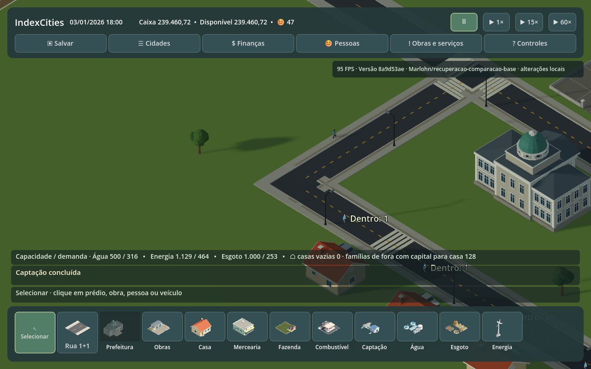
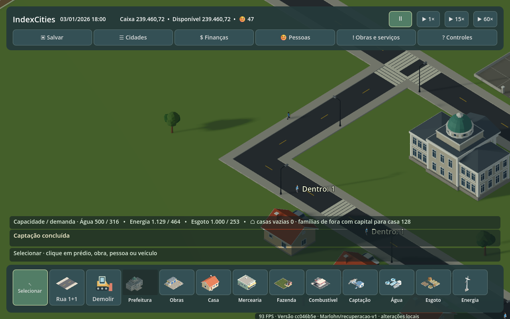
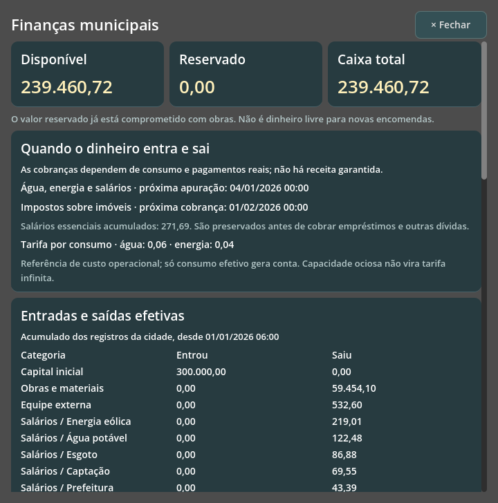

**Execuções do coordenador:** build Godot/.NET sem erros ou avisos; suíte completa de **89 testes aprovada**; Godot 4.7.2 mono com OpenGL Compatibility, ciclo de interface com **42 construções, 47 cidadãos e uma empresa**, preservando a oferta monetária de 20 milhões. Foram usados materiais, caminhões, trabalhadores, compras e pagamentos reais. O smoke viário verificou T, quatro entradas, encaixe em obra, cancelamento, save/load de esboços e Demolir, giro/clique direito e confirmação com rotas de entrega alteradas enquanto o orçamento estava aberto. O responsável técnico também operou uma sessão nativa com inspeção, demolição e salvamento em diretório isolado; isso não é validação humana do responsável pelo produto.

**Desempenho medido:** no mesmo cenário real de 42 construções, 47 cidadãos e 244 nós viários, amostras de pelo menos 15 segundos em 1x, 15x e 60x mantiveram cerca de 165 FPS, com frame médio próximo de 6,1 ms. Em 60x avançaram 900 segundos simulados em 15,0 segundos reais. O ensaio de mil nós mede somente geração de superfície (15–21 ms), numa geometria sintética: não mede uma cidade povoada nem o custo total da revisão viária. Nenhuma velocidade foi alterada.

**Revisão independente:** DeepSeek V4.1 Flash foi solicitado ao Orca, mas o launcher recusou a seleção verificável do modelo (`capability_unsupported`) antes de criar um worker. O fallback **Claude Haiku 5.5** realizou as revisões. A primeira rodada executou um smoke Godot próprio; a segunda rodou a suíte em cópia isolada, sem abrir o Godot. Encontrou faixas excessivas, faixa central sobre travessia, fechamento incorreto de meio-fio, evidências sobrescritas, faixa sobre rodovia e risco de demolição com efeitos envelhecidos. Esses problemas foram corrigidos. Na verificação focada final, em contexto novo, o Haiku confirmou **27/27 casos de travessia**, compilou o Godot em cópia isolada e confirmou por leitura a revalidação do orçamento e o arrasto sobre HUD; não executou GUI nessa verificação. O coordenador executou a GUI: a quote mudou de zero para quatro rotas reais de entrega e o primeiro clique reapresentou os efeitos sem cobrar; o arrasto iniciado no mapa continuou sobre o catálogo. A segunda rodada usou uma `main` local antiga e atribuiu à entrega comportamentos econômicos já existentes; o verificador final confirmou os blobs idênticos e corrigiu a atribuição. Permanece uma pergunta documental sobre essas regras anteriores, sem tratar a atribuição incorreta como prova de regressão.

**Ainda em recuperação:** nomes e renomeação já aprovados, ainda sem código nesta entrega; amostra de grama/água produzida pelo Opus 5.5 em workspace isolada, ainda sem integração. Ritmo econômico, caixa baixo, manutenção, atividade convincente de fazendas/eólicas e acabamento completo do mundo continuam sem validação global. Também faltam desempenho com população maior e revisão de HUD em janelas menores que o desktop testado. O Haiku apontou riscos baixos ainda não comprovados em recuperação de caminhada num ingresso em L e recuperação de tempo após pausa longa do processo; o diagnóstico de build também precisa distinguir falha do git de árvore limpa. Essas ressalvas não foram declaradas resolvidas. A proposta de 3600x não foi aprovada nem implementada. Aumentar velocidade também adianta consumo, vencimentos e despesas; as sondas econômicas não provaram a causa da partida pessoal que ficou sem caixa.

**Próxima partida humana:** construir uma reta e dois L próximos, ligar T/quatro entradas, arrastar uma fileira ao lado de rua em obra, identificar o âmbar, observar caminhões concluindo acesso, salvar/retomar, girar com botão direito, cancelar com clique curto e demolir conferindo efeitos. Avaliar se os menus ajudam a reconhecer falta de acesso, água, energia e caixa disponível. Registrar o momento em que falta uma ação interessante e manter a avaliação global aberta.

## Evidências da recuperação — nomes e ambiente, 2026-10-13

> **Revisão humana: PENDENTE.** O PR #7 foi aceito e integrado à `main` em `a19f8a4`. Esta segunda entrega usa essa base atualizada. A aprovação do nome opcional e da renomeação está na SPEC; os materiais decorativos têm registro IA-020, ainda pendente de avaliação estética. A missão global continua aberta.

**Experiência:** o menu Cidades oferece nome opcional separado do código do mapa e Renomear ao lado das partidas salvas. O nome atual e seu código aparecem no cartão de salvamento. Renomear mantém o identificador/arquivo e não troca o mapa ou a cidade; cancelar e falhar na escrita mantêm o nome anterior. A troca de nome em arquivo não aberto modifica apenas o campo do nome, preservando dados desconhecidos sem migrar o save. A partida aberta salva seu progresso antes da renomeação.

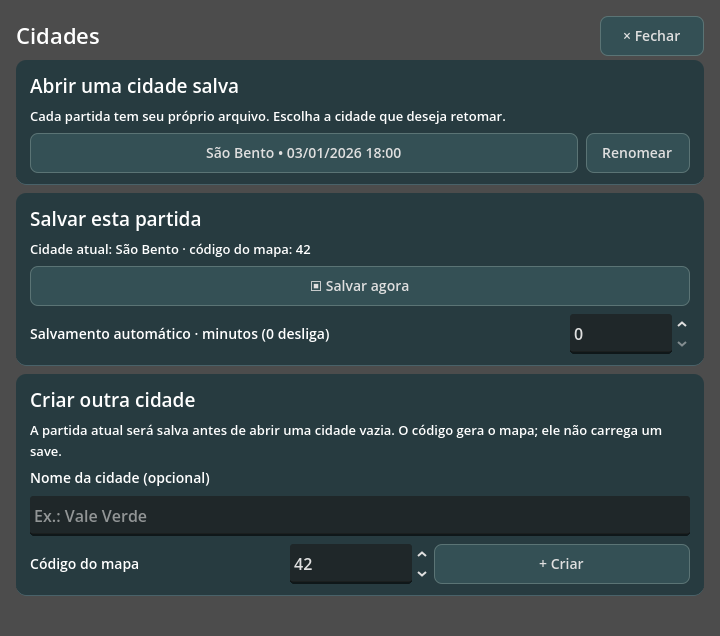

**Ambiente:** materiais originais produzidos pelo **Claude Opus 5.5**, configuração `max` disponível no Orca, foram aplicados à grama e à malha existente do lago. A cor do chão varia discretamente; a água recebe margem interna e ondulação de sombreamento. Não houve alteração de vértices, posição, raio, altura, colisões, fonte de água, poluição ou recursos. A ondulação é decorativa, tem a mesma cadência nas velocidades existentes e congela na pausa. **O contorno circular permanece; não declaramos resolvida a aparência natural do corpo d'água inteiro.**

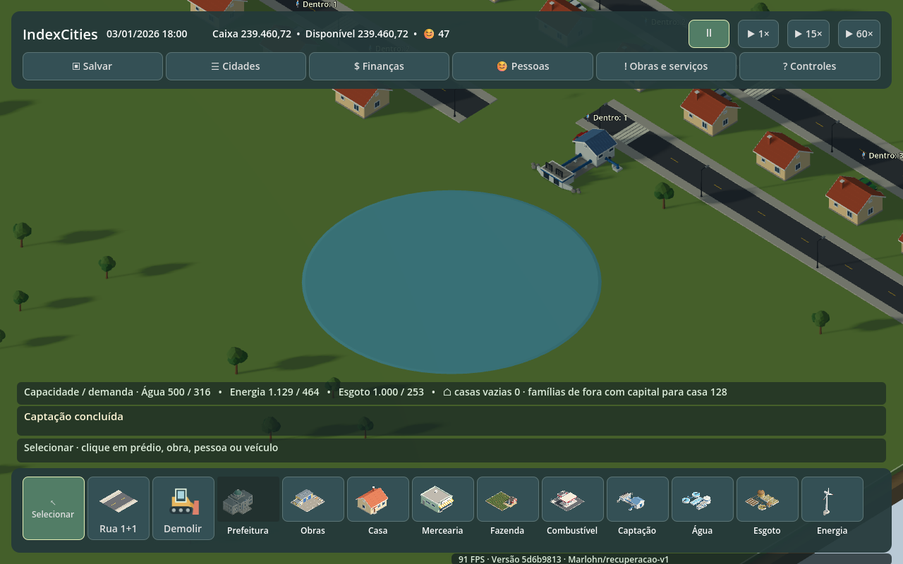
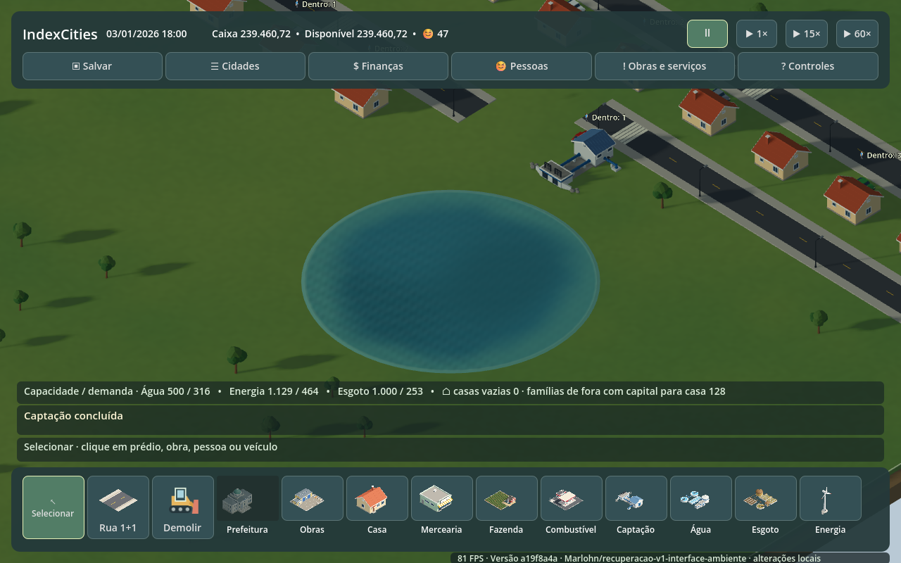

As imagens usam a mesma cidade de entrada, horário 18:00, foco `(152,61;86,04)`, zoom 110, yaw 45, viewport 1280×800, câmera congelada e jogo pausado. O executável anterior foi recompilado com o código da entrega #7, idêntico ao código da `main` para esse recorte; o rodapé identifica cada compilação em execução.

**Testes reais:** build sem erros/avisos; validador de assets com **136 verificações, zero falhas**; Godot Compatibility renderizado com checagem de dimensões, fase da água na pausa, velocidades intactas e JSON da simulação inalterado. O teste de nomes digitou acentos e verificou cancelamento, criação com nome, fallback `Cidade <seed>`, carga com ferramenta/esboço, campos desconhecidos e falhas de escrita em cidade aberta e não aberta. O bloqueio de arquivo gerou a exceção esperada do Windows e deixou o arquivo original íntegro. O ciclo completo pela GUI também passou com **42 prédios, 47 cidadãos, uma empresa e oferta monetária de 20 milhões**. A suíte de 89 testes da entrega anterior permanece a evidência do núcleo, que não foi alterado nesta entrega; não foi repetida sem mudança de regras. Os nove saves pessoais mantêm os hashes originais.

**Revisão independente:** **Claude Haiku 5.5**, fallback pela indisponibilidade operacional já verificada do launcher DeepSeek, leu código, shaders, capturas e logs, e compilou cópia isolada sem erros/avisos. Não executou Godot próprio. Pediu cobertura de falha em cidade não aberta e preservação da informação do código após nomear; o primeiro caso foi acrescentado e a informação foi mostrada para a cidade aberta. Na verificação focada, confirmou a cobertura e a captura. A lista ainda não mostra o código de outras cidades sem carregá-las. Também apontou riscos baixos de nomes muito longos/invisíveis, ordem da lista após renomear, Enter sem envio no campo de criação e salto cosmético de fase após frame longo. Essas ressalvas não foram declaradas resolvidas. A ordem por última escrita foi mantida; não foi inventado um novo limite de nome.

**Desempenho observado no jogo:** uma fixture maior criada por APIs normais, com **213 construções, 244 cidadãos, 174 veículos e 776 nós viários**, contém 30 veículos viajando no checkpoint. Em duas amostras sequenciais de pelo menos 15 segundos em 1x, antes/depois dos materiais, a média foi aproximadamente **71 quadros/s**, com intervalos médios de **14,10/14,15 ms**. É uma única comparação neste computador, sem afirmar neutralidade em outras GPUs. No mesmo checkpoint, a execução com materiais novos em 60x avançou 902 segundos simulados em 15,0 segundos reais (quanta de dois segundos nas bordas), mas caiu a **31 quadros/s em média**, intervalo médio 32,08 ms. Esse custo exige trabalho próprio; não é apresentado como fluidez satisfatória nem atribuído ao shader, pois falta comparação pareada em 60x. Nenhum multiplicador mudou.

**Ritmo e economia, investigação paralela:** a sonda do núcleo atingiu a mesma população por construção, migração, compra de veículos e empréstimo existentes, conservando 20 milhões. Não é cidade equilibrada: tinha déficit de água e custos reais. Em repetições isoladas, o núcleo sustentou cerca de 547–605 segundos simulados por segundo real; a proposta anterior de 3600x não é sustentada por essa carga. A sonda também isolou recusa de manutenção por cotação 750,98 acima de disponível 727,06, sem compromissos; usando um empréstimo normal numa cópia, a mesma manutenção concluiu por 163,69. Reserva excessiva nos casos medidos, despesas recorrentes, tempo até imposto e custo de processamento são questões distintas. Não foi diagnosticado o save pessoal que ficou sem caixa, nem alterada uma regra econômica. A investigação completa permanece em artifacts locais, com status PENDENTE; qualquer decisão significativa de orçamento ou tempo precisa de aprovação e registro na SPEC.

**Próxima partida humana:** criar cidade com nome, conferir código, renomear uma partida antiga, cancelar, retomar e verificar que mapa/recursos/esboço permanecem. Observar água e grama em pausa e movimento, dia/noite e diferentes zooms. Avaliar nomes longos e várias partidas na lista. Registrar atividade urbana e fluidez em 1x/60x. Nomes melhores e materiais novos não encerram a recuperação de economia, circulação, atividade urbana e acabamento geral.

## Investigação do caixa em saves do jogador — 2026-10-13

**Revisão humana desta seção: PENDENTE.** Leitura dos nove arquivos locais, sem carregar ou modificar partidas no Godot. Esta evidência complementa as sondas anteriores; ainda não confirma qual arquivo corresponde ao episódio narrado pelo responsável.

Um save tem **204 moradores, saldo de 3.074,32 e horário 02/01/2026 11:42:18**. O registro financeiro fecha exatamente: capital inicial de 300.000, receitas de água de 4,33 e energia de 16,07, contra despesas de 296.946,08. Dessas despesas, **294.137,10 são obras/materiais e 2.366,90 são equipes externas**. O restante são salários públicos efetivamente pagos (379,08) e demolição (63). Não há empréstimos nem obras em andamento reservando o saldo nesse checkpoint. Não foi detectado dinheiro desaparecido neste registro.

O imposto seguinte está em **01/02/2026**: faltam aproximadamente **11h48 de tempo real em 60x**, se o computador acompanhar a velocidade selecionada. Água, energia e salários são apurados diariamente; avançar até o imposto também executa os custos, manutenção, consumo e necessidades correspondentes. O checkpoint registra água potável de 500 para demanda de 1.797,6. Isso confirma caixa baixo e insuficiência de serviço nessa cidade, mas não prova travamento dos SIMs, ausência de toda atividade nem equilíbrio econômico futuro.

**Consequência para a recuperação:** distinguir gasto real de construção, reserva de orçamento, falta de arrecadação antes do primeiro vencimento, capacidade dos serviços e custo de processamento. Aumentar o multiplicador sozinho não resolve essas relações. O empréstimo manual já existe; facilitar sua localização e atualizar os saldos exibidos após a ação são melhorias de apresentação cobertas por IA-019, sem assegurar que uma dívida torne a cidade viável. Alterar calendário, cobrança, custos, destino das vendas de imóveis ou regras de recuperação exige decisão humana prévia na SPEC.

Os detalhes e a conciliação decimal ficam em `artifacts/verification/simulation-perf/player-economy-readonly.json` e `player-lowcash-ledger-readonly.json`, locais e ignorados pelo Git. Os valores são observações desse checkpoint, não uma previsão de receita nem uma nova regra.

## Entrega 3 — custo de simulação e finanças visíveis (2026-10-13)

**Revisão humana desta seção: PENDENTE.** Base: `main` atualizada em `57d3b94`. Esta etapa não altera velocidade, calendário, valores, regras econômicas, logística, necessidades ou formato dos saves. A recuperação global continua aberta.

**Mudança para o jogador:** menor custo de processamento em cidade povoada a 60x. O empréstimo manual existente aparece após o calendário, antes do histórico longo. O painel acompanha saldos, contratos, cobranças, tarifas, salários, dívidas e registros reais sem exigir reabertura; mantém o editor e a rolagem. Isso facilita encontrar a ação e compreender seu efeito, sem assegurar que tomar dívida torne uma cidade sustentável.

**Núcleo:** presença dos trabalhadores é reutilizada somente dentro do cálculo de infraestrutura; pesos constantes de distribuição de capacidade são calculados uma vez, mantendo soma na ordem dos consumidores pendentes; poluição de uma mesma posição residencial é reutilizada somente durante a atualização de necessidades. Não foi reduzida a frequência dos passos nem omitido consumo, transporte, saúde ou pagamento.

**Equivalência executada:** suíte de 89 testes aprovada. Um Codex separado verificou cópias dos 15 arquivos do núcleo: a base extraída de `a19f8a4` é idêntica nesses arquivos a `57d3b94`; a versão alterada corresponde às fontes implementadas. Sete cidades criadas por operações normais e um caso sintético explicitamente controlado de fome/morte passaram por **634 comparações de JSON completo**, incluindo save/load e continuação. Os avanços longos foram executados em **Debug**, com 7.200, 10.800 ou 16.200 segundos simulados por cidade. Em Debug e Release, passaram **2.017 comparações de alocação por bits** e 30 comparações de avanços fracionários por configuração. Isso protege estado e causalidade, não certifica prazer de jogar.

**Protocolo de desempenho:** carregar duas versões do núcleo no mesmo processo produziu resultados Release negativos, inclusive após mais aquecimento. Esses resultados foram preservados. Na confirmação com processo novo por amostra, os três pares do checkpoint com trânsito tiveram o mesmo JSON final e redução média de **16,49% no tempo** e **5,37% nas alocações**. A influência do protocolo foi observada; a causa interna específica, como PGO ou código genérico compartilhado, continua hipótese. Esse resultado Release cobre uma cena; não é medição de FPS nem benefício universal em cidade vazia.

**Godot renderizado:** mesma fixture inicial com 213 construções, 244 cidadãos, 174 veículos e 776 nós viários, mesmos materiais/câmera/viewport, Godot 4.7.2 mono, GL Compatibility e RTX 3050 Laptop 6 GB. Cada amostra mede pelo menos 15 segundos depois do aquecimento. Três pares alternados em 60x:

| Par | Antes: quadros/s médios | Depois: quadros/s médios | Antes: P95 de intervalo (ms) | Depois: P95 de intervalo (ms) |
|---|---:|---:|---:|---:|
| 1 | 31,76 | 36,06 | 43,63 | 35,40 |
| 2 | 32,05 | 38,59 | 37,24 | 33,11 |
| 3 | 32,73 | 37,46 | 35,86 | 33,08 |

São médias calculadas por quadros/tempo real, não o contador instantâneo `fps`. A mediana passou de aproximadamente **32 para 37 quadros/s** neste computador; ainda há custo de apresentação/engine e não se promete 60 quadros/s. O aquecimento por 60 quadros faz os instantes iniciais da janela de medição diferirem ligeiramente; a simulação avançou de verdade cerca de 900 segundos em cada janela de 15 segundos. O primeiro par em 1x foi 72,86 → 70,45 quadros/s; a verificação adicional com três pares alternados teve **73,72 / 75,84 / 75,18 antes e 75,01 / 74,00 / 75,78 depois**. As medianas ficaram próximas de 75 quadros/s, com diferenças de sinais mistos. Não se declara ganho ou neutralidade universal em 1x. Logs e métricas completas ficam nos artifacts locais de `simulation-perf` e `simulation-base`.

**Interface e persistência executadas:** compilação final Godot/.NET sem avisos ou erros. Na janela nativa, um clique contratou 10.000 no clone do save com 204 moradores e atualizou 3.074,32 → 13.074,32 no mesmo painel. O autosave isolado confirmou transferência `global` → `city`, principal de 10.000 e soma das carteiras de exatamente 20 milhões. Após a correção do achado de revisão sobre contratos/histórico antigos, o cenário renderizado `--finances-smoke` passou: acionamento de controles instanciados, contrato/fluxo visíveis, atualização periódica após outra transação real e um passo real, recusa com JSON completo preservado, editor/foco/rolagem mantidos, save/load idêntico e descarte da atualização ao fechar. O cenário automatizado usa sinais e foco da GUI da engine; não é teste de digitação pelo teclado nativo nem validação humana.

As capturas abaixo usam a mesma cidade, horário inicial, câmera e viewport. A base recebeu apenas um harness de captura, sem regra ou interface alteradas. O contador de FPS durante a captura inicial não é a amostra de desempenho acima.

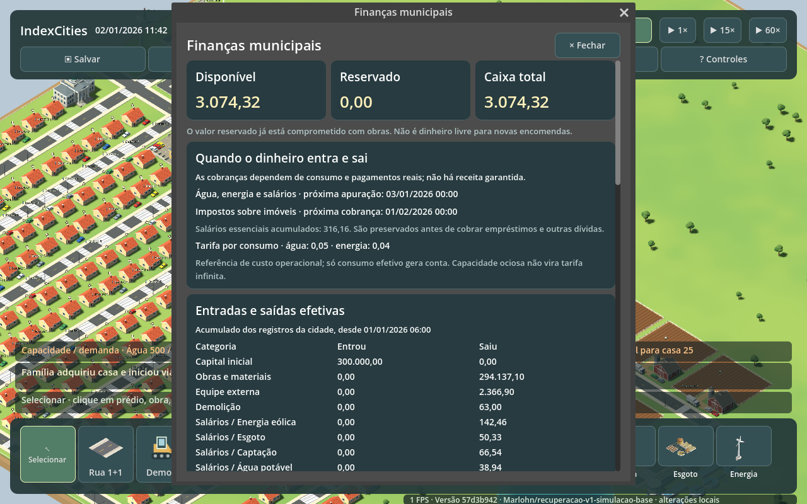
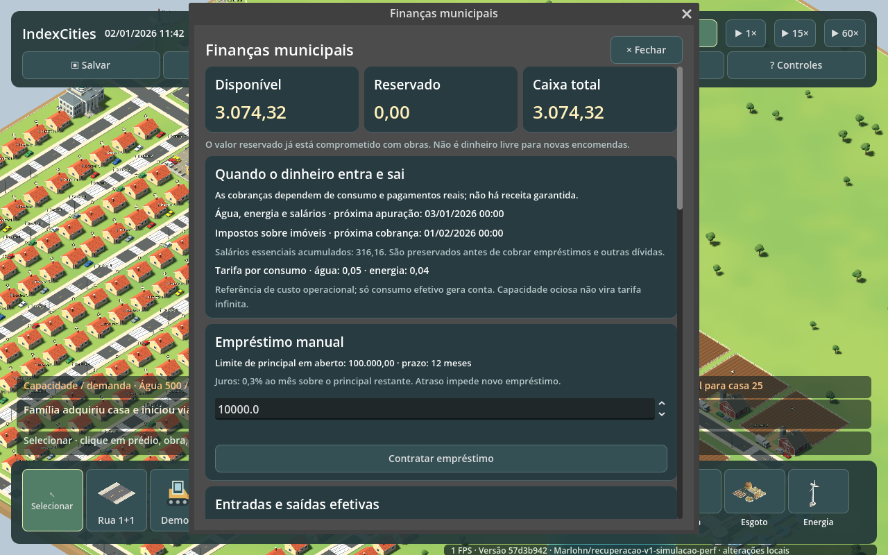
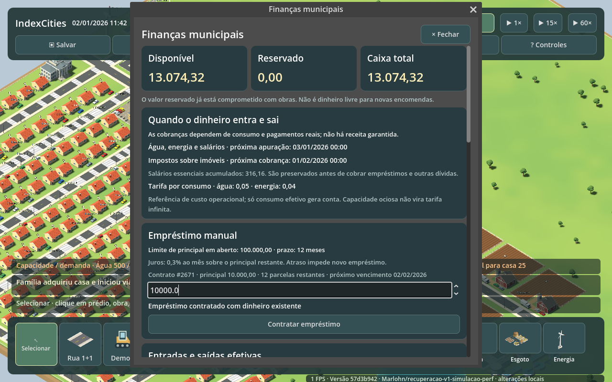
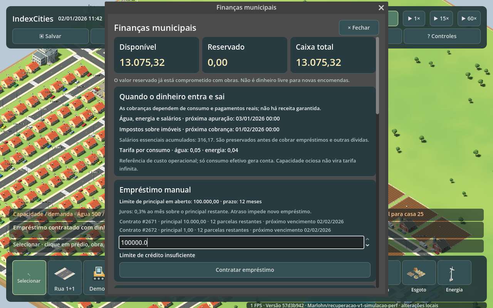

**Revisão independente:** Claude Haiku 5.5, fallback do DeepSeek pela indisponibilidade operacional já registrada; modelo efetivo confirmado pelo receipt do launcher. A primeira análise foi estática, sem testes próprios. A revisão integrada apontou contratos/histórico e outros dados financeiros desatualizados no modal; a correção acima passou no cenário Godot e foi examinada pelo Haiku. Em cópia isolada, ele executou build Godot sem avisos/erros, persistência headless aprovada e caso sintético de morte parcial, com 84 de 244 mortes no primeiro passo e JSON base/alterado idêntico em todos os checkpoints até 1.200 segundos. Não abriu GUI própria; leu a captura de contrato e o log do cenário executado pelo coordenador. Aceitou a integração técnica nesse escopo, mantendo ressalvas sobre custo de atualização dos salários no painel, buscas lineares restantes, resultados restritos à cena/máquina medida, equivalência longa somente Debug e economia mensal ainda aberta. A conferência final dos três pares em 1x foi concluída pelo Haiku, sem diferença consistente nessa cena e máquina. Revisão técnica não aprova a experiência global nem promove esta seção a revisão humana concluída.

**Pendências relevantes:** o calendário e o primeiro imposto mensal continuam produzindo espera longa; não há prova de equilíbrio futuro do save com pouco caixa. O empréstimo transfere dinheiro existente e cria obrigação real, não renda. Não foi acrescentado 3600x. A investigação e qualquer alteração significativa de economia/tempo dependem de decisão humana. Permanecem a avaliação global de construção, atividade urbana, qualidade visual e fluidez com outras populações/GPUs.

**Próxima partida humana:** observar resposta dos controles e circulação em 1x/60x; abrir Finanças, localizar o empréstimo, conferir limites/juros, contratar apenas se desejado e verificar saldo/contrato/histórico sem reabrir; acompanhar o painel enquanto o relógio corre, fechar e retomar a partida. Avaliar se as informações ajudam a decidir e quais oportunidades ainda faltam quando há pouco caixa.

## Entrega 4 — acompanhar a atividade real dos SIMs (2026-10-14)

**Revisão humana desta seção: PENDENTE.** Entrega iniciada em `57d3b94` e integrada à `main` atualizada em `528d30d`, após o merge da PR #9. Alterações de apresentação cobertas por IA-019, preservando dados, ações, movimentação, decisões, nomes e regras econômicas existentes.

**Reprodução:** no clone da cidade com 204 moradores, o menu Pessoas foi aberto na pausa e a simulação avançou normalmente até mudar uma atividade. Clara 74 passou de “Indo visitar outra família” para “Visitando família em Casa”; o botão ainda mostrava a viagem anterior. O cenário também encontrou um evento pessoal real sem mudança de IDs, recarregou o checkpoint imediatamente anterior e repetiu o passo de dois segundos com a inspeção aberta: o histórico continuava com os eventos antigos. Ambos foram confirmados na versão anterior, sem fabricar atividade nem alterar campos de SIMs.

**Mudança para o jogador:** Pessoas atualiza atividades, carteiras, empresas e candidatos no mesmo painel; novas pessoas e mudanças estruturais atualizam a lista, mantendo a janela e o contêiner de rolagem. A inspeção organiza os mesmos dados em situação atual, bem-estar, recursos e últimos acontecimentos. A ação Acompanhar fica junto da atividade. Os oito acontecimentos mais recentes acompanham eventos reais sem exigir trocar a seleção. A lista de famílias continua longa e os nomes existentes não mudaram; isto corrige a leitura desatualizada, não comprova que todos os problemas de atividade urbana foram resolvidos.

**Verificações executadas pelo coordenador:** build Godot/.NET sem avisos ou erros; importação headless; cenário Godot Compatibility renderizado `--activity-smoke`, com mudança de atividade por avanço normal, manutenção da janela/rolagem, inspeção pelo botão existente, atualização do histórico, apresentação sem mutação de JSON e save/load completo idêntico. Um cenário separado, criado por Prefeitura, rua e casa com obras normais, verificou a migração de um morador e sua inclusão no mesmo menu anteriormente vazio, além de fechamento sem erro do timer. Oferta monetária permaneceu em 20 milhões nos dois cenários. A automação usa sinais de controles instanciados, não teclado/mouse físico. A primeira tentativa do teste de histórico procurou somente a mesma pessoa e não encontrou evento no horizonte; o harness foi corrigido para procurar um evento real e reproduzir seu checkpoint, sem alterar a simulação. O núcleo não foi modificado nesta entrega.

**Partida na janela nativa:** na cópia isolada em 60x, o coordenador abriu Pessoas, selecionou Felipe 5 e clicou Acompanhar. A inspeção passou de “Visitando família em Casa” às 12:03 para “Em casa” às 12:14 sem fechar; a câmera foi para a posição atual e a rolagem física exibiu recursos e o título do histórico. A observação confirma esses gestos e a atualização dessa pessoa; não é teste prolongado de toda a cidade nem medição de FPS. A cópia foi encerrada, sem alterar saves do jogador.

Capturas do mesmo checkpoint e câmera. O contador durante a captura não é medição de desempenho:

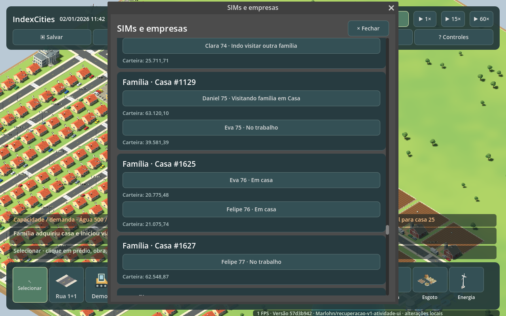
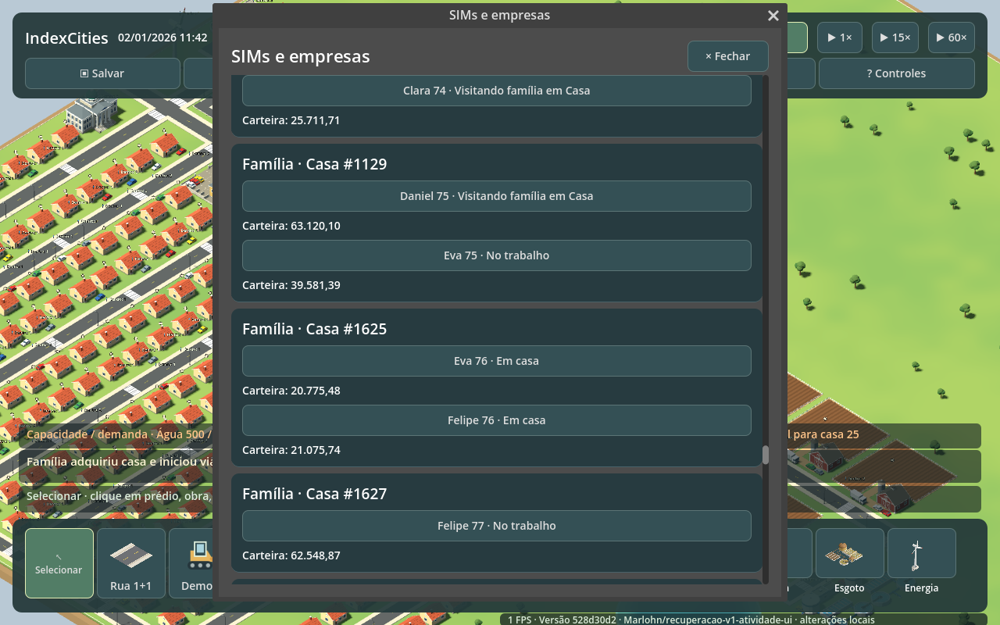
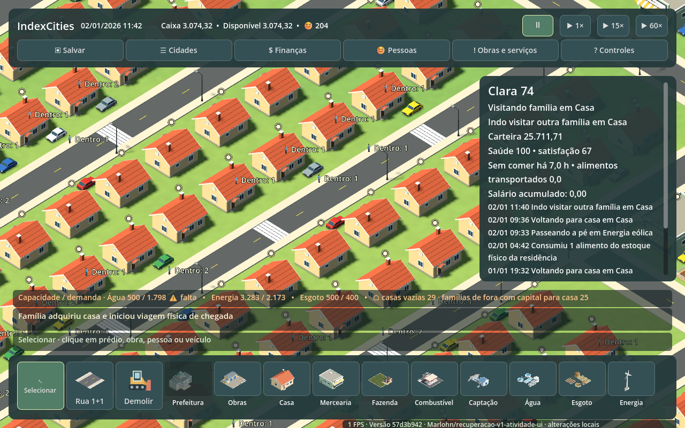
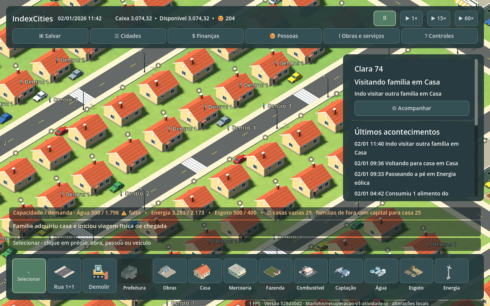

**Revisão independente:** Claude Haiku 5.5, fallback pela indisponibilidade operacional já registrada do DeepSeek; modelo efetivo confirmado pelo launcher. Executou build e smoke renderizado próprios em cópia isolada, com JSON/save-load íntegros. Apontou checagem manual do histórico, falso erro potencial do harness para pessoas sem família, ausência de teste de morte/rolagem e histórico abaixo da primeira tela. O coordenador corrigiu o harness, acrescentou caso de morte explicitamente sintético (saúde/fome controladas somente no teste, morte processada pela rotina real), com remoção da pessoa e rolagem mantida em 200, e colocou os acontecimentos logo depois da atividade. O Haiku recompilou a fonte integrada a `528d30d`, executou novamente os cenários de morte/rolagem e migração real, confirmou os marcadores de sucesso e examinou as capturas. Não jogou manualmente; a partida nativa é evidência do coordenador. Não encontrou problema importante impedindo a próxima partida humana. O teste de histórico inspeciona a pessoa do próximo evento real, que pode ser diferente de Clara 74.

**Limites e pendências:** custo de atualização da lista com populações maiores não foi medido; mortes múltiplas e o caminho de pessoa sem família não foram exercitados. Na cópia sem `.git`, o diagnóstico mostra erro bruto do Git, falha de baixa gravidade ainda aberta. A versão integrada passou também pela persistência headless, com dois saves isolados, migração de esboço legado, relógio 1x e continuação idêntica. As primeiras tentativas do revisor usaram argumentos incorretos de Godot e não são validação; foram corrigidas antes dos testes válidos. Os nove saves pessoais mantiveram os hashes. Nenhuma revisão técnica promove esta seção a revisão humana concluída.

**Próxima partida humana:** abrir Pessoas com o relógio correndo, inspecionar um SIM em deslocamento, acompanhar sua chegada e seus acontecimentos, rolar a lista e voltar a uma família. Observar se é mais fácil compreender o que a pessoa faz. A recuperação global continua aberta; trânsito persistente, abastecimento, ritmo mensal e acabamento ainda exigem trabalho e avaliação.

## Entrega 5 — saída das vagas, fila e travessia (2026-10-14)

**Revisão humana desta seção: PENDENTE.** Base inicial `528d30d`, após o PR #9, atualizada para `05d76e0` após o merge do PR #10. Os conflitos da integração preservam os cenários de atividade e circulação e os registros das duas entregas. Os dois cenários combinados passaram no Godot: fila real liberada e atividade/histórico acompanhando os SIMs, com dinheiro e persistência conferidos. As revisões independentes cobrem o reparo delimitado da fila; a margem do acesso e as limitações abaixo mantêm esta etapa em preparação. A recuperação global continua aberta.

**Causa reproduzida:** na cópia de um save real com 204 moradores, dois carros saem das vagas distintas da fazenda 1274 ao terminar o turno. O filtro de direção deixa o segundo convergir para apenas 0,05 m do primeiro; depois, os critérios de fila fazem ambos esperar um pelo outro. A investigação partiu do save anterior à saída, com avanços normais de dois segundos, sem editar agentes, vagas, posições ou combustível. A fila posterior prende outros veículos e pedestres em uma travessia, afetando também a presença de trabalhadores. Isso não prova que toda ausência de atividade ou falta de água tenha essa causa.

**Mudança para o jogador:** o carro saindo da vaga considera o veículo que já ocupa aquele trecho mesmo quando os rumos de aproximação diferem. O desempate existente por ID passa a ser coerente no caso quase coincidente, permitindo recuperar a fila já salva. Veículo realmente imobilizado por falta de combustível continua bloqueando a passagem. Rotas, vagas, velocidade, consumo, prioridades, pedestres e dinheiro permanecem reais; ninguém é removido ou transportado instantaneamente. A espera lateral informa “Aguardando espaço para acessar a faixa”, sem presumir que todo índice zero de rota é saída de garagem.

**Validação anterior à margem aprovada:** a versão daquela rodada passou **98/98 testes**, sem falhas ou casos ignorados. Os nove casos novos cobrem coincidência, obstáculo sem combustível, distância normal de fila, tráfego contrário em ambos os sentidos, carro com índice zero já na própria faixa, duas entradas por lados opostos e rota refeita antes de uma curva. Build Godot sem avisos ou erros. Os dois cenários renderizados foram repetidos após a última guarda: na fila salva, os três carros observados se deslocam mais de 100 m, consomem combustível e os cinco pedestres que esperavam retomam deslocamento. Na saída original, os dois carros completam deslocamento e o mínimo medido no trecho reto, depois da entrada, é 8 m. Oferta monetária conserva 20 milhões; save/load e mais dois minutos de continuação mantêm JSON completo idêntico. A persistência headless da versão atual também passou, preservando esboço livre, migração de esboço legado, relógio 1x e continuação. Os nove saves pessoais mantêm hashes idênticos.

As imagens são capturas limpas do Godot, na mesma cidade, câmera e viewport 1280×800. A primeira mostra o checkpoint real bloqueado às 23:42; a segunda, o resultado após dois minutos simulados com a correção. Não é comparação de aparência nem benchmark de FPS. Na janela nativa, o coordenador também ativou 60x no clone pausado e observou a rua livre às 23:48.

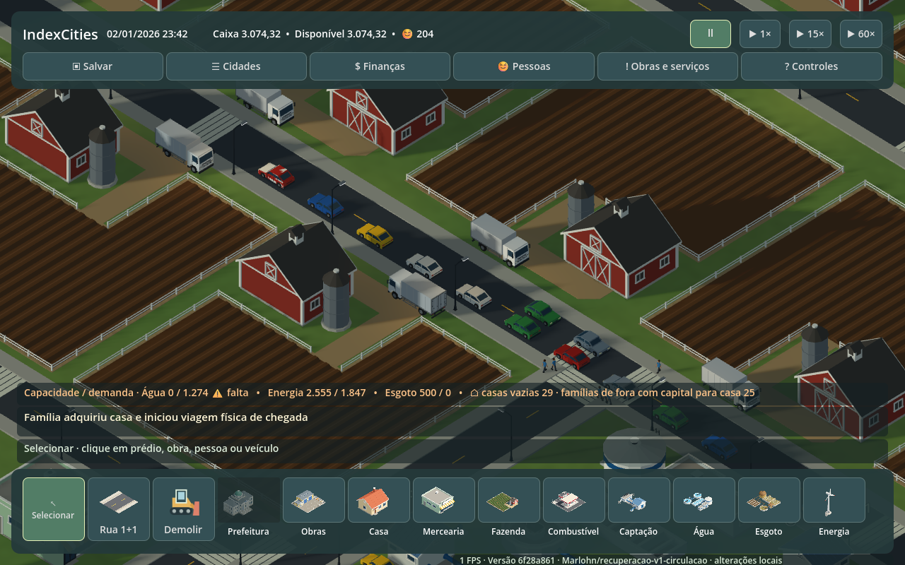
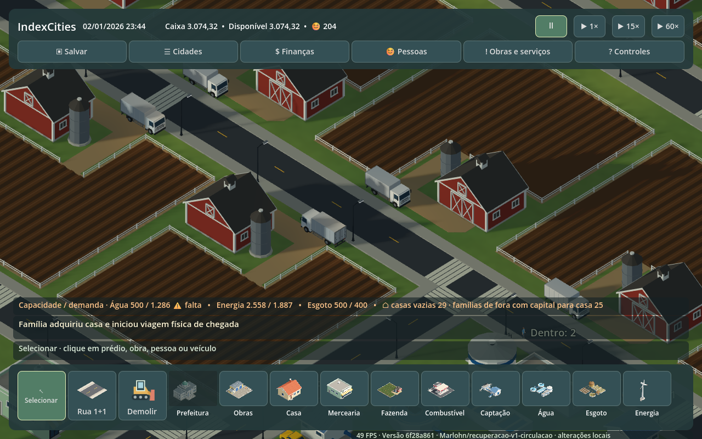

O replay Release da saída original e o replay da fila já existente chegaram a 30 minutos simulados, com invariantes e save/load/continuação idênticos. Na saída original, os carros preservam a distância normal de fila no trecho reto e chegam às vagas de casa. Uma asserção inicial de 8 m euclidianos em qualquer ponto falhou numa curva posterior, com rumos diferentes e 7,8577 m entre os centros; o log foi preservado. A checagem de 8 m foi delimitada à fila reta após a entrada, em vez de certificar espaçamento de qualquer curva. Essa evidência cobre esta origem e esta fila; não certifica todas as combinações de garagem/cruzamento, população maior ou desempenho global.

**Primeira revisão independente:** Claude Haiku 5.5, fallback pela indisponibilidade operacional verificada do launcher DeepSeek, em contexto separado. Executou a suíte própria em cópia isolada (93/93), testes de sensibilidade contra a main, replays Release e cenários controlados; não abriu Godot próprio. Confirmou a recuperação do par e encontrou entrada ainda insuficiente para tráfego vindo de lado, aviso genérico diante de veículo sem combustível e ausência de checagem da distância no smoke. A correção passou a avaliar ocupação no eixo da rua, incluindo a faixa contrária, e a apresentação identifica o impedimento real conforme IA-021. Entradas opostas e replanejamento receberam cobertura; o smoke passou a conferir a fila reta. A segunda verificação crítica está em andamento. Não foi inventado reboque nem desvio garantido para obstáculo sem rota alternativa.

**Efeito integrado observado em um dia:** a partir do mesmo save original de 204 moradores, a versão corrigida completou 24 horas simuladas por avanços normais, sem construção, empréstimo, edição de posições, agentes, estoque ou dinheiro. Os checkpoints mantiveram invariantes e 20 milhões; o save ao fim do dia passou por carga e continuação idêntica. Comparação com a execução anterior na main, no mesmo horizonte:

| Observação | Antes | Depois |
|---|---:|---:|
| Amostras com capacidade potável zero, entre 1.441 amostras de um minuto | 825 | 353 |
| Veículos com causa “Fila na faixa” no checkpoint final | 19 | 0 |
| Trabalhadores presentes no checkpoint final | 70 | 86 |
| Fome máxima de um morador, em horas, no checkpoint final | 35,99 | 17,54 |
| Caixa municipal no checkpoint final | 2.596,46 | 2.591,31 |

População permaneceu 204, sem mortes nas duas execuções. A produção total de alimentos permaneceu aproximadamente 301,06; não foi demonstrado aumento de produção. A melhora de deslocamentos e necessidades não produz dinheiro novo nem garante oferta de água constante: turnos, localização de captações e capacidade continuam reais. A contagem de amostras não é duração contínua exata de falta de água. Não foi medido FPS nesta sonda nem executado o mês completo; não se declara equilíbrio econômico, preferência ótima em toda garagem ou validação humana da experiência.

**Pendências:** validação integrada da margem do acesso aprovada em 2026-10-14, suas limitações e teste humano da circulação. O primeiro imposto mensal e a falta de oportunidades com pouco caixa continuam em discussão; não foi alterada velocidade nem regra econômica. Rio/lago continuam visualmente insatisfatórios segundo o novo feedback; as amostras iniciais Opus foram concluídas em prévia isolada, receberam críticas e uma nova amostra está em desenvolvimento, sem integração.

**Resultado da segunda revisão e verificação suplementar:** o Haiku confirmou a recuperação da fila reta em execução própria de 900 segundos, sem dinheiro novo. Encontrou saída esperando durante 240 segundos em fluxo periódico de carros, sensibilidade ao tamanho do passo e aviso de vaga ao refazer rota numa curva. A guarda da faixa de entrada corrigiu o caso da curva e passou em cópia própria do Haiku (9/9 focados); o teste das duas entradas também foi corrigido para iniciar ambas no índice zero. A suíte atual de 98 e os smokes foram executados após essa guarda. A sonda de um dia acima pertence à iteração anterior à última guarda, sem alegar uma nova medição diária dela. O coordenador jogou a versão atual na janela nativa, ativou 60x a partir do checkpoint pausado e observou a rua livre após avançar até 00:14, incluindo despesas reais à meia-noite.

Uma hipótese isolada calcula o intervalo necessário para liberar o acesso inteiro, em vez do tempo restante no passo. O revisor mediu menor espera em fluxo periódico e ausência de sobreposição no recorte amostrado, com ressalvas; não executou Godot nem certificou colisão contínua. **Decisão humana pontual confirmada em 2026-10-14:** o responsável autorizou a recomendação de manter a prioridade do tráfego na rua e permitir o ingresso quando houver espaço para concluir a manobra inteira. Essa decisão foi registrada na SPEC antes da implementação. A aprovação do comportamento não valida automaticamente a fórmula, as sondas anteriores ou a experiência global; os novos testes e a revisão integrada ainda precisam ser concluídos.

**Atualização após a aprovação da margem (2026-10-14):** a branch foi integrada à `main` `2a75a4b` (PR #12) e a autorização entrou na SPEC em `13d7e46`, antes do código `6f28a86`. A margem passou a considerar a manobra inteira. A primeira revisão independente dessa integração, **Claude Haiku 5.5**, executou 113 testes originais e 13 sondas próprias em cópia (126 aprovados). Não executou Godot próprio; leu as evidências do coordenador. Encontrou risco alto quando o tráfego vinha de rodovia mais rápida que a rua de acesso (F1) e espera dependente do passo em fluxo já estabelecido (F2). O primeiro teste de fluxo do coordenador começa numa oportunidade inicial; seu nome foi corrigido para explicitar esse limite, sem declará-lo prova de fluxo estável.

**Correção F1 em `c021ab3`:** a previsão consulta a velocidade nominal dos próximos nós da rota do veículo que se aproxima, dentro do horizonte da manobra. Os 15 novos casos falham na fonte anterior e passam após a correção, com duas orientações por caso, passos de 0,1/0,5/2 segundos e manutenção normal/reduzida no acesso. A suíte completa passou **128/128**, sem falhas/skip. Build Godot sem erros/avisos; os dois cenários renderizados foram repetidos com essa fonte: fila salva com três carros e cinco pedestres retomando, e duas saídas originais com mínimo de 8 m na fila reta. Dinheiro de 20 milhões e save/load/continuação JSON completo idênticos. A rechecagem independente de F1 foi concluída pelo Claude Haiku 5.5: executou testes próprios e 1.008 medições controladas de aproximação, sem movimento inseguro detectado na fonte corrigida nesses casos. Não executou Godot; os limites geométricos permanecem. **F2 permanece aberta:** no fluxo uniforme pré-carregado, o revisor mediu a saída esperando 44/76 segundos ou sem entrar em 120 segundos em alguns intervalos de 25–28 m, com passo de jogo de dois segundos. Esses casos não são cobertos pelo sucesso da fila real. Está em investigação técnica isolada, sem nova regra de cortesia, preferência, timeout ou alteração do passo global. A PR #11 continua em rascunho.

**Integração e limite da evidência:** na fonte `6f28a86`, anterior a F1, os cenários renderizados de serviços e atividade passaram no mesmo host: diagnóstico atualiza, botões/rolagem/inspeção continuam corretos e Ana 24 muda de dirigir para caminhar após estacionar. Persistência headless manteve esboço livre, migração legada, relógio 1x e continuação. Uma observação Release sem ação do jogador completou 72 horas com invariantes, oferta monetária e save/load/continuação idênticos. O estado inicial completo tem o mesmo SHA-256 da observação anterior na base dos serviços. No fim havia 204 vivos, zero mortes registradas, produção acumulada de alimentos de 573,04, água operacional de 887,23 para demanda 1.288 e Caixa de 2.232,51. Ainda havia déficit; imposto acumulado era zero. A observação foi repetida depois de F1, com a mesma entrada e hashes de fontes registrados: 72 horas contínuas em 273,096 segundos de execução do núcleo, invariantes, oferta monetária e save/load/continuação preservados. Os agregados finais acima se repetiram; isso não certifica a trajetória inteira, não mede FPS e não comprova equilíbrio mensal ou diversão. Os logs, fontes e checkpoints permanecem em `artifacts/verification/circulation/approved-clearance`. O usuário está testando a `main`; os testes do coordenador usam cópias e pastas isoladas, sem alterar seus saves. A última fórmula foi executada em cenários Godot renderizados fora da área visível, sem nova partida manual em primeiro plano durante o playtest do usuário.
**Atribuição corrigida pelo coordenador:** a revisão suplementar descreveu o par 2005/2011 como carros na via refazendo rota, por ter índice zero e destino distante. A inspeção somente de leitura do checkpoint original encontrou suas posições exatamente nas vagas `b:1998:1` e `b:1998:0` do posto de combustível. A separação de 2,2 m é o espaçamento das vagas reais do posto; o segundo carro ainda aguardava embarque. `DockPosition`/`ParkingSpot` já apontam ao destino ao despachar a viagem, então esses campos não provam a origem na rua. A espera observada é real, mas essa atribuição não demonstra bug de replanejamento. Os relatórios independentes e a conferência local `car-origins/initial-inspection.json` foram preservados. Permanecem limitações de entrada/circulação além do par original; não se declara o acesso resolvido em todas as geometrias.

**Próxima partida humana:** retomar a cidade anterior sem substituir o save pessoal, observar saídas simultâneas das fazendas, filas e travessias em 1x/60x; verificar se trabalhadores chegam e carros voltam à vaga, se a espera é compreensível e se caminhões/logística continuam funcionando. Avaliar a cidade inteira, pois a liberação de uma fila não encerra a recuperação.
## Recuperação integrada — diagnóstico de serviços (entrega 6, 2026-10-14)

**Revisão humana desta seção: PENDENTE.** Incremento de apresentação IA-022, registrado antes do código, sobre a `main` atualizada `05d76e0` (PR #10). A entrega de circulação em PR #11 é independente e ainda não está nesta base. Diagnóstico legível não comprova abastecimento satisfatório nem conclusão da recuperação global.

**Problema reproduzido:** no mesmo checkpoint real com 204 cidadãos, o menu antigo mostrava totais de água/energia/esgoto e causas agregadas. Não distinguia capacidade instalada de operacional nem funcionários contratados de pessoas que chegaram ao turno. A inspeção da captação #2568 dizia “sem fonte natural viável/energia”; a fonte estava fora da faixa realmente aceita pelo cálculo, mesmo com presença e energia. O menu também guardava valores antigos até reabri-lo.

**Mudança para o jogador:** Obras e serviços destaca o déficit de água antes da lista, mostra capacidade operacional e demanda, separa captação de tratamento e informa capacidade instalada. Cada instalação apresenta contratados, previstos na escala atual e presentes. Os fatores usam condições reais: obra, conexão exterior, fonte natural, escala/presença, equipe necessária em pessoas, manutenção, energia e efeito efetivo da poluição. O potencial de tratamento nas condições atuais fica explicitamente separado da captação e capacidade do último cálculo; a comparação não afirma que a causa passada é um estado atual diferente. Ausentes aparecem com sua atividade real a pé, vínculo com veículo e causa, designação para obra ou situação fora do posto. Os botões incluem a identificação da instalação. Dados e cores atualizam no mesmo painel; obras, cancelamentos, entregas, outras construções, história e suas ações de inspeção continuam acessíveis. A história atualiza sem recriar os botões da lista e uma mudança estrutural aguarda a soltura do mouse esquerdo. A inspeção também recebe as condições do serviço. A ordem de instalações pode exigir rolagem em uma cidade grande; não se declara resolvida toda a organização dos menus.

**Núcleo preservado:** somente consultas de leitura e extração das fórmulas existentes de equipe/fonte/tratamento e do predicado de presença. Não há campo persistente novo, contratação automática, alteração de turnos, capacidade, manutenção, produção, distribuição ou política. A comparação executada em Release após as correções finais cobriu 120 checkpoints de JSON completo idênticos à base: cidade real e cidade inicial seed 42, sessenta avanços de um minuto cada, contra `Infrastructure.cs` e `Mobility.cs` originais de `05d76e0`. Não é prova para todo estado possível.

**Verificações do coordenador:** suíte final de 92 testes aprovada, build sem avisos ou erros e importação headless. O Godot 4.7.2 mono em GL Compatibility executou `--services-smoke`: captura inicial, avanço normal de trinta minutos, atualização de dados/mesma janela/rolagem 200, inspeção da captação correta, JSON inalterado pela UI, save/load integral e continuação de 120 segundos idêntica. Oferta monetária permaneceu em 20 milhões. Casos adicionais, explicitamente sintéticos em uma cópia não salva da cidade, verificaram captação de 40 abaixo do potencial do tratamento, ausentes em veículo e a pé, um evento que não recria o botão e inspeção correta após mudança estrutural. Não comprovam atividade real nem são apresentados como partida. Esse cenário usa sinais dos controles instanciados, não gestos físicos. Uma tentativa de testar foco falhou: os botões já têm `FocusMode.None` na base e o harness também consultava um nó já liberado. A falha foi preservada e o teste corrigido verifica a ação após reconstrução; não foi habilitada navegação de teclado.

**Uso da janela nativa:** o coordenador abriu o menu com o mouse, rolou até os tratamentos e inspecionou a captação #2568. Viu tratamento sem trabalhadores presentes apesar de seis contratados. Depois abriu o mesmo menu em 60x e observou energia de 2.065 para 2.109 e vento de 43% para 44%, entre 00:02 e 00:34 do dia 03/01, sem fechá-lo. Na fonte final, abriu novamente o menu e clicou “Inspecionar Captação #538”, conferindo a instalação operacional de 500 e os novos textos. Essa última janela usou viewport 1280×700; as capturas comparativas abaixo usam 1280×800. O déficit de água continuou real; não foi mascarado. Capturas iniciais de desktop ocluído ou parcialmente cortado não contam como evidência visual completa. A janela foi efetivamente vista usando `--always-on-top` somente na execução de QA e foi encerrada. O contador de FPS nas imagens não é benchmark.

Capturas renderizadas do mesmo estado inicial:

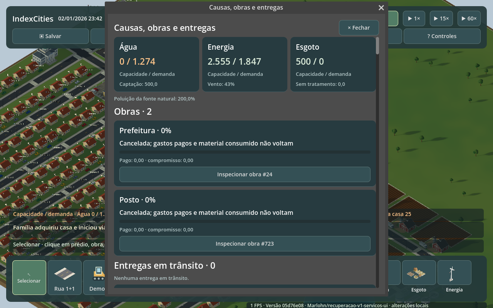
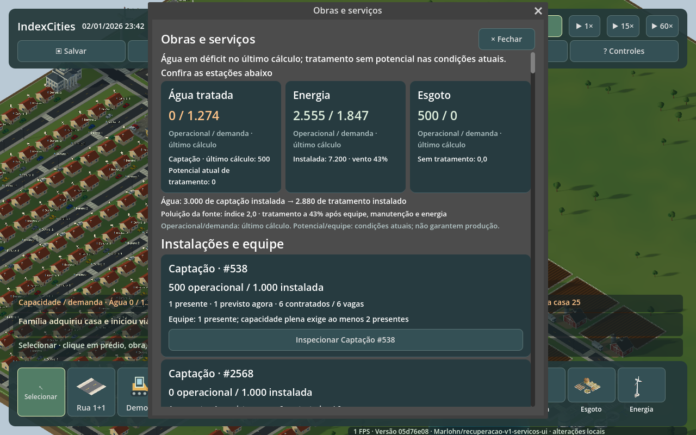
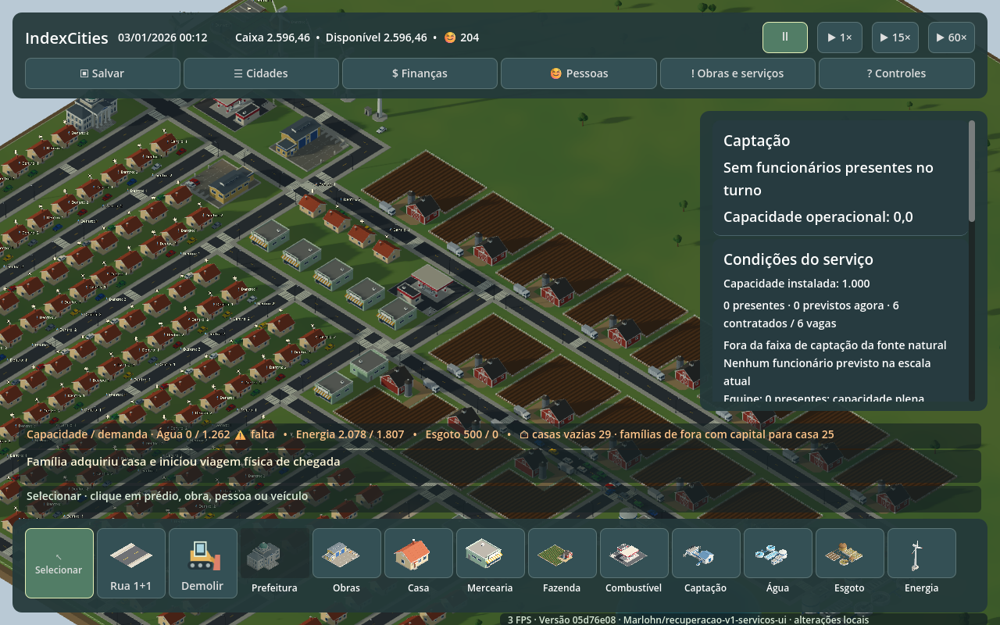

**Revisão independente concluída:** o DeepSeek foi iniciado via `dsh`, mas ficou no onboarding “No usable credential”; nenhum parecer foi produzido. O fallback **Claude Haiku 5.5**, modelo efetivo confirmado pelo launcher Orca, revisou sem editar produção. A primeira rodada apontou ausência do limite da captação, equipe e poluição pouco legíveis, estados de ausência insuficientes, botões iguais e reconstrução por evento. Esses pontos foram corrigidos. A segunda conferiu as fórmulas e apontou a mistura temporal nos textos e custo repetido; os rótulos foram corrigidos e o potencial do conjunto é reutilizado uma vez por atualização do menu. Uma checagem final delimitada confirmou os pontos e não encontrou problema importante impedindo a próxima partida humana.

**Execução e limites do revisor:** executou comparação própria em cópias isoladas, com 60 checkpoints idênticos em cinco mundos ao longo de dois dias simulados, consultas sem mutação, identidades de potencial/presença e fronteira de turno. Na segunda cópia, as duas falhas adicionais da suíte foram de caminho longo ao gravar dumps e também ocorreram na base; a suíte de 92 casos passou na workspace do coordenador. **Não executou Godot:** analisou código, logs e capturas do coordenador. A checagem final não repetiu os testes. A hipótese de regressão de foco foi invalidada pelo `FocusMode.None` já existente. A inspeção continua com chamadas repetidas; o relatório chamou seu custo de quadrático, mas o código chama `ServiceInspection` somente para um prédio selecionado, sem laço de tratamentos. Não há medição desse custo. Críticas e correções de interpretação foram preservadas; revisão independente não equivale a concordância automática nem aprovação humana.

**Limites e próxima partida humana:** conferir se o painel permite entender por que a água não chega, localizar a instalação responsável e distinguir obra, emprego, escala e presença sem adivinhar pela mensagem agregada. A lista continua longa e a qualidade da hierarquia precisa de avaliação humana. Não há benchmark de menus com populações grandes nem teste de entrada física durante o adiamento de reconstrução. Os casos sintéticos não cobrem todos os ramos e não certificam abastecimento. Saves de QA usam apenas pastas isoladas em `artifacts/verification`; os nove hashes pessoais se mantiveram entre o checkpoint desta etapa e as últimas execuções. A referência foi gravada depois do primeiro smoke; não é apresentada como comparação criptográfica anterior à etapa inteira. Água visual, margem de entrada no trânsito e ritmo mensal continuam abertos nas respectivas frentes. Esta etapa não altera a velocidade do jogo.

**Regressões complementares de F1:** corrigido o alvo inicial do veículo nas fixtures de distâncias entre nós e adicionados quatro casos com um trecho rápido entre o carro e a saída. Os 19 casos corrigidos falham na fonte anterior; os 40 testes focados e a suíte completa de 132 casos passam na fonte atual. O comentário da previsão explicita o uso conservador de velocidades nominais. F2 continua isolada como candidata, aguardando integração e revisão.

### Integração de F2 e conferência crítica — 2026-10-14

**Revisão humana desta seção: PENDENTE.** Candidata Codex GPT-6.1 Sol integrada em 8a1c6f1, após fonte F1 validada. O coordenador executou 147 testes e build Godot sem avisos/erros; a fila real foi executada novamente no Godot renderizado (rendered-d43cb3d9ddcb4eedadf6d4573f50bf36): três carros e cinco pedestres retomaram, gap13,95 m, dinheiro20 milhões, JSON save/load e continuação preservados. A candidata considera oportunidades dentro do mesmo passo, com posições do tráfego no mesmo instante. Operações de motoristas/carga continuam uma vez por passo e o Quantum global continua2 segundos. Não resolve a fila causada pela via demolida do novo save.

**Revisor independente:** Claude Haiku5.5, modelo efetivo confirmado pelo Orca, reproduziu147 testes e executou15 próprios, inclusive mutação da folga8 para7 m. Não executou Godot. Apontou uma expectativa temporal frouxa (procedente, estreitada para espera até1,70 s e movimento em1,80 s) e classificou como risco alto uma distância inferior a8 m junto de um T. A conferência do coordenador detectou que a menor distância registrada acontecia depois do ingresso, com o carro já seguindo sua faixa e o outro na faixa oposta: não é a distância exigida durante a manobra.

**Contraprova reproduzível:** o coordenador repetiu a geometria, fluxo e controles do R5, usando a cópia do núcleo instrumentada com observador de segmentos reais (sem alterar decisões). Nas seis combinações de mão direita/sinal e passos0,1/0,5/2 s, a distância longitudinal mínima DURANTE o movimento até o primeiro ponto da faixa foi8,00007 m; a mínima entre centros foi9,21134 m. Os valores de7,8/6,4/3,4 m foram reproduzidos apenas depois desse movimento, quando as faixas já eram separadas. O relatório original fica preservado; sua atribuição a perda de guarda ao chegar ao índice1 não é sustentada por essa medição. A nova conferência independente deve verificar o método e as fontes antes de liberação. Artefatos: f2-independent-review/report.md e f2-root-countercheck/{Program.cs,run.log,countercheck.json}. O tempo de cerca de210 s com sinal permaneceu nesse cenário sintético; não foi explicado nem anunciado resolvido.

**Presença visual:** um teste controlado em cópia da cidade de200 cidadãos moveu apenas um morador existente2,6 m até sua porta pelo movimento normal e verificou chegada/interpolação/pausa no Godot. Não criou SIMs ou recursos, mas é uma fixture sintética, não reprodução da partida. A chegada ao interior e a pausa passaram SEM alterar a visibilidade de produção. O relato de pessoas sobre casas continua aberto; não foi atribuída uma causa com base somente na leitura do interpolador. Log godot-interior-before e capturas interior-6b7ebe8484244a9e835020b3d19458fb. Não há benchmark de FPS ou aprovação humana de experiência global nesta etapa.
