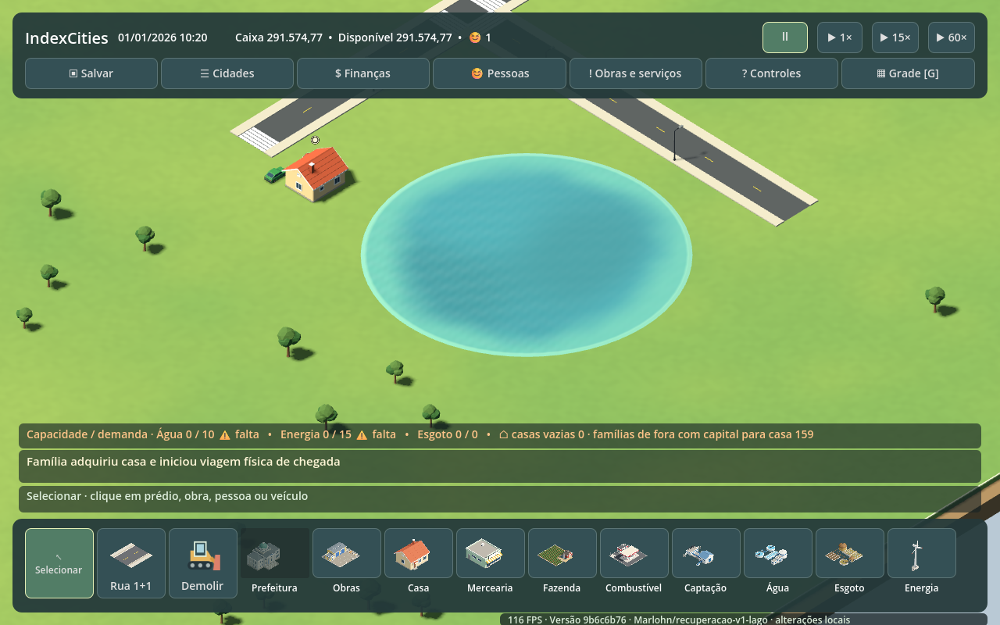
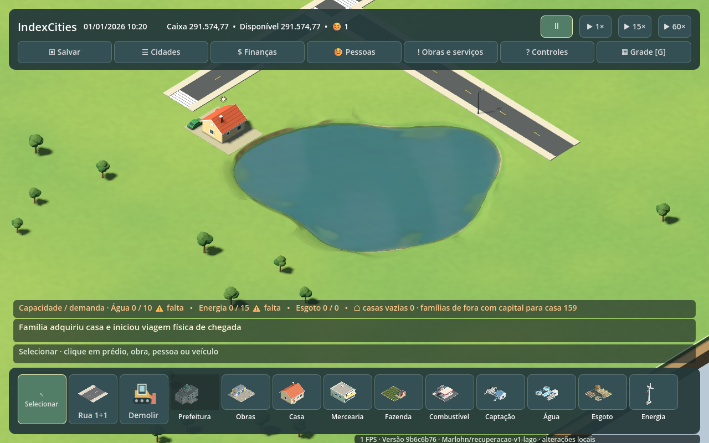
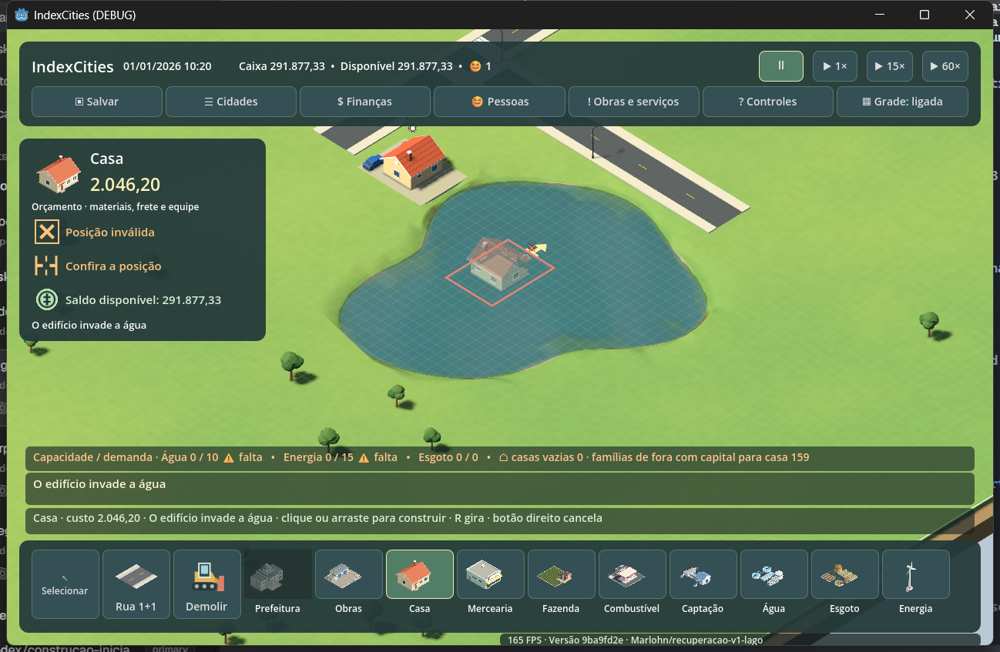
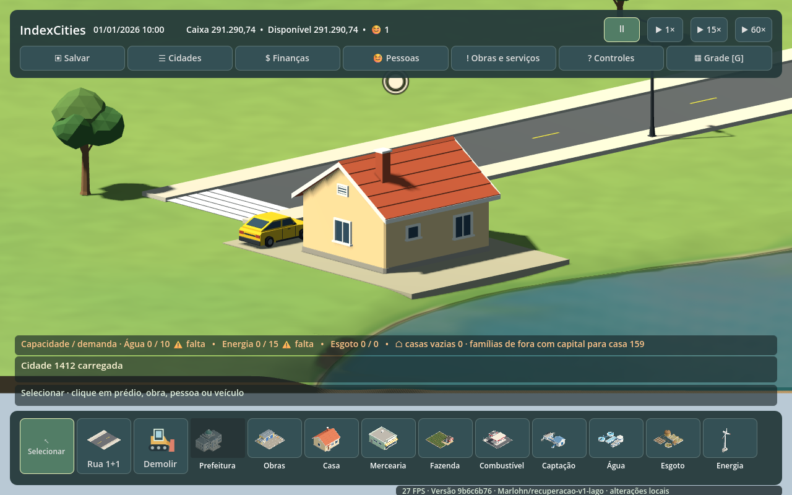
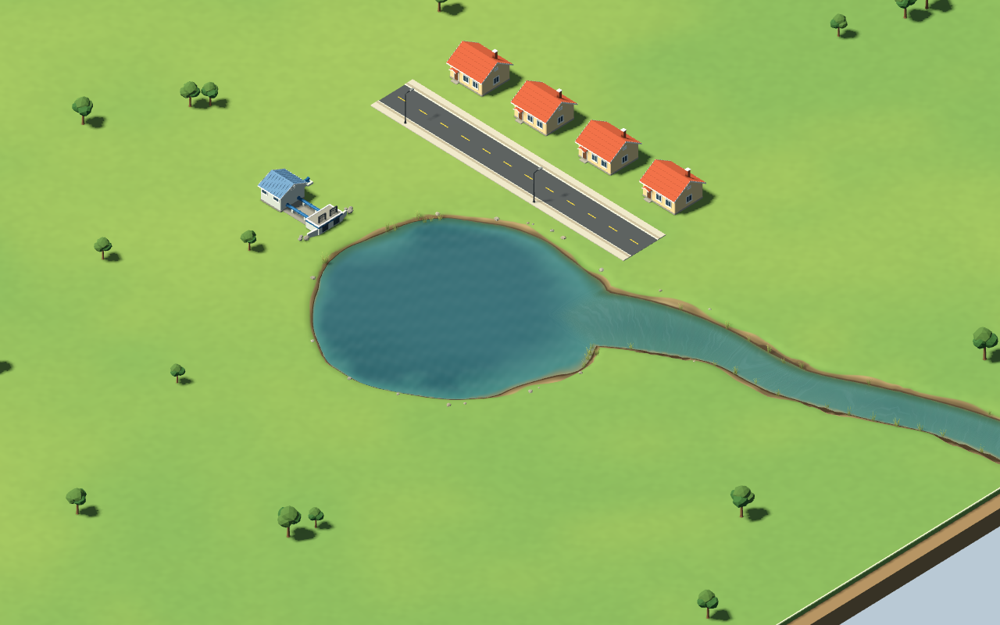

# IndexCities — Mundo, mapa, terreno e ambiente

> **Revisão humana:** PARCIALMENTE REVISADO.  
> **Auditoria:** classificação conservadora com base no estado anterior à reorganização temática, commit `4b97ace2`. o documento mistura conteúdo discutido/confirmado com pesquisa, síntese ou redação da IA ainda não revisada integralmente.
>

> **Status:** exploração ativa, com algumas decisões já promovidas para a SPEC — não é fonte de verdade.
>
> Reúne direção visual, geração e reprodutibilidade do mapa, terreno, vegetação, clima e decisões de representação física do espaço urbano. Decisões já oficiais devem ser lidas na SPEC.

## Como ler este documento

Este arquivo é material de exploração temática. Quando houver divergência, use:
- `docs/SPEC.md` para o produto desejado;
- `docs/ARCHITECTURE.md` para decisões estruturais de software;
- `AGENTS.md` para regras de trabalho e documentação.

## Integração do lago irregular — 2026-10-14

**Revisão humana desta seção: PENDENTE.** A direção de cidades novas com contorno irregular e relevo foi aprovada pelo responsável e registrada na SPEC antes da implementação original (`5ebd3f6`, na frente de estudo). A aprovação da direção não aprova a estética final. A entrega está na branch `Marlohn/recuperacao-v1-lago`, baseada na `main` que integrou as PRs #14 e #11; os estudos A/B/C/D permanecem separados dessa entrega.

O lago novo salva 128 vértices, usados pela água, pela validação de lotes/vias e pela distância de captação. Os mapas circulares continuam no esquema antigo, sem conversão. A malha e os materiais derivam da amostra D original do **Claude Opus 5.5**, com modelo/esforço `max` confirmados no Orca. O coordenador integrou picking sobre os triângulos renderizados, grade na superfície e apoio visual sob construções na margem (IA-023, **PENDENTE de revisão humana**), preservando as posições e obrigações reais. Não foi adicionado rio, recuo obrigatório, edição de terreno ou atividade fictícia.

**Evidência do coordenador:** 170 testes passaram na fonte final; 20 testes focados também passaram após as correções. Build Godot sem avisos/erros. Cenário renderizado nas seeds 42/1412/2877: área da água e vértices coincidem com o contorno, 240 projeções de clique sobre água/margens e pausa. Em cada seed, obras reais concluídas por caminhões/equipes, casa na margem com acesso, save/load e continuação de 20 minutos com JSON idêntico. Inclui três vistas próximas do contato do lote com a margem, em ângulo diagnóstico que não adiciona controle ao jogo. Uma cópia isolada da cidade humana com 200 habitantes manteve círculo, geografia e consultas de captação. Logs em `artifacts/verification/water-integrated`; execução final `rendered-7b96088a79b448dc843cfabad7002fde`.

Na janela nativa, o coordenador conferiu a prévia vermelha sobre água, a recusa do clique, Esc, G fora da construção, giro por E e salvamento pelo HUD. O JSON da simulação salvo permaneceu estruturalmente idêntico ao inicial, com duas edificações. A ferramenta nativa não ofereceu F5 nem arrasto direito; esses gestos não foram declarados testados nesta rodada. Os saves normais do jogador não foram usados como destino.

**Desempenho local:** em duas rodadas sequenciais de 15 segundos, a mesma cidade pequena (2 prédios, 126 nós viários, 1 morador), câmera e velocidade 60x ficou em aproximadamente 165 FPS, tanto na referência circular quanto no lago novo; intervalo médio de quadro 6,06 ms e p95 aproximadamente 6,31 ms. A referência foi uma cópia técnica do cenário convertida apenas para comparação, não uma migração de partida humana. A montagem final do lago novo levou 318–487 ms nas três seeds medidas. A comparação de FPS foi feita antes do último ajuste de variedade de contornos e continua limitada àquela cena salva. Não é certificação para cidades grandes, outras GPUs ou build exportada.

**Correções após a primeira revisão:** removida a repetição da forma a cada 97 seeds, usando os 32 bits do código para fases e amplitudes dentro do envelope anterior, sem consumir o RNG econômico. Contornos já salvos continuam iguais. As bases foram aproximadas do piso para reduzir o risco de fresta apontado pelo parecer, e a tabela de exploração foi corrigida. A descrição factual de JSON foi mantida na exploração, retirando a alteração canônica questionada. A grade segue sendo alinhamento, inclusive sobre a água, com a validade comunicada pela prévia; não foi inferida aprovação para mudar esse controle. Bases retangulares ainda podem parecer plataformas: as três vistas de contato ajudam a avaliação humana, sem afirmar aceitação estética.

**Revisão independente:** duas rodadas com **Claude Haiku 5.5**, modelo/esforço `high` efetivos confirmados nos recibos do Orca (`ctx_af010fc4e1eb` e `ctx_b3061a2105fc`), em fallback automático. O DeepSeek falhou com `MISSING_CREDENTIAL`; não foi confirmada falta de créditos. Na primeira rodada, o revisor executou 169 testes Release e sondas próprias: 2.580 retângulos, 64.500 consultas de distância e 720 trechos retos, sem divergências geométricas nos casos testados. Comparou um save humano de 200 moradores entre `main` e a entrega em seis checkpoints de 600 segundos, com hashes de simulação, colocação e captação idênticos. Na segunda, conferiu as correções, 10.000 contornos distintos e a preservação de um contorno salvo antes da calibração, além de repetir suas sondas de geometria e compatibilidade.

O Haiku **executou seu próprio cenário no Godot** na segunda rodada (`rendered-3c9bdc39dd1c442ba5931e3749caa3b1`, `INDEXCITIES_LAKE_RECOVERY_OK`, saída 0), após corrigir uma chamada que não havia iniciado o cenário por falta de `--`. A tentativa inválida foi preservada como tal, sem atribuir falha ao jogo. A montagem nessa rodada levou 539–760 ms; a variação não foi isolada como regressão. Nenhuma rodada encontrou achado alto/crítico. Permanecem abertos o julgamento estético das bases/água e a leitura da grade sobre a água. Exportação e cidades grandes não foram medidas. As vistas baixas são diagnósticas; mensagens residuais entre fixtures e o FPS durante inicialização/avanços em lote não avaliam a experiência humana. Relatórios locais: `water-integrated/independent-review/report.md` e `independent-recheck/report.md`. A reclamação de lago pouco real e a recuperação global continuam dependendo da partida humana.

Comparação técnica controlada, com a mesma cidade pequena, câmera e horário: referência circular e mapa novo. Não são uma migração da cidade do jogador. O FPS no rodapé dessas capturas inclui a inicialização e não representa a medição estabilizada acima.

## Estudo de água e margens após a partida — 2026-10-14

**Revisão humana desta seção: PENDENTE.** O responsável voltou a considerar rio/lago visualmente insatisfatórios após a integração dos materiais. O coordenador solicitou amostras originais ao **Claude Opus 5.5**, com esforço `max` confirmado no Orca; `ultracode` não é uma opção efetivamente disponível nesse runtime. O estudo está isolado na branch `Marlohn/recuperacao-v1-agua-estudo`, commit `01ef5f7`, sem alteração de gameplay ou integração ao jogo.

O código atual coloca a tampa do lago 9,5 cm acima do chão e usa um cilindro circular. A amostra A preserva a malha e pinta margens irregulares; a B apresenta uma bacia rebaixada e uma ligação a rio apenas na cena de assets. O coordenador conferiu imagens de dia, de noite e da margem de perto. A pintura de terra dentro da área circular bloqueada de A pode confundir o posicionamento, então não é recomendação de integração. B permanece proposta visual; não comprova captação, recursos, profundidade, fluxo ou operação urbana.

O Opus executou importação e renderização GL Compatibility com 29 capturas e validador com **1.593 verificações, zero falhas**. A comparação local de custo da prévia não mede FPS nem desempenho da cidade integrada; não foi executada build exportada ou testada outra GPU. O [README e os recursos do estudo](https://github.com/Marlohn/IndexCities/blob/01ef5f71fed550cbef286c2c647a58589c0ab39a/src/IndexCities.Godot/Assets/WaterStudy/README.md) registram dimensões, materiais, cenários e limitações. A avaliação estética humana continua pendente.

Antes de integrar uma geometria diferente, é necessário decidir sua relação com a área física de água, captação, validade das construções, mapas/saves existentes e eventual rio sem pontes na V1. Não há aprovação dessas mudanças nesta seção. A investigação visual deve ajudar a decidir com imagens; não transformar pintura de margem em prova de correção da experiência.

---

## Qualidade ambiental local — referência temática (2026-10-11)

> **Revisão humana desta seção: PARCIALMENTE REVISADO.** A direção 5C e seu recorte residencial enxuto foram aprovados na SPEC; cálculos, fontes e resultados de pesquisa continuam PENDENTES de validação.

A proposta antes descrita aqui foi consolidada no documento temático [**Qualidade ambiental local — gameplay, cálculo e performance**](local-environment-wellbeing.md). O modelo inicial prioriza vegetação/jardins reais no entorno de residências, influência local moderada e saturável, consulta de condição ambiental compartilhável pelos moradores e recálculo quando entradas reais mudarem. Não analisar cada decoração/trajeto por SIM ou por frame; não introduzir sistema de felicidade no Criativo por inferência. Fórmula, objetos elegíveis, renderização 3D e custos permanecem para calibração e medição no jogo integrado.

---

## Referência visual fornecida

> **Revisão humana desta seção:** PARCIALMENTE REVISADO — há decisão/discussão humana associada, mas o texto e/ou a pesquisa da IA não foram revisados integralmente.

**Status:** direção visual em exploração; a apresentação 3D isométrica já está confirmada na SPEC.

**Revisão humana desta nova análise visual: PENDENTE.** Foram fornecidas referências visuais e, posteriormente, **duas capturas de uma cena low-poly produzida por IA via código na Godot, em outro projeto**. Elas ajudam a avaliar linguagem visual, câmera, densidade e legibilidade, **mas não são assets implementados do IndexCities, nem prova de desempenho, medidas ou pipeline já aprovado**. A avaliação técnica está no [estudo de assets](asset-production-pipeline.md).

Características observáveis nas referências:

- visual 3D estilizado, com geometria simples e leitura limpa;
- câmera alta/isométrica capaz de mostrar simultaneamente ruas, calçadas, lotes e edifícios;
- edificações individuais claramente distinguíveis;
- escala urbana de bairro/cidade pequena, com casas, comércio de esquina, vegetação, mobiliário urbano e vias;
- prioridade para legibilidade visual em vez de realismo fotográfico;
- presença visível de detalhes urbanos como faixas de pedestre, postes, bancos, cercas, jardins e mesas externas;
- cidadãos e veículos aparecem em escala compatível com leitura individual.

As imagens são referência de exploração, não especificação dimensional. Medidas, grid, tamanho de lote, distância de câmera e densidade ainda precisam ser definidos e testados.

### Pipeline de assets

**Hipótese atual após o teste visual de 2026-10-11:** validar primeiro **IA criando geometria paramétrica na própria Godot**, gerar/salvar as variantes e reutilizá-las; **Blender e IA 3D externa ficam opcionais** para casos que não funcionarem bem por código. O formato, a escala detalhada, a gestão das malhas, LOD e desempenho ainda exigem teste. Esta é **pesquisa PENDENTE**, não ferramenta ou arquitetura aprovada. Ver [estudo de assets](asset-production-pipeline.md).

---

## Terreno, vegetação e alcance de serviços

> **Revisão humana desta seção:** PARCIALMENTE REVISADO — há decisão/discussão humana associada, mas o texto e/ou a pesquisa da IA não foram revisados integralmente.

**Status:** parcialmente decidido.

### Edição de terreno

**Adiada para o futuro.**

No escopo inicial, o jogador não precisa modificar relevo.

Razão prática: terraplanagem aumenta a complexidade de vários sistemas ao mesmo tempo, incluindo:

- colocação de edifícios;
- vias e inclinações;
- navegação;
- água;
- colisões;
- visual;
- geração/validação do mapa.

A decisão pode ser reavaliada depois que construção, vias, água e terreno-base estiverem estáveis.

### Vegetação

Direção decidida:

- vegetação deve ter presença visual forte;
- árvores e outros elementos naturais podem ser removidos para construção;
- variedade, densidade e integração com ruas/lotes devem receber atenção visual.

**Atualização:** 5C e o recorte inicial de vegetação próxima às moradias estão na SPEC; fórmula, alcance, catálogo e medição continuam em [pesquisa temática própria](local-environment-wellbeing.md), sem bônus automático por árvore.

### Parques, amenidades e serviços

O modelo de alcance e influência ainda está em pesquisa. A seção específica **"Alcance, influência e escolha de serviços"** contém a comparação atual entre raio rígido, heurística de influência, custo de viagem e modelos híbridos.

### Poluição sonora

**Fora do escopo atual.**

Pode ser reavaliada futuramente caso ruído se prove relevante para bem-estar, moradia ou valor imobiliário.

---

---

## Geração de mapa e reprodutibilidade

> **Revisão humana desta seção:** PARCIALMENTE REVISADO — há decisão/discussão humana associada, mas o texto e/ou a pesquisa da IA não foram revisados integralmente.

**Status:** estrutura decidida; algoritmo ainda em exploração.

Decidido:

- seed determinística;
- mesma seed deve reproduzir o mesmo mapa-base;
- seed será ferramenta importante de debug, teste e reprodução de bugs;
- terreno inicial já inclui natureza e conexão externa;
- sem compra de tiles/áreas no escopo atual;
- borda fixa no início.

Ainda precisa ser definido:

- geração da base plana do mapa;
- distribuição de vegetação;
- geração de rio/lago;
- posição e quantidade de conexões externas;
- tamanho do mapa;
- como versionar a geração para que uma mesma seed continue reproduzível quando o algoritmo mudar.

### Observação importante para debug

Se o algoritmo de geração evoluir, apenas guardar a seed pode não ser suficiente para reproduzir mapas antigos. Uma solução futura pode exigir armazenar também a **versão do gerador** ou serializar o mapa resultante no save. Isso deve ser considerado quando a implementação começar.

---

---

## Terreno plano no escopo inicial

> **Revisão humana desta seção:** PARCIALMENTE REVISADO — há decisão/discussão humana associada, mas o texto e/ou a pesquisa da IA não foram revisados integralmente.

**Status:** decidido.

O mapa inicial do IndexCities será plano.

Consequências para o escopo atual:

- não há morros ou variações relevantes de elevação;
- não é necessário resolver inclinação de ruas ou prédios nesta fase;
- edição de terreno continua adiada;
- rios e lagos podem existir em um terreno essencialmente plano;
- pontes e outras estruturas que dependam de desnível devem ser avaliadas separadamente, sem assumir relevo acidentado.

Essa decisão reduz complexidade de construção, pathfinding, geração de mapa e validação durante as primeiras fases do projeto.

---

---

## Construção híbrida: grid lógico + liberdade de posicionamento

> **Revisão humana desta seção:** PARCIALMENTE REVISADO — há decisão/discussão humana associada, mas o texto e/ou a pesquisa da IA não foram revisados integralmente.

**Status:** **direção de produto decidida na SPEC em 2026-10-08** (alternativa C: grade lógica com posicionamento assistido). A geometria exata, os detalhes de snapping e o custo de consultas espaciais seguem em validação no jogo integrado, sem POC isolada obrigatória.

> **Revisão humana desta seção:** PARCIALMENTE REVISADO — o responsável escolheu explicitamente o modelo híbrido; evidências comparativas, hipóteses de implementação e análise de riscos redigidas pela IA permanecem sem revisão integral.

A escolha rejeita tanto o **encaixe visual rigidamente limitado a células completas** quanto o **posicionamento inteiramente livre como obrigação**. A grade fornece referência lógica para ocupação/consultas espaciais, enquanto a interface oferece encaixes úteis com alguma liberdade de ajuste. A ocupação efetiva, colisões, acessos viários, conexões e demais restrições físicas continuam vinculantes. A confirmação de uma obra não pode depender apenas de alinhamento visual. A rua ortogonal em L, a proibição de ligação direta de edifícios a rodovias e os viadutos em níveis separados permanecem definidos pela SPEC.

**Trade-offs aceitos:** menor rigidez para o jogador e layouts mais variados, ao custo de validar footprints e acessos que podem não coincidir exatamente com células de grade. A implementação deve evitar geometria arbitrária difícil de diagnosticar, rechecagens globais contínuas e falsa conexão visual. A divisão da grade em células menores para mobiliário/detalhes de rua é uma hipótese técnica, **não requisito do produto**.

### Evidência comparativa

Farthest Frontier começou com construção em grid por razões estratégicas e, em 2026, adicionou posicionamento livre em 360° após feedback recorrente dos jogadores. O jogo manteve a possibilidade de alternar entre modo livre e grid durante a colocação. Algumas estruturas continuam presas ao grid por causa das restrições do pathfinding.

Fontes:
- Crate Entertainment — Free-Build Mode: https://forums.crateentertainment.com/t/v1-1-patch-preview/152189
- Crate Entertainment — v1.1.0: https://forums.crateentertainment.com/t/farthest-frontier-v1-1-0/153834
- Godot 4.5 — GridMap: https://docs.godotengine.org/en/4.5/classes/class_gridmap.html

### Hipóteses técnicas a verificar na implementação integrada

A **existência de grade lógica e o posicionamento assistido já foram decididos**; os mecanismos abaixo seguem como possibilidades, sem aprovação individual de cada item.

Testar:
- uma **grade lógica interna** para ocupação, colisão, lotes e consultas espaciais;
- posicionamento visual com alguma liberdade;
- snap opcional a borda da rua, alinhamento com vizinhos, linhas/células da grade e ângulos úteis;
- possibilidade de mostrar/ocultar a grade como ajuda visual.

### Riscos a medir na validação integrada

- footprints irregulares;
- gaps visuais;
- colisão entre construções;
- conexão correta com calçada/rua;
- estacionamento e pontos de carga;
- pathfinding de pedestres;
- performance das consultas espaciais;
- clareza do feedback de posicionamento.

---

---

## Clima e ambiente sazonal

> **Revisão humana desta seção:** PARCIALMENTE REVISADO — há decisão/discussão humana associada, mas o texto e/ou a pesquisa da IA não foram revisados integralmente.

**Status:** documentado para futuro; fora do escopo atual.

Tópicos preservados para reavaliação futura:

- chuva;
- temperatura;
- estações do ano;
- efeitos climáticos sobre a cidade;
- chuva forte e alagamentos;
- impactos de alagamento no trânsito e em edificações;
- aumento de risco de incêndio em períodos secos/quentes;
- variação de consumo de energia com frio/calor;
- redução de disponibilidade de água em períodos secos.

Nenhum desses sistemas deve ser implementado no escopo atual. Devem ser revisitados quando a simulação básica de mobilidade, serviços urbanos, energia, água e emergências estiver estável.

---
