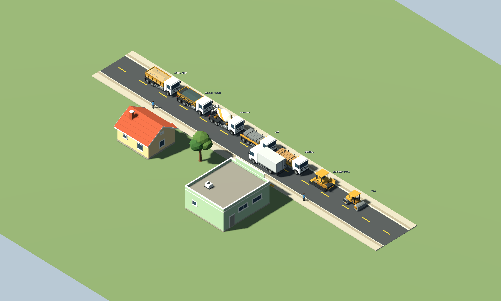
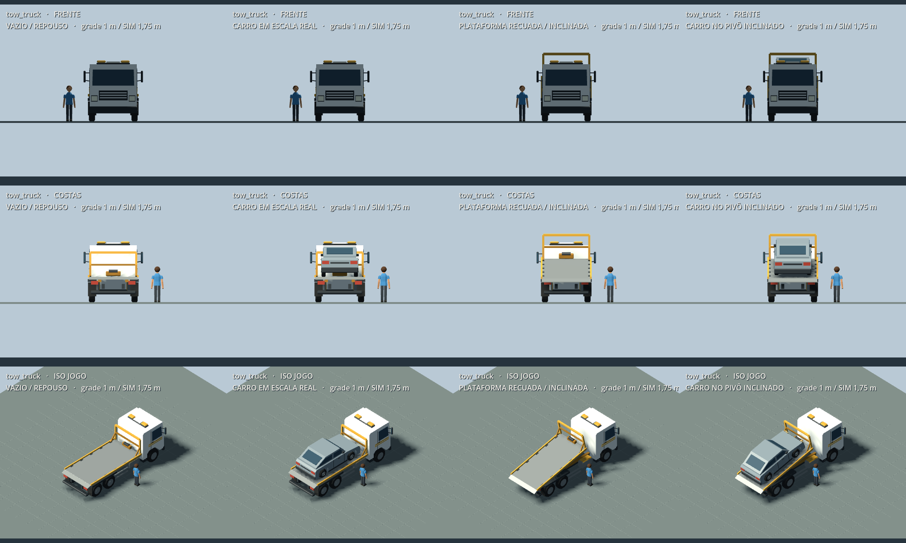

# Construction — caminhões e pavimentação

Arte 3D autoral do IndexCities, preparada em GPT-6.1-Sol com esforço xhigh (confirmado pelo terminal Orca). Estética final **PENDENTE de revisão humana**. Fonte editável em `Source/`; cenas e malhas são derivadas, sem scripts de runtime, física ou autoplay. Usa somente o kit e materiais do próprio projeto V1, sem modificar essa família. Não usa imagens como malhas nem recursos externos.

Contrato: metros, Y para cima, frente −Z, raiz no solo/centro. Carrocerias permanecem no retorno vazio. O host controla as cargas, quantidades e movimentos reais. Todas as cargas e coberturas vêm **ocultas**. Os nomes abaixo são estáveis; caminhos relativos à raiz de cada cena.

| Cena em `Scenes/` | Partes para o host |
| --- | --- |
| `vehicle.truck_dump.a.tscn` | `BedPivot/Bed`; `BedPivot/TailgatePivot/Tailgate`; `BedPivot/LoadSandGravel`; `BedPivot/LoadAsphalt`; `BedPivot/Cover`; `HydraulicBase`; `HydraulicRod`; `Wheel_FL/FR/ML/MR/RL/RR` |
| `vehicle.truck_mixer.a.tscn` | `DrumMount/Drum`; `ChutePivot/Chute`; `Wheel_FL/FR/ML/MR/RL/RR` |
| `vehicle.truck_flatbed.a.tscn` | `LoadSteel`; `LoadWood`; `Wheel_FL/FR/ML/MR/RL/RR` |
| `vehicle.tow_truck.a.tscn` | `DeckPivot/Deck`; `DeckPivot/CarryAnchor` (`Marker3D`); `RecoveryFrame`; `Wheel_FL/FR/ML/MR/RL/RR` |
| `vehicle.asphalt_paver.a.tscn` | `HopperLeftPivot/Wing`; `HopperRightPivot/Wing`; `HopperLoad`; `ScreedPivot/Screed`; `TrackLeft`; `TrackRight` |
| `vehicle.road_roller.a.tscn` | `FrontSteering/FrontDrum`; `RearDrum`; `FrontSteering` |

Basculante: `BedPivot.rotation.x` positivo levanta a frente da caçamba; tampa traseira abre com X negativo. Cargas são filhas da caçamba. `Cover` usa lona escura com abertura traseira que permite reconhecer o asfalto escuro; não ligar em areia/brita. Retirar a lona antes de bascular. Cilindro hidráulico tem dois nós para o host ajustar entre os pontos `HydraulicAnchor` e `BedPivot/HydraulicTarget`.

Betoneira: `DrumMount` contém a inclinação fixa do eixo; girar `DrumMount/Drum.rotation.z` no eixo local do tambor. O tambor é carroceria, não carga visual e não desaparece quando vazio. `ChutePivot.rotation.y` direciona a calha; giro não significa entrega real por si.

Guincho (`vehicle.tow_truck.a`): plataforma metálica baixa, cabeceira aberta com guincho, guias laterais, cabine branca com faixas ocre e giroflex âmbar **apagado e não emissivo**. `DeckPivot` em repouso fica em `(0, 1.15, 2.9)`; X positivo levanta a frente (−Z) em relação à traseira e Z positivo desliza a plataforma para trás. A pose de revisão usa posição `(0, 1.15, 3.5)` e X=12°, ilustrando somente o início do basculamento/deslizamento; não representa rampa totalmente abaixada, ciclo completo, prazo ou animação automática. O piso fica acima dos para-lamas nessa pose.

`DeckPivot/CarryAnchor` fica no centro da plataforma, no piso: posição local `(0, 0.09, -1.815)`, portanto `(0, 1.24, 1.085)` em relação à raiz no repouso. O host prende o **veículo real** a esse nó com transformação local identidade (raiz do veículo no solo, frente −Z e escala original). O marcador acompanha a plataforma ao inclinar/deslizar. A cena entregue vem vazia. O carro de passeio atual (`Assets/V1/Scenes/vehicle.car_passenger.a.tscn`, 4,20 × 1,86 m incluindo retrovisores) cabe no piso útil de X `−1.14..1.14`, Z `−1.10..3.27`, Y `1.24`, sem encostar na cabeceira/guincho. O caminhão de carga atual de 7,20 m **não cabe inteiro** nesta plataforma compacta de 4,93 m; seu modo de transporte pertence à integração e não deve ser representado reduzindo o modelo ou afirmando encaixe inexistente. Esse limite foi comunicado ao coordenador.

Rodas: eixo X local, rolagem rumo −Z = ângulo negativo, raio 0,47 m. Dianteiras podem esterçar em Y. Pavimentadora: asas do funil giram em Z, mesa em X; em repouso `ScreedPivot.position.y = 0.50`, em trabalho `0.42` com rotação X zero (contato no solo). Esteiras são peças independentes, sem animação embutida. Rolo: cilindros giram em X (raio 0,5885 m); esterço dianteiro em Y. Poses de operação constam no manifesto e na ferramenta de validação, sem impor limites à simulação.

Quantidade: os pivôs de `BedPivot/LoadSandGravel` e `BedPivot/LoadAsphalt` ficam na base interna da caçamba (Y local 0,14); `LoadSteel`/`LoadWood` no piso Y=1,32 e `HopperLoad` na base Y=0,84. O host pode ajustar `scale.y` desses nós à quantidade real, sem escalar a carroceria. Esconder a carga quando vazia; no concreto o recipiente permanece fechado, sem massa de concreto visual fictícia.

`Candidate_*` são apenas referências visuais, não acessos funcionais. Não há trabalhador figurante. Materiais não emitem luz. Malhas agrupam detalhes por material, com recursos compartilhados entre rodas.

Aplicação dos princípios: a apresentação distingue materiais e execução sem cliques novos, espera extra ou estados econômicos adicionais; silhuetas dão feedback a quem constrói sem ler. SIMs e empresas só são afetados pelas regras já existentes no host. Cargas ocultas e ausência de autoplay evitam atividade fictícia e mantêm a causa no estado real. Classificação: apresentação de logística automática e da ação de construção já aprovada; nenhuma política ou configuração do jogador nova.

Base de produto: `docs/spec/materiais-logistica.md` (Caminhões reconhecíveis pelo material) e `docs/spec/construcao.md` (Pavimentação física das ruas), decisão humana de 2026-10-16. O guincho é amostra de arte solicitada em 2026-10-18 para o socorro externo a veículos sem combustível; as regras canônicas e a integração em `docs/spec/transporte-circulacao.md` são responsabilidade da frente de simulação. A amostra torna o resgate reconhecível sem cliques, espera ou política nova; SIMs e empresas só são afetados por seu veículo e deslocamento reais no host. Não expõe configuração do jogador nem inventa transporte. Esta documentação de arte não substitui a SPEC.





Regeneração a partir da raiz do repositório (Godot 4.7.2 mono descoberta pelo `scripts/Play.ps1`):

```powershell
$engine = 'C:/Users/Marlohn/Tools/Godot/Godot_v4.7.2-stable_mono_win64_console.exe'
& $engine --headless --path src/IndexCities.Godot --script res://Assets/Construction/Source/build_construction.gd
& $engine --headless --path src/IndexCities.Godot --script res://Assets/Construction/Source/verify_construction.gd -- --validate-only
& $engine --path src/IndexCities.Godot --rendering-method gl_compatibility --resolution 2000x1200 --position 20,20 --script res://Assets/Construction/Source/verify_construction.gd
```

O terceiro comando exige janela real. Gera 16 capturas principais e um detalhe da betoneira em `artifacts/verification/construction-models`, além de uma cena de prancha em `Preview/construction_board.tscn`. Inclui `sheet_tow_truck.png`, os detalhes do carro sobre a plataforma (frente/costas) e a pose inclinada do guincho. As cargas e o carro visíveis nessas capturas são ilustrações de autoria, não uma cidade simulada; a prancha urbana existente preserva suas sete amostras de construção. A ferramenta usa câmera ortográfica na direção `(300,330,300)`, luz e ambiente iguais aos do host atual. Nenhum save é lido ou escrito pela ferramenta de assets. Cópias permanentes das capturas úteis, medições e relato ficam em `Preview/`.

Medição da geometria final (superfícies somadas por instância, inclusive as rodas; “todos” inclui cargas alternativas ocultas, que não devem aparecer simultaneamente):

| Família | Triângulos vazio / todos | Superfícies vazio / todos | MeshInstances totais | Envelope repouso X × Y × Z (m) |
| --- | ---: | ---: | ---: | --- |
| Basculante | 2.522 / 3.502 | 25 / 30 | 14 | 2,90 × 2,78 × 7,20 |
| Betoneira | 2.778 / 2.778 | 27 / 27 | 10 | 2,90 × 3,28 × 7,20 |
| Carroceria aberta | 2.374 / 3.898 | 23 / 29 | 10 | 2,90 × 2,78 × 7,20 |
| Guincho | 2.750 / 2.750 | 27 / 27 | 9 | 2,90 × 2,97 × 7,20 |
| Pavimentadora | 1.358 / 1.372 | 16 / 17 | 7 | 2,54 × 2,84 × 4,62 |
| Rolo | 952 / 952 | 14 / 14 | 4 | 2,32 × 2,71 × 3,97 |

Cada malha tem até 7 superfícies. Rodas reutilizam um recurso; os dois cilindros do rolo compartilham outro. A medição do preview em GL Compatibility/RTX 3050 registrou 641 chamadas e 57.096 primitivas na prancha urbana inteira, e 57 chamadas/3.060 primitivas no detalhe da pavimentadora. São contadores globais de render com cenário, rótulos e sombras, não o custo isolado do asset nem benchmark de partida. Não foram medidos FPS, tempo de GPU, LOD ou frota numerosa.

Validação do guincho em 2026-10-18: geração das seis famílias, build do host (zero erros; aviso CS8629 já presente em `Main.ProblemAlertsQA.cs:198`, arquivo não alterado), importação real, lista de 35 cenários de QA, `INDEXCITIES_SMOKE_OK buildings=0 roads=17`, 677 verificações de recursos/contrato sem falhas e render real das pranchas em GL Compatibility/RTX 3050, janela Windows 2000 × 1200. Inclui encaixe do carro original, marcador no piso e folga da plataforma inclinada sobre os para-lamas. O smoke usou saves isolados no caminho absoluto de `artifacts/verification/construction-models/smoke-saves`. Logs detalhados em `artifacts/verification/construction-models`. Revisão independente da arte em andamento; a ligação ao estado real da simulação fica com o coordenador. Build Windows exportada, ciclo completo de embarque e avaliação humana da estética continuam pendentes. Não declarar esta amostra como experiência integrada aprovada.
