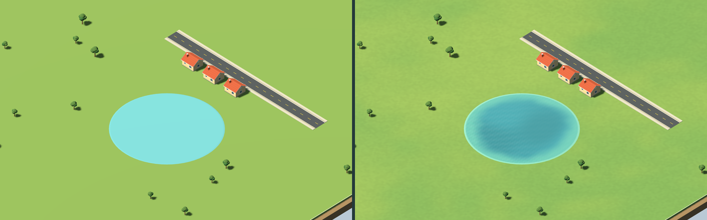
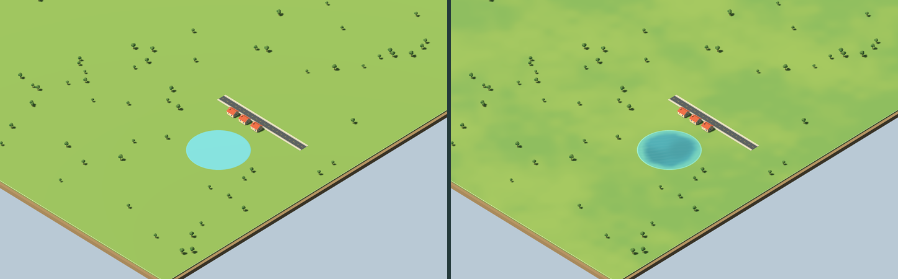
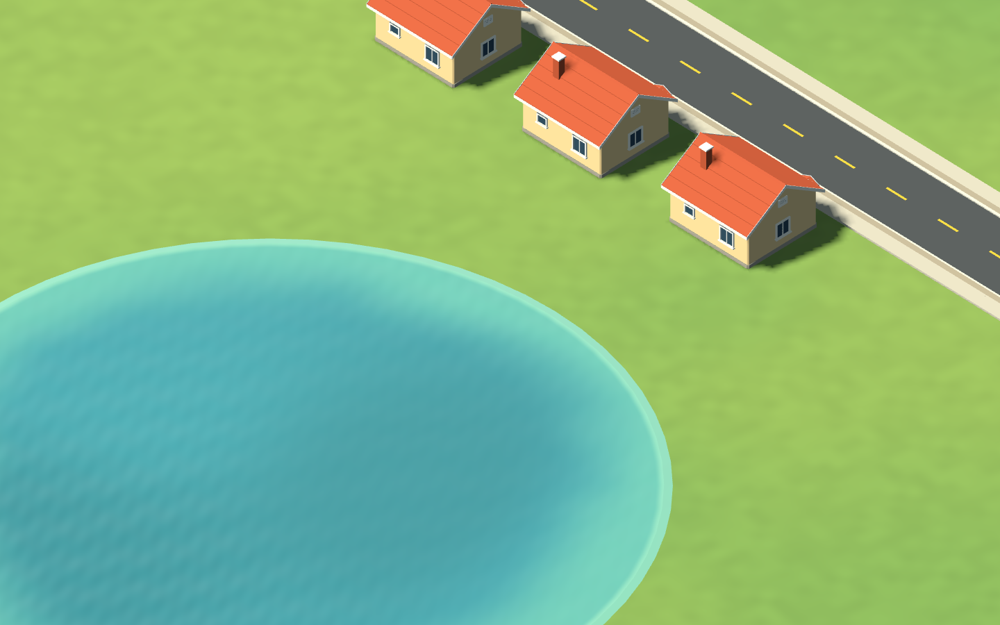
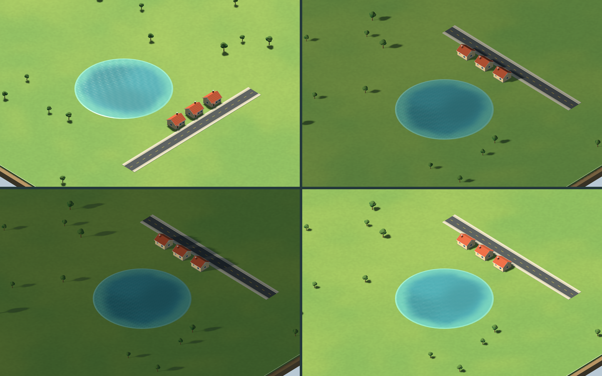

# IndexCities — amostra RecoveryEnvironment (grama e água)

> **Revisão humana: PENDENTE.** Esta amostra foi feita pela frente de assets (IA), a pedido do coordenador, para a recuperação visual da V1. Cores, intensidades, ondulação e todas as medidas são **propostas a revisar**. Este README documenta a entrega e não é fonte de verdade. O comportamento do jogo é definido pela [`docs/SPEC.md`](../../../../docs/SPEC.md).
>
> **Só estética.** A água não representa nível, vazão, captação, capacidade, produção, consumo, qualidade nem profundidade. A grama não representa bioma, fertilidade, umidade, obstáculo, zona, lote nem valor do terreno. Nenhum dos dois materiais cria regra, estado, opção ou consequência. Também não mudam a silhueta, o nível, o raio nem o picking/colisão do lago. **Materiais integrados pelo Codex em 2026-10-13**, conforme a decisão provisória IA-020 da SPEC; estética ainda pendente de avaliação humana.

O host mantém a ondulação em tempo decorativo de apresentação, com cadência igual nas velocidades do jogo e fase imóvel na pausa. A fase é local ao material da cidade e não é estado lógico de save. O lago mantém o contorno circular anterior; esta integração não declara resolvida a naturalidade do corpo d'água como um todo. A prévia abaixo continua sendo uma amostra de autoria, não uma partida.



## 1. Pedido atendido

- **Grama:** material `env_grass_soft` com variação de cor suave e determinística em coordenadas de mundo. A cor média é a mesma do chão atual do jogo (`#7d9b52`).
- **Água:** material `env_lake_water`, natural, com ondulação discreta, para a malha atual do lago:
  - faixa rasa clara de largura irregular junto à margem;
  - fundo quase uniforme com manchas suaves;
  - ondulação animada só no sombreamento, sem deslocar vértices.
- **Prévia:** cena com a **mesma câmera, luz e ambiente** do `Main.cs`, e o chão, a saia de terra, o lago e a borda do mapa com as **mesmas medidas** do `CityWorld.cs`. Serve para comparar antes e depois no mesmo ângulo.
- **Fonte:** gerador, validador e script de captura originais em GDScript.
- **Imagens:** capturas reais na Godot 4.7.2, no renderizador GL Compatibility do jogo.

## 2. Inventário

| Arquivo | O que é | Tamanho |
| --- | --- | ---: |
| `Shaders/env_grass_soft.gdshader` | Shader espacial da grama, opaco, sem texturas | 5,2 KB |
| `Shaders/env_lake_water.gdshader` | Shader espacial da água, opaco, sem texturas | 9,9 KB |
| `Materials/env_grass_soft.tres` | `ShaderMaterial` só com o shader (os padrões ficam no shader) | 239 B |
| `Materials/env_lake_water.tres` | idem | 239 B |
| `Preview/recovery_environment_preview.tscn` | Cena de prévia (vitrine; não é partida) | 77 KB |
| `Preview/Captures/` | Capturas e `render_report.json`. Tem `.gdignore`, então a Godot não importa | 2,7 MB |
| `Source/build_recovery_environment.gd` | Gerador dos `.tres` e da cena de prévia | — |
| `Source/validate_recovery_environment.gd` | Validador headless | — |
| `Source/render_recovery_environment.gd` | Capturas (precisa de janela) | — |
| `*.uid` | UIDs criados pela própria Godot na importação | — |

**Sem texturas:** nenhuma imagem é usada pelos materiais. A variação vem de ruído de valor calculado no shader.

## 3. Compatibilidade

- **Godot 4.7.2 mono** (`Godot_v4.7.2-stable_mono_win64`).
- **Renderizador GL Compatibility** (`gl_compatibility`, driver `opengl3`), o mesmo do `project.godot` do jogo.
- **Capturas em:** OpenGL 3.3.0, NVIDIA 546.18, GeForce RTX 3050 6 GB Laptop, Windows 11.
- **Recursos usados nos shaders:**
  - uniforms comuns, varyings, `uint` com literais hexadecimais, `fwidth`, `round` e `TIME`;
  - `VIEW_MATRIX`, `INV_VIEW_MATRIX` e `VIEW` no fragmento;
  - `MODEL_MATRIX` só no `vertex()`.
- **Recursos não usados:** textura de tela ou profundidade, `ALPHA`, `EMISSION`, `light()`, `render_mode`, `instance uniform` e `global uniform`.
- **Opacos:** não entram na fila de transparência.
- **Sombreamento:** sem `render_mode`, os shaders usam os mesmos modos padrão de difuso e especular do `StandardMaterial3D` atual. Recebem sombras e seguem o ciclo dia/noite pela luz do jogo.
- **Forward+, Mobile, GPUs AMD/Intel e build exportada: não testados.**

## 4. Unidades, dimensões e premissas

- **Unidades:** metros, Y para cima, plano XZ. Os dois padrões dependem só da posição no **mundo**: não mudam com a câmera, a hora ou a seed, e continuam sem emenda entre malhas vizinhas.
- **Chão do jogo:** `BoxMesh` de 512 × 1 × 512 m em y = −0,56, com o topo em −0,06. O shader não altera a malha.
- **Lago do jogo:** `CylinderMesh` com `top_radius` = R, `bottom_radius` = R + 1, `height` = 0,15 e 64 segmentos, em y = −0,04. A tampa fica em +0,035, e o talude visível vai até cerca de R + 0,63 m.
  - Na simulação, R varia de 28 a 40 m. Na seed 42, o centro é (152,61; 86,04) e R = 28,38 m (valor recalculado aqui com o mesmo xorshift64* da simulação).
  - O shader **não precisa de parâmetro do host**:
    - na tampa em leque, um varying que vale 0 no vértice central e 1 na borda dá d/R, então R ≈ d / v (erro < 0,2 %);
    - o talude lateral conta como margem.
  - **Se o lago deixar de ser essa malha**, revise essa parte (ou passe a usar um uniform de raio).
- **Escalas da grama:**
  - manchas grandes de ~56 m (em duas oitavas, a segunda com ~26 m);
  - manchas médias de ~12 m;
  - granulado de 1,2 m, só na luminância (±2,5 %).
- **Escalas da água:**
  - faixa rasa de ~3,2 m, com a borda interna irregular em ±2,6 m;
  - cor de fundo completa a ~9 m da margem;
  - manchas do fundo de ~21 m;
  - ondas de 4,3 / 2,7 / 1,75 / 1,15 m;
  - rajadas de ~17 m que derivam devagar.
- **Anti-cintilação:** cada escala menor que ~8 px na tela é atenuada com `fwidth` e some por volta de ~3 px. Com zoom afastado, granulado e ondas pequenas desaparecem sozinhos.
- **Tempo da água:** as frequências fecham um número inteiro de ciclos em 3600 s (o *rollover* padrão de `TIME`), então não há salto quando o relógio do shader reinicia. Se `rendering/limits/time/time_rollover_secs` mudar, o salto pode reaparecer.

## 5. Parâmetros (padrões no shader)

**Grama (`env_grass_soft`)**

| Uniform | Padrão | Função |
| --- | --- | --- |
| `base_color` | `#7d9b52` | Cor média, igual ao chão atual. Com `variation` = 0, o resultado é exatamente essa cor lisa (o granulado continua, ±2,5 %) |
| `warm_tint` / `cool_tint` | `#86a054` / `#6c9452` | Extremos da variação: um pouco mais quente e um pouco mais fria/profunda |
| `variation` | 0,7 | Intensidade da variação de cor |
| `patch_size_m` / `detail_size_m` | 56 / 12 | Tamanho das manchas em m |
| `grain_size_m` / `grain_strength` | 1,2 / 0,025 | Granulado fino de luminância |
| `roughness_value` | 0,85 | Igual ao material atual |

**Água (`env_lake_water`)**

| Uniform | Padrão | Função |
| --- | --- | --- |
| `deep_color` / `shallow_color` / `shore_color` | `#3b8898` / `#5aa59e` / `#79b9a8` | Fundo, faixa rasa e linha rente à borda |
| `sky_color` | `#b9c9d5` | Cor “refletida” (o fundo do ambiente do jogo), misturada por Fresnel suave |
| `shallow_width_m` / `deep_distance_m` | 3,2 / 9 | Largura da faixa rasa e distância em que o fundo se completa |
| `shore_line_m` / `edge_wobble_m` | 0,6 / 2,6 | Linha clara na borda e irregularidade da faixa rasa (só cor) |
| `deep_variation` | 0,6 | Manchas escuras irregulares no fundo |
| `ripple_strength` / `ripple_speed` / `wind_angle_deg` | 1 / 0,55 / 35 | Ondulação; 0 desliga |
| `facet_size_m` | 0 | **Alternativa low-poly** (normal constante por triângulo de ~N m). 0 = suave |
| `reflection_strength` / `reflection_power` | 0,6 / 1,8 | Fresnel estilizado |
| `roughness_value` / `specular_value` | 0,3 / 0,28 | Brilho do sol, suavizado para a câmera virada ao sol |
| `host_time_s` | −1 | < 0: usa `TIME`. ≥ 0: tempo fornecido pelo host (por exemplo, para parar no pause). Passe `fmod(segundos, 3600)` |

## 6. Capturas

Todas foram feitas em GL Compatibility, viewport de 1440 × 900 (o do projeto) com MSAA 4x (o do `Main`), câmera do jogo (ortogonal, foco + (300, 330, 300) girado pelo yaw) e sol pela fórmula horária do `Main`. A água usa `host_time_s` fixo para a captura ser reproduzível.

- `env_compare_z110_h10.png`: antes e depois lado a lado (imagem do topo).
- `env_before_z110_h10.png` e `env_after_z110_h10.png`: os dois quadros em resolução cheia.
- `env_compare_z250_h10.png`: zoom 250, antes e depois.
- `env_after_z45_shore_h10.png`: close da margem com casas e rua V1.
- `env_variants_sheet.png`: folha 2 × 2 com câmera girada para 135° (lado do sol), 17:00, 21:00 (noite) e a **alternativa facetada** (`facet_size_m` = 2, não é o padrão).
- `env_motion_strip.png`: o mesmo recorte do lago em 0, 0,4 e 0,8 s.







## 7. Sugestão de integração (para o Codex; não executada)

1. No `CityWorld.Reset`, troque só o `MaterialOverride` de duas malhas, sem mudar malha, posição, raio ou altura:
   - chão: `GD.Load<Material>("res://Assets/RecoveryEnvironment/Materials/env_grass_soft.tres")` no lugar de `Material("7d9b52")`;
   - lago: `GD.Load<Material>("res://Assets/RecoveryEnvironment/Materials/env_lake_water.tres")` no lugar de `Material("6bb3bd")`.

   Se o `load` falhar, pode manter a cor plana atual como reserva.
2. Mantenha o `CylinderMesh` do lago como está (tampa em leque, talude R → R + 1). É ele que dá ao shader a distância até a margem.
3. **Pausa:** por padrão, a ondulação anda com o tempo real do motor, inclusive com o jogo pausado. Para parar no pause, o host pode alimentar `host_time_s`.
   - Essa é uma escolha de apresentação, a ser decidida pelo coordenador ou pelo responsável.
   - Se virar comportamento do jogo, o registro na SPEC segue o fluxo do `AGENTS.md`.
4. Confira, no jogo integrado, a leitura dos contornos de prévia (verde, âmbar e vermelho), dos canteiros e dos textos sobre a grama com variação.
5. **Exportação:** sugere-se excluir `Assets/RecoveryEnvironment/Source/*` e `Assets/RecoveryEnvironment/Preview/*` do preset. São ferramentas e documentação.

## 8. Como regenerar, validar e capturar

A raiz `res://` é `src/IndexCities.Godot`.

```sh
# Gerar materiais .tres e a cena de prévia (headless):
godot --headless --path src/IndexCities.Godot --script res://Assets/RecoveryEnvironment/Source/build_recovery_environment.gd
# Validar (headless):
godot --headless --path src/IndexCities.Godot --script res://Assets/RecoveryEnvironment/Source/validate_recovery_environment.gd
# Capturas finais (precisa de janela; não usar --headless):
godot --path src/IndexCities.Godot --script res://Assets/RecoveryEnvironment/Source/render_recovery_environment.gd -- --final
# Variantes de calibragem, fora do repositório:
godot --path src/IndexCities.Godot --script res://Assets/RecoveryEnvironment/Source/render_recovery_environment.gd -- --calib --out=<pasta>
```

- **O que é derivado:** os `.tres` e a cena são gerados pelo gerador. Para mudar algo, edite os shaders ou o gerador e rode de novo.
- **Pastas em uso:** o gerador e as capturas escrevem só dentro desta pasta. A cena de prévia instancia, sem alterar, `vegetation.tree_broadleaf.a`, `road.urban_1x1.a.straight` e `residential.small_house.a` do pacote `Assets/V1`.

## 9. Checks executados (2026-10-13)

- **Validador headless** no projeto real (`--path src/IndexCities.Godot`): `[validate] 136 checks, 0 falhas`, exit 0 (23 arquivos na pasta, 2,8 MB, quase tudo capturas). Ele confere:
  - compilação dos dois shaders no parser da Godot e os uniforms esperados;
  - ausência de textura, tela/profundidade, `ALPHA`, `EMISSION`, `light()` e atribuição a `VERTEX`, `NORMAL` ou `POSITION` no `vertex()`;
  - padrões da grama iguais ao material atual;
  - materiais sem parâmetros duplicados;
  - câmera, sol e ambiente da prévia iguais aos do `Main.cs`;
  - chão e lago com as medidas do `CityWorld.cs`;
  - cena sem script, física, animação ou luz extra;
  - distribuição do hash: média, desvio e correlação vizinha em 6 sais;
  - pasta sem imagem importável fora de `Preview/Captures`.
- **Limite do headless:** ele não compila o GLSL na GPU. Isso foi coberto pelas capturas com janela, sem nenhum `SHADER ERROR` no log.
- **Importação headless do projeto real** (`--import`): exit 0, sem erros nem avisos.
  - Num worktree sem `.godot/`, a importação regrava os 27 `.import` de `Assets/V1` com fim de linha LF. O conteúdo é idêntico; só muda o EOL.
  - Restaurei esses arquivos com `git checkout`. Ninguém editou nada no V1.
  - Os `*.uid` desta pasta nasceram nessa importação.
- **Cena de prévia aberta headless** no projeto real por 60 quadros (`--quit-after 60`): exit 0, sem erros.
- **Capturas com janela**, liberadas pelo coordenador:
  - Para não roubar o foco da janela de jogo dele, rodaram num **projeto temporário fora do repositório**, cujas pastas `Assets/RecoveryEnvironment` e `Assets/V1` são *junctions* para as pastas reais (`res://` resolve igual).
  - O projeto temporário tem as mesmas configurações de render do jogo (`gl_compatibility`, 1440 × 900) e uma janela pequena com `no_focus`.
  - O `project.godot` do repositório não foi editado.
- **Custo medido** (quadro inteiro, 1440 × 900, MSAA 4x, RTX 3050, média de 2 × 90 quadros alternando antes e depois):

  | Vista | GPU antes | GPU depois |
  | --- | ---: | ---: |
  | Zoom 110 | 1,49 ms | 1,57 ms |
  | Lago ocupando a tela (zoom 45) | 1,27 ms | 1,54 ms |

  - A CPU ficou praticamente igual (+0,03 ms).
  - É medição local indicativa, não benchmark: não houve teste em hardware fraco.
- **Movimento da água** no mesmo recorte (soma RGB por pixel, de 0 a 765):

  | Intervalo | Média | Máximo |
  | --- | ---: | ---: |
  | 0,4 s | 3,6 | 20 |
  | 0,8 s | 5,9 | 30 |

  A ondulação é perceptível de perto, sem cintilar.
- **Revisão visual:** fiz três rodadas de calibragem com captura. As correções principais foram:
  - o fundo escuro centralizado parecia um “olho”;
  - as listras de onda paralelas foram trocadas por frentes curvas;
  - o tom da faixa rasa era menta demais;
  - a grama tinha amarelo demais;
  - o brilho do sol aparecia com a câmera virada para ele.

  **Não houve revisão adversarial independente.**

## 10. Não verificado e decisões em aberto

**Não verificado:**

- integração no jogo real (HUD, prévias coloridas, ciclo dia/noite contínuo);
- outras GPUs, Forward+ ou Mobile, build exportada para Windows e hardware fraco;
- abertura no editor com interface (só houve importação headless);
- legibilidade com quem ainda não lê.

**A decidir** (coordenador ou responsável):

1. **Estética:** intensidade da variação da grama, cores da água e a linha clara da margem. Tudo PENDENTE.
2. **Água suave (padrão) ou facetada** (`facet_size_m` ≈ 2): a facetada conversa mais com o low-poly do V1, e a suave parece mais natural.
3. **Ondulação no pause:** veja §7.3.
4. **Variação por seed:** o padrão da grama é o mesmo em todo mapa (depende só da posição). Variar por seed exigiria um deslocamento vindo do host. Não implementei.

## 11. Origem e autoria

- **Autoria:** shaders, gerador, validador e script de captura são originais, escritos para este pedido.
- **Técnicas:** ruído de valor com hash inteiro próprio, Fresnel estilizado e dispersão de águas profundas, todas implementadas do zero.
- **Nada copiado:** nenhum código, textura, modelo ou arquivo de projetos anteriores ou da internet foi consultado, copiado ou baixado.
- **Modelo:** Claude Opus 5.5 (`claude-opus-5-5`) no Claude Code, com esforço de raciocínio **max**, como o coordenador pediu.
- **Ultracode:** o `AGENTS.md` pede `ultracode`, mas essa opção não está disponível nesta CLI e não foi usada.
- **Execução:** sem subagentes e sem workflows.
