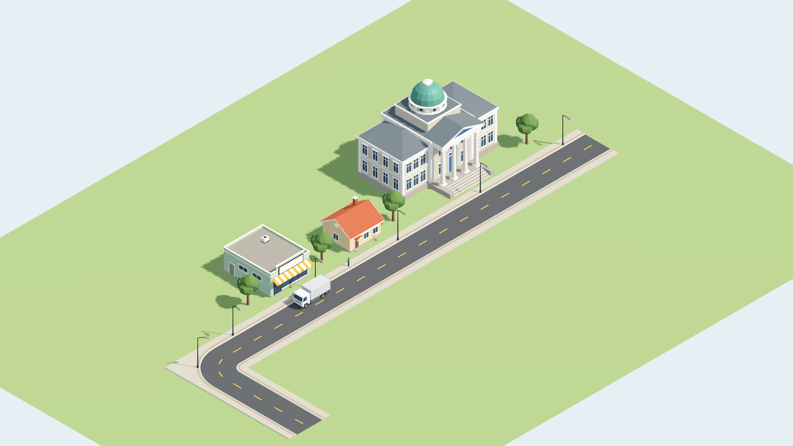
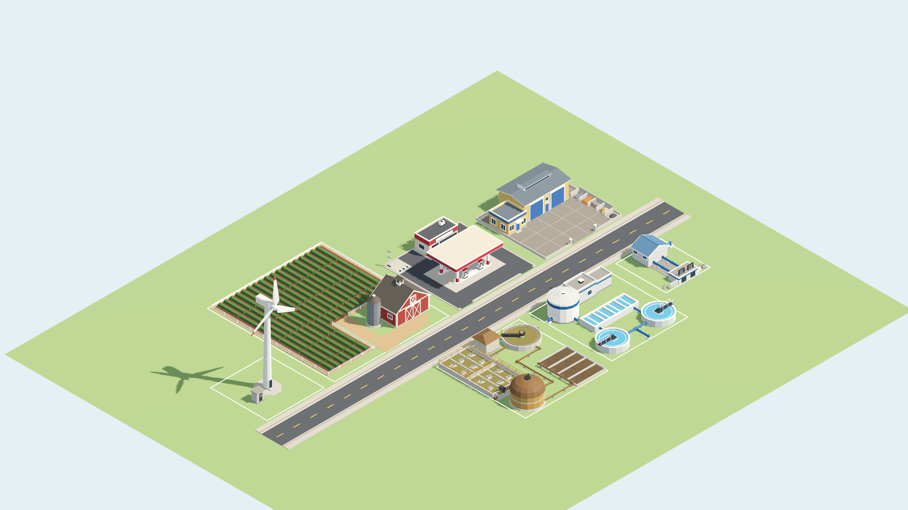

# IndexCities — amostra visual V1 (assets)

> **Revisão humana: PENDENTE.** Estética (estilo low-poly, paleta, silhuetas), todas as **medidas propostas**, pivôs, envelopes e **marcadores/conectores candidatos** desta pasta são propostas da frente de assets (IA) para **compatibilização com o integrador (Codex)**. Nada aqui aprova footprint, lote, acesso funcional, capacidade, custo, escala de gameplay ou comportamento. A autorização de comportamento é a [`docs/SPEC.md`](../../../../docs/SPEC.md); este README é documentação de entrega, não fonte de verdade.

Pedido atendido: primeira amostra **original e editável** de arte 3D isométrica para o catálogo V1 aprovado — **Prefeitura, casa simples, mercearia pequena, trecho de rua urbana 1+1 (reta, esquina em L, calçadas, poste), uma árvore, SIM pedestre e caminhão de carga** — com uma variante por família, ícones/miniaturas dos três prédios e prancha de revisão.

**Segunda onda (2026-10-12):** as sete funções restantes da V1 — Pátio de Obras, fazenda pequena, posto, captação de água, tratamento de água, tratamento de esgoto e energia eólica — estão na [§12](#12-segunda-onda-2026-10-12--funções-restantes-do-catálogo-v1). Com elas, os **10 tipos de construção do catálogo** têm cena, ícone SVG e miniatura PNG.



As imagens em `Preview/Captures/` e `Thumbnails/` são **capturas reais da Godot 4.7.2** (renderizador Forward+, Vulkan). A composição da prancha é uma vitrine arbitrária: **não é uma partida**, não povoa o jogo e não define lotes, recuos, acessos ou tráfego. O SIM e o caminhão aparecem parados como peças de escala.

## 1. Inventário

| Família (VisualId) | Cena | Raiz | Nós para o host | Triângulos | Superfícies | Envelope visual X × Y × Z (m) |
| --- | --- | --- | --- | ---: | ---: | --- |
| `civic.city_hall.a` — Prefeitura | `Scenes/civic.city_hall.a.tscn` | `CityHall` | `Body`, `Candidate_PedestrianEntry` | 3 790 | 7 | 24,6 × 17,94 × 17,8 |
| `residential.small_house.a` — casa simples | `Scenes/residential.small_house.a.tscn` | `SmallHouse` | `Body`, `Candidate_PedestrianEntry` | 790 | 6 | 8,78 × 6,57 × 8,59 |
| `commercial.grocery_small.a` — mercearia pequena | `Scenes/commercial.grocery_small.a.tscn` | `GrocerySmall` | `Body`, `Sign/SignPanel`, `Sign/SignText` (Label3D vazio), `Candidate_PedestrianEntry`, `Candidate_CargoPoint` | 832 | 7 + 2 | 10,4 × 6,15 × 13,5 |
| `road.urban_1x1.a` — peça reta | `Scenes/road.urban_1x1.a.straight.tscn` | `RoadUrban1x1Straight` | `Body`, `Connector_West`, `Connector_East`, `Candidate_LampSlot` | 70 | 5 | 10,5 × 0,18 × 10,5 |
| `road.urban_1x1.a` — esquina em L | `Scenes/road.urban_1x1.a.corner_l.tscn` | `RoadUrban1x1CornerL` | `Body`, `Connector_West`, `Connector_North`, `Candidate_LampSlot` | 314 | 5 | 10,5 × 0,18 × 10,5 |
| `road.urban_1x1.a` — poste | `Scenes/road.urban_1x1.a.lamp.tscn` | `StreetLamp` | `Body`, `LampGlass`, `Candidate_LightSource` | 192 | 2 + 1 | 0,42 × 6,68 × 2,25 |
| `vegetation.tree_broadleaf.a` — árvore | `Scenes/vegetation.tree_broadleaf.a.tscn` | `TreeBroadleaf` | `Body` | 312 | 3 | 4,40 × 6,49 × 4,38 |
| `agent.sim_pedestrian.a` — SIM pedestre | `Scenes/agent.sim_pedestrian.a.tscn` | `SimPedestrian` | `Rig/Hips/{Torso,Head,ArmL,ArmR,LegL,LegR}`, `AnimationPlayer` (`idle`, `walk`) | 606 | 9 | 0,64 × 1,75 × 0,36 |
| `vehicle.truck_cargo.a` — caminhão de carga | `Scenes/vehicle.truck_cargo.a.tscn` | `TruckCargo` | `Body`, `Wheel_FL/FR/RL/RR` (malha compartilhada), `Candidate_CargoDoor` | 1 992 | 7 + 4 × 2 | 2,90 × 3,30 × 7,20 |
| `vehicle.car_passenger.a` — carro de passeio compacto (candidato; revisão PENDENTE) | `Scenes/vehicle.car_passenger.a.tscn` | `CarPassenger` | `Body`, `Wheel_FL/FR/RL/RR` (malha compartilhada) | 1 200 | 5 + 4 × 2 | 1,86 × 1,48 × 4,20 |

Os números vêm do último build completo (`manifest.v1.json`). O envelope é a caixa da malha visível; ele inclui beirais, escadas, toldo, retrovisores etc. e **não é footprint**.

**Pastas**

- `Scenes/` — cenas `.tscn` (texto, sem scripts). `Meshes/` — `ArrayMesh` `.tres` gerados (uma superfície por material). `Materials/` — `StandardMaterial3D` `.tres` compartilhados.
- `Source/` — **fonte editável**: `kit/` (construtor de malhas, paleta, contexto do gerador, previews finais), `recipes/` (uma receita GDScript por família + prancha), `build_v1_assets.gd`, `render_v1_previews.gd`, `validate_v1_assets.gd`, `make_v1_icons.gd`.
- `Icons/` — ícones SVG 128 × 128, sem texto, dos **10 tipos de construção**. `Thumbnails/` — 16 miniaturas PNG 512 × 512 com fundo transparente (10 construções e 6 outras peças).
- `Preview/v1_sample_board.tscn` e `Preview/v1_wave2_board.tscn` — cenas de revisão (abrem no editor); a segunda desenha os lotes do host. `Preview/Captures/` — prancha, close, vista dos fundos, lineup, folha de contato, paleta SVG, relatório de medição. Tem `.gdignore`; o editor não importa.
- `manifest.v1.json` — envelope, marcadores (posição e *forward*), malhas, superfícies, triângulos, medidas propostas e partes, por cena.

## 2. Convenções técnicas candidatas

- **Y para cima. 1 unidade = 1 metro** (convenção técnica da amostra, não escala de gameplay aprovada).
- **Fachada candidata voltada a −Z.** Pivô no solo (y = 0). Nos prédios, o pivô fica no centro do corpo principal em XZ, sem escadas, toldos ou degraus.
- Raiz `Node3D` com metadados `visual_id`, `asset_status` (contém “PENDENTE”), `visual_envelope_min` e `visual_envelope_size`.
- Marcadores `Marker3D` `Candidate_*` e `Connector_*`: o **−Z local aponta para o *forward*** (por exemplo, para fora da porta). Eles são **candidatos**. Um detalhe desenhado ou um marcador não é acesso funcional.
- O nome do slot é o nome do material e o nome da superfície. Variante de cor = trocar material por superfície (`set_surface_override_material`), sem regenerar a malha.
- Nenhum material emissivo é aplicado por padrão. Não há scripts, luzes, colisão, física, partículas, timers nem `AnimationPlayer` com autoplay.

## 3. Contrato de nós por família (para o host)

- **Prefeitura.** Malha única estática em 7 superfícies: `plinth_stone`, `trim_white`, `civic_stone`, `civic_roof`, `glass_dark`, `civic_accent`, `civic_dome`. Silhueta: embasamento, alas de dois pavimentos, pavilhão central, pórtico com 4 colunas e frontão (tímpano azul), ático, tambor e cúpula pátina com lanternim. Não tem relógio, bandeira, texto nem símbolo.
- **Casa simples.** Malha única em 6 superfícies: `plinth_stone`, `house_wall`, `house_roof`, `trim_white`, `wood_door`, `glass_dark`. A porta fica fora do centro, no lado +X da fachada, com marquise e degrau. Não tem garagem, cerca, jardim nem janela acesa.
- **Mercearia pequena.** `Body` em 7 superfícies (`plinth_stone`, `shop_wall`, `concrete_dark`, `trim_white`, `metal_dark`, `glass_dark`, `shop_awning`).
  - **`Sign`** é um nó substituível ou removível. Contém `SignPanel` (painel liso `shop_sign_blank`) e `SignText` (Label3D com **texto vazio**, voltado a −Z), que a integração preenche com o nome da **empresa real operadora**.
  - Não há nome, logo, pictograma de ramo nem mercadoria à mostra, para que o mesmo modelo-base possa abrigar outro ramo.
  - A porta de serviço fica na lateral +X, com `Candidate_CargoPoint` (*forward* +X).
- **Rua 1+1.** Cada peça é uma malha única em 5 superfícies (`road_asphalt`, `road_curb`, `road_sidewalk_service`, `road_sidewalk`, `road_marking_yellow`).
  - Reta: ao longo de X, com conectores em ±5,25 (*forward* ±X).
  - Esquina: liga as bordas −X e −Z (`Connector_West`, `Connector_North`). O asfalto é um quarto de coroa centrado em (−5,25; 0; −5,25), com raios de 2,0 a 8,5.
  - `Candidate_LampSlot` marca onde um poste caberia; a quantidade e o espaçamento ficam com a integração.
- **Poste.** `Body` (`metal_dark`, `metal_light`) e **`LampGlass` separado** com `road_lamp_glass_off`.
  - O material **`road_lamp_glass_on`** (emissivo) acompanha a família, mas **não está aplicado**. A integração só troca para ele com noite efetiva **e** energia realmente atendida (regra da SPEC).
  - `Candidate_LightSource` fica no difusor, com *forward* −Y. Não há `Light3D`.
- **Árvore.** Malha única em 3 superfícies: `tree_bark`, `tree_foliage`, `tree_foliage_dark`. É candidata a MultiMesh por região (não medido).
- **SIM.** O host move e gira a raiz `SimPedestrian`.
  - `ArmL/ArmR` e `LegL/LegR` têm pivô no ombro e no quadril e giram em X local. As malhas `.arm` e `.leg` são compartilhadas.
  - O `AnimationPlayer` contém `idle` (pose neutra) e `walk` (loop de 1,0 s, avanço geométrico estimado de 1,58 m por ciclo, ainda não calibrado). Não há autoplay: o host só toca a animação quando um SIM real anda ou para.
  - Os slots `sim_skin`, `sim_hair`, `sim_top`, `sim_bottom` e `sim_shoes` podem variar por SIM via override por parte. Nenhuma regra de diversidade é decidida aqui.
- **Caminhão.** O `Body` tem 7 superfícies; o baú é liso, sem marca, e as portas traseiras são fechadas.
  - As rodas `Wheel_*` compartilham uma malha, com origem no centro do eixo: eixo dianteiro em z = −2,55 e traseiro em z = +1,75; bitola de 1,96 m; raio de 0,47 m.
  - Rolagem: rotação em X local; andar para −Z equivale a ângulo negativo (−distância ÷ raio). Esterço das rodas dianteiras: compor `Basis(Y, esterço) * Basis(X, rolagem)`.
  - Faróis e lanternas não são emissivos. `Candidate_CargoDoor` fica em z = +3,90, com *forward* +Z.
- **Carro de passeio** (`vehicle.car_passenger.a`, candidato PENDENTE). Mesmo contrato do caminhão: frente em −Z, pivô no solo no centro do veículo, `Body` + `Wheel_FL/FR/RL/RR` com malha compartilhada (raio 0,30 m, largura 0,20 m, bitola 1,58 m, eixos em z = ∓1,30).
  - A pintura é a superfície própria **`car_paint`** do `Body`; o host varia a cor com `set_surface_override_material` usando `car_paint_red`, `car_paint_blue`, `car_paint_white`, `car_paint_yellow` ou `car_paint_green` (em `Materials/`, prefixo `car_`). A cor de cada veículo não é decidida aqui.
  - Demais superfícies do `Body`: `glass_dark`, `metal_dark`, `car_headlight_off` e `car_taillight` (não emissivos). Sem interior, placa, marca ou texto, e sem marcadores candidatos.
  - Miniatura gerada com `render_v1_previews.gd -- --thumb=res://Assets/V1/Scenes/vehicle.car_passenger.a.tscn`; o carro ainda não consta da prancha, do lineup nem da folha de contato.

## 4. Medidas propostas e conectores (CANDIDATOS)

| Item | Proposta | Observação para compatibilizar |
| --- | --- | --- |
| Rua 1+1 | 2 × 3,25 m de asfalto + calçadas de 2,0 m = **10,5 m**. Meio-fio de 0,15 m. Topo do asfalto em y 0,03 e da calçada em y 0,18 | Calçada paginada (só visual): meio-fio 0,20 + faixa de serviço 0,50 + faixa livre 1,30 m, tomando a NBR 9050 como referência de proporção. Módulo reto de 10,5 m; esquina de 10,5 × 10,5 m. A calçada fica 18 cm acima do lote em y = 0 (degrau). Nível de lote e rampas ficam com a integração |
| Linha central | Amarela tracejada (traço de 2,0 m, período de 5,25 m na reta) | No arco de ~8,25 m, traço e período são escalados na mesma proporção. Outros comprimentos de reta só mantêm o ritmo em múltiplos de 5,25 m (a receita avisa) |
| Esquina | A calçada externa é “o restante” do quadrado (~45 m² pavimentados) | Decidir se o lote de esquina ocupa essa cunha |
| Poste | Haste de 6,5 m, braço de 1,6 m sobre a pista, eixo a 0,45 m da face do meio-fio | Slots só no lado +Z da reta e no meio do arco; o espaçamento real é da integração |
| Prefeitura | Embasamento de 24,5 × 15,2 m e 1,0 m de altura. Escadaria avança 2,6 m. Cornija das alas em 8,8 m, frontão em 12,05 m, cúpula em 17,1 m, lanternim em 17,94 m | O eixo da cúpula fica em z = +1,15 (não no pivô). Contados a partir da porta, pórtico + escada avançam 5,2 m. O embasamento de 1 m foge do guia (0,2–0,45 m) e põe a porta 1 m acima do solo; a representação de acessibilidade/rampa **não** é decidida no asset |
| Casa | Corpo de 8 × 7 m, paredes de 3,1 m sobre plinto de 0,3 m, cumeeira em 5,98 m, chaminé em 6,57 m | — |
| Mercearia | Corpo de 10 × 12 m, parede de 4,4 m + platibanda de 0,5 m, letreiro até 5,78 m, toldo de 1,3 m | A porta de serviço em +X pode ficar bloqueada num lote de meio de quadra; talvez seja preciso variante espelhada ou porta nos fundos (espelhamento por escala −1 não foi testado) |
| Árvore | 6,5 m de altura, copa de ~4,3 m, altura livre de 2,9 m | Junto ao meio-fio, a copa invade a pista e corta visualmente o baú do caminhão (3,3 m); diante de fachadas, pode cobrir portas. Opções: altura livre ≥ 3,4 m, recuo visual mínimo ou variante menor |
| SIM | 1,75 m; quadril em 0,88 m; ombros de 0,57 m | Cabeça levemente aumentada para leitura isométrica |
| Caminhão | 7,2 × 2,45 m (2,9 m com retrovisores) × 3,3 m; entre-eixos de 4,3 m | Caminhão genérico para materiais ou mercadorias |

## 5. Paleta e estilo (CANDIDATOS)

Low-poly facetado (normais por face): volumes chanfrados, molduras e beirais salientes, vidros escuros sem interior. Cada família tem um acento próprio para quem ainda não lê: **cúpula pátina** (Prefeitura), **telhado cerâmico** (casa) e **toldo ocre listrado** (mercearia).

Paleta completa com hex em `Preview/Captures/v1_palette.svg`. Desvios das sugestões iniciais, todos reversíveis e pendentes:

- `civic_stone` #c9c1af: mais fria, para separar da parede da casa e do `trim_white`.
- `civic_accent` #3a62a0: separa a porta do vidro.
- `shop_wall` #a9c6a6.
- `shop_awning` ocre #d39b35, no lugar do verde-azulado, que repetia o matiz da cúpula.
- `road_sidewalk`, `road_curb` e `road_sidewalk_service` mais escuros.
- `road_lamp_glass_off` cinza #8d918f: o quase branco parecia aceso de dia.
- Folhagem da árvore mais escura.

Os materiais exclusivos usam prefixo por família (`civic_`, `house_`, `shop_`, `road_`, `tree_`, `sim_`, `truck_`). O prefixo `tree_` é genérico: reservá-lo a esta família ou renomear antes de criar uma segunda árvore.

## 6. Ícones, miniaturas e prancha

- `Icons/civic.city_hall.a.svg`, `Icons/residential.small_house.a.svg`, `Icons/commercial.grocery_small.a.svg`: vetoriais, sem texto. São gerados por `Source/make_v1_icons.gd` com blocos simplificados projetados na **mesma câmera isométrica** das miniaturas e com as cores lidas dos materiais. São versões simplificadas (por exemplo, a cúpula do ícone tem menos facetas que o modelo), não capturas.
- `Thumbnails/<visual_id>.png`: capturas Godot 512 × 512 com fundo transparente das 9 peças.
- `Preview/Captures/v1_contact_sheet.png`: prancha com conjunto, miniaturas rotuladas, lineup e paleta. Também em `Preview/Captures/`:
  - `v1_board_iso.png` e `v1_board_iso_back.png` (conjunto em isométrico, de frente e dos fundos);
  - `v1_board_closeup.png` (close);
  - `v1_lineup_front.png` (elevação com grade de 1 m e figura de 1,75 m).
- No isométrico das miniaturas e da prancha, a fachada −Z é a face clara à direita e o lado +X fica à esquerda.

## 7. Fonte editável e origem

Toda a geometria nasce de **receitas GDScript originais** (`Source/recipes/*.gd`) sobre primitivas próprias do kit (`Source/kit/mesh_builder.gd`: caixa chanfrada, telhados, troncos de cone, icosfera determinística, extrusão etc.). Nenhum modelo, textura, código ou arquivo de projetos anteriores ou da internet foi consultado, copiado, portado ou baixado. Não há texturas. O único recurso de terceiros usado é a fonte padrão embutida da Godot, nos `Label3D` e nos rótulos da folha de contato.

Malhas, cenas, materiais, miniaturas, capturas e o manifesto são **derivados**: para alterar algo, edite a receita (ou `kit/palette.gd` para materiais compartilhados) e regenere. Editar à mão um `.tscn` ou `.tres` gerado é perdido na próxima geração.

## 8. Como regenerar

Os caminhos assumem a raiz `res://` = `src/IndexCities.Godot`. Godot usada: `C:/Users/Marlohn/Tools/Godot/Godot_v4.7.2-stable_mono_win64_console.exe`.

```sh
# Gerar tudo (materiais, malhas, cenas, prancha e manifest.v1.json):
godot --headless --path src/IndexCities.Godot --script res://Assets/V1/Source/build_v1_assets.gd
#   -- --only=commercial_grocery_small   (só as receitas cujo nome de arquivo começa assim; funde as entradas no manifesto sem tocar nas demais)
#   -- --force-palette                   (regrava os materiais compartilhados de kit/palette.gd)
# Validar o contrato (headless):
godot --headless --path src/IndexCities.Godot --script res://Assets/V1/Source/validate_v1_assets.gd
# Ícones SVG (headless):
godot --headless --path src/IndexCities.Godot --script res://Assets/V1/Source/make_v1_icons.gd
# Capturas finais e miniaturas (precisa de renderização real, sem --headless):
godot --path src/IndexCities.Godot --script res://Assets/V1/Source/render_v1_previews.gd -- --final
#   -- --final-wave2   (refaz só as capturas e miniaturas da segunda onda)
# Depois de regenerar ícones ou miniaturas, atualize o cache de importação do projeto:
godot --headless --path src/IndexCities.Godot --import
# Folha de revisão de uma cena (4 vistas, grade, figura de 1,75 m, marcadores em magenta):
godot --path src/IndexCities.Godot --script res://Assets/V1/Source/render_v1_previews.gd -- --review=res://Assets/V1/Scenes/<id>.tscn --out=<pasta>
```

## 9. Instruções de integração (sugestões para o Codex)

1. Resolver `VisualId` → `res://Assets/V1/Scenes/<arquivo>.tscn` (veja `manifest.v1.json`). As peças da rua compartilham `road.urban_1x1.a` e se distinguem pelo campo `piece`.
2. Referenciar partes **por nome ou caminho** (`Sign/SignText`, `LampGlass`, `Wheel_FL`, `AnimationPlayer`, `Candidate_*`). A Godot 4.7 grava `unique_id` novos nos nós a **cada regeneração** e não expõe isso a scripts. Evite *editable children* e overrides dependentes desses IDs.
3. **Letreiro:** `SignText.text` = nome da empresa operadora real; vazio sem operador. Para trocar a identidade visual, substitua o nó `Sign` inteiro ou faça override da superfície `shop_awning`. A cor do toldo como identidade **não foi decidida**.
4. **Poste:** `LampGlass.material_override = load("res://Assets/V1/Materials/road_lamp_glass_on.tres")` somente com estado real de noite e energia atendida. Uma luz de cena, se houver, fica a cargo do host (use `Candidate_LightSource`).
5. **SIM:** `play("walk")` ou `play("idle")` conforme o estado real. Ajuste `speed_scale` pela velocidade simulada (referência: 1,58 m por ciclo).
6. **Escala:** usar a peça em escala 1 preserva a relação com o SIM e o caminhão. Escalar uniformemente ao lote do catálogo (como o `CityWorld.cs` atual faz) muda a escala humana de portas e degraus; o lote final ainda não está compatibilizado.
7. **Renderizador:** o projeto usa **GL Compatibility**. A amostra renderiza corretamente nele (geometria, materiais, Label3D e marcadores conferidos), mas sob a mesma luz do preview as cores saem **mais claras/lavadas** que no Forward+. Calibre a energia da luz e a exposição do ambiente real do jogo antes de julgar a paleta.
8. **Exportação:** sugere-se excluir `Assets/V1/Source/*` e `Assets/V1/Preview/*` do preset de exportação; são ferramentas e documentação.

## 10. Checks realmente executados

Todos foram rodados com Godot 4.7.2 mono num **projeto temporário fora do repositório** (scratchpad), cuja pasta `Assets/V1` aponta para esta pasta. Assim `res://Assets/V1/...` resolve exatamente como na raiz `src/IndexCities.Godot`. O `project.godot` do repositório não foi criado, aberto nem editado por esta frente.

- **Build completo headless:** `[build] OK (8 famílias, 9 cenas)`, exit 0, gerando o manifesto e a prancha.
- **Validador headless** (`validate_v1_assets.gd`): carrega e instancia as 9 cenas e a prancha, resolvendo todas as dependências. Confere nós esperados, metadados de ID, envelope e status PENDENTE, ausência de script, luz, física e autoplay, as animações `idle` e `walk`, malhas e materiais externos em `Meshes/` e `Materials/`, nenhum material aplicado emissivo, `SignText` vazio e rodas com malha compartilhada. Resultado do último run em §10.1.
- **Capturas Forward+** (Vulkan, RTX 3050): prancha, close, fundos, lineup, 9 miniaturas e folha de contato, todas inspecionadas visualmente.
- **Captura GL Compatibility** (OpenGL 3.3) da prancha e da mercearia: renderiza corretamente, com as cores mais claras descritas em §9.7.
- **Medição local sintética** (`Preview/Captures/render_report.json`, viewport 1920 × 1080, Forward+, RTX 3050). Não é benchmark do jogo: não houve medição em GL Compatibility nem no hardware-alvo.
  - Prancha: 137 objetos visíveis, 11,5 mil primitivas, **62 draw calls** visíveis e 117 de sombra, ~1,9 ms de GPU.
  - Grade de 400 casas + 400 árvores (3 600 objetos, 441 mil primitivas): **36 draw calls**, ~3,2 ms de GPU. Instâncias da mesma malha e material são agrupadas pela Godot.
- **Revisão adversarial por agentes**, com uma lente de conformidade (SPEC e briefing) e outra de direção de arte:
  - Prefeitura e rua: passaram nas duas lentes, só com achados *minor*. A maioria foi aplicada (cornija sem faces coplanares, pilastras retiradas atrás das colunas, bocel nos degraus, topo ≤ 18 m, cores, paginação da calçada e tracejado do arco).
  - Árvore: corrigida e verificada de forma independente.
  - **Casa, mercearia, SIM e caminhão:** a revisão por agentes não chegou a rodar (limite de uso). Esses modelos foram revisados só pela coordenação da frente de assets, com as folhas de 4 vistas e o validador. Não houve revisão adversarial independente.
- **Ícones:** SVG rasterizados pela própria Godot a 256 px e a 640 px e inspecionados.

### 10.1 Último run do validador

Na entrega da amostra 1: `[validate] 499 checks, 0 falhas` (9 cenas e a prancha). Último run, após a onda 2: `[validate] 1044 checks, 0 falhas` (exit 0; 16 cenas e 2 pranchas).

## 11. Não verificado / pendências

- Carregamento no **projeto real do Codex** (editor, importação, C#), em **build exportada para Windows** e com a câmera, a luz, o ciclo dia/noite e as sombras reais do jogo.
- Seleção e picking, colisão, estados visuais (prévia válida/inválida, obra, selecionado, sem acesso/insumo): **não produzidos nesta amostra**.
- Animação `walk` em movimento real: há leve deslizamento do pé e uma oscilação de −1,8 mm; a velocidade não foi calibrada.
- MultiMesh, LOD e HLOD não foram criados nem medidos. A cintilação das cruzes de caixilho da Prefeitura em pan não foi verificada (uma LOD economizaria ~2,4 mil triângulos).
- Espelhamento da mercearia (escala X −1) não foi testado.
- Encaixe real com o grid, os lotes e o traçado da integração. Pontos de §4 a decidir pelo Codex ou pelo responsável:
  - cunha da esquina;
  - degrau de 18 cm da calçada;
  - slots de poste;
  - porta de serviço;
  - árvore × caminhão;
  - referência de pivô da Prefeitura;
  - embasamento de 1 m.
- **Estética, paleta e todas as medidas: revisão humana PENDENTE.**

## 12. Segunda onda (2026-10-12) — funções restantes do catálogo V1

> **Revisão humana: PENDENTE** (estética, medidas, posições de marcadores, estados visuais). Com esta onda, as dez construções do catálogo V1 têm cena, malhas, materiais, fonte editável, ícone SVG e miniatura PNG. A amostra anterior **não foi regenerada**: suas cenas e malhas continuam as mesmas, e seus ícones saíram idênticos byte a byte.



A prancha `Preview/v1_wave2_board.tscn` mostra cada instalação dentro do **contorno do lote lógico do host** (`Model.cs`). A fileira do outro lado da rua está girada 180° para conferir a rotação. Nas capturas, os nós `State_*` estão ligados só para ilustrar.

### 12.1 Contrato adicional da onda 2

- **Pivô no CENTRO do lote**, no solo. A fachada e o acesso principal ficam voltados a −Z, perto de `z = −D/2` (como `Building.Door` no host).
- **O envelope inteiro cabe no lote**: `x ∈ [−W/2, W/2]` e `z ∈ [−D/2, D/2]`, contando também os estados ocultos e o disco do rotor. O gerador falha se exceder, e o validador confere. Como o host só reduz modelos maiores que o lote, estas cenas entram em escala 1. O lote fica gravado no metadado `lot_candidate_m`.
- **Estado é do host.** Estoque, cultivo e água/efluente em processo ficam em nós `State_*` (Node3D) com `visible = false` por padrão. O host liga cada um a partir de estado REAL. O manifesto lista os `state_nodes` de cada cena.
- **Partes móveis** (rotor, nacele, ponte do decantador) são nós separados com pivô no eixo. Não há `AnimationPlayer` nem autoplay.

### 12.2 Inventário

| Família (VisualId) | Lote X × Z (m) | Raiz | Nós para o host | Triângulos | Envelope X × Y × Z (m) |
| --- | --- | --- | --- | ---: | --- |
| `civic.works_depot.a` — Pátio de Obras | 24 × 22 | `WorksDepot` | `Body`; `State_Stock/{SandGravel, Concrete, Steel, Wood, Asphalt}`; `Candidate_PedestrianEntry`, `Candidate_VehicleGate`, `Candidate_CargoPoint` | 2 446 (Body 1 676) | 23,9 × 7,29 × 21,9 |
| `agriculture.farm_small.a` — Fazenda pequena | 36 × 40 | `FarmSmall` | `Body` (celeiro, silo, solo preparado); `State_Crop/Crop`; `Candidate_PedestrianEntry`, `Candidate_CargoPoint`, `Candidate_FieldAccess` | 2 829 (Body 1 625) | 34,8 × 9,55 × 39,4 |
| `commercial.fuel_station.a` — Posto | 24 × 24 | `FuelStation` | `Body`; `Sign/SignPanel`, `Sign/SignText` (vazio); `Candidate_VehicleEntry/Exit`, `Candidate_PumpStop_1..4`, `Candidate_FuelDelivery`, `Candidate_PedestrianEntry` | 1 970 | 24,0 × 6,06 × 24,0 |
| `utility.water_intake.a` — Captação | 14 × 16 | `WaterIntake` | `Body`; `Candidate_PedestrianEntry`, `Candidate_WaterSource` (+Z), `Candidate_PipeOutlet` | 1 702 | 13,70 × 4,95 × 15,19 |
| `utility.water_treatment.a` — Tratamento de água | 24 × 26 | `WaterTreatment` | `Body`; `State_Water/WaterSurfaces`; `Candidate_PedestrianEntry`, `Candidate_PipeInlet`, `Candidate_PipeOutlet` | 2 868 | 23,35 × 6,13 × 25,5 |
| `utility.sewage_treatment.a` — Tratamento de esgoto | 26 × 28 | `SewageTreatment` | `Body`; `ClarifierBridge` (móvel); `State_Water/Effluent`, `State_Sludge/SludgeCake`; `Candidate_PedestrianEntry`, `Candidate_PipeInlet`, `Candidate_PipeOutlet` | 3 236 | 25,96 × 7,34 × 27,26 |
| `utility.wind_power.a` — Energia eólica | 18 × 18 | `WindPower` | `Body`; `Nacelle` → `Nacelle/Rotor`; `Candidate_ServiceEntry` | 680 | 17,78 × 31,5 × 17,78 |

Cada `Body` tem no máximo 7 superfícies. Posições exatas dos marcadores, superfícies por malha e medidas propostas estão no `manifest.v1.json`.

### 12.3 Notas por família (para o host)

- **Pátio de Obras.**
  - Composição: galpão de 14 × 8 m com dois portões fechados voltados a −Z; escritório cívico (reusa `civic_accent` e `civic_roof`) com porta em x = 8,4; pátio em concreto com abertura frontal livre de 7,2 m; quatro baias **vazias** no `Body`.
  - Estoque: `State_Stock` (oculto) tem um filho pequeno por material V1, cada um na sua baia. Os filhos vêm visíveis; quem esconde é o pai. O host liga o pai e cada filho conforme o estoque real.
  - Mureta baixa de perímetro opcional, com pilares na abertura: **a decidir** (veja 12.5).
- **Fazenda.**
  - Composição: celeiro vermelho com portão fechado, silo baixo (estrutura) e acesso de terra; 18 canteiros de solo preparado no `Body`.
  - Cultivo: `State_Crop` (oculto) traz fileiras verdes genéricas (1 204 triângulos), sem cultura identificável. Reaproveita `tree_foliage*`.
  - Cerca branca de mourão e trilho em volta do campo (`FENCE_ON`): **a decidir**.
- **Posto.**
  - Composição: cobertura sobre 4 pilares; 2 ilhas com 2 bombas de visor liso; loja simples com `Sign` (letreiro do operador real, sem preço); tampas do tanque e respiros; entrada e saída na borda −Z.
  - Paradas candidatas: uma por bomba, todas do lado −Z de cada ilha, voltadas a +X. Abastecimento dos dois lados e fila ficam com a integração.
- **Captação.** Casa de bombas, tubulação azul e tomada d'água com grade na borda **+Z (lado candidato voltado ao rio ou lago)**. A adutora sai pela lateral +X. Não há tratamento.
- **Tratamento de água.**
  - Composição: 2 decantadores circulares com ponte, bateria de filtros, reservatório com faixa azul, casa de controle e tubos azuis.
  - Água: `State_Water` (oculto) contém a água limpa (`water_clean`).
  - Tubos: água bruta entra por +Z; água tratada sai por −X.
- **Esgoto.**
  - Código de cor ocre, oliva e castanho, sem azul: 3 raias de aeração com passarela, decantador com ponte radial, biodigestor com cúpula, leitos de lodo e casa de controle.
  - `ClarifierBridge` gira em torno do Y local, com o eixo no decantador em (7,8; 0; −8,0). Sem animação.
  - Estados: `State_Water` (efluente oliva) e `State_Sludge` (lodo nos leitos).
- **Eólica.**
  - `Nacelle` fica no topo da torre, em (0; 21,95; 0), e pode girar em Y (guinada), se o host quiser.
  - `Nacelle/Rotor` tem o pivô no **centro do cubo**, em (0; 1,05; −2,25) local à nacele, e gira **em torno do Z local**. Pose padrão: uma pá para cima. Raio da pá ≤ 8,6 m.
  - Sem autoplay: só o host gira o rotor, com geração real.
  - O envelope declara o **cilindro varrido em qualquer guinada** e cabe no lote 18 × 18.

### 12.4 Ícones, miniaturas e capturas

- **Ícones:** `Icons/<visual_id>.svg` dos **10 tipos de prédio**. Cada família da onda 2 desenha o próprio ícone em `draw_icon(ic)` dentro da sua receita, com a mesma câmera e as cores lidas dos materiais. Os ícones mostram o estado "em operação" (plantação, água, estoque) só como ilustração de catálogo.
- **Miniaturas:** `Thumbnails/<visual_id>.png`, 16 PNG de 512 × 512 com fundo transparente (os 10 prédios e as demais peças), capturadas da própria cena com os `State_*` ligados.
- **Capturas da onda 2:** `Preview/Captures/v1_wave2_board_iso.png`, `v1_wave2_board_iso_back.png`, `v1_wave2_lineup_front.png` e `v1_wave2_contact_sheet.png`.
- **Magenta nos ícones da amostra 1 — causa e correção:**
  - O primeiro rascunho dos SVGs (01:26) foi gerado **antes** de existirem os materiais das famílias. O gerador caía em silêncio em `#ff00ff`, que a importação gravou como `#fc00fc`.
  - O projeto do jogo continuou usando o cache `.godot/imported` desse rascunho; o jogo em execução não reimporta.
  - Corrigido no gerador: material ausente agora é **erro**, e o ícone não é gravado.
  - Também corrigido: as instâncias das receitas ficam guardadas no gerador, porque um `Callable` sozinho não mantém um `RefCounted` vivo.
  - **Depois de regenerar ícones ou miniaturas**, rode `godot --headless --path src/IndexCities.Godot --import` ou abra o editor.

### 12.5 Decisões em aberto da onda 2 (para o Codex ou o responsável)

1. **Cercas e muretas:** cerca do campo da fazenda e mureta de perímetro do Pátio. A especificação da onda 2 as permitia como opcionais, mas o guia base evita cercas que sugiram lote. As duas saem com uma constante na receita.
2. **Cor de acento do posto:** o carmim `#b8343f` é da mesma família de vermelho do telhado da casa. A forma diferencia os dois, mas a paleta precisa de revisão.
3. **Captação:** o lado +Z como margem da água é só um candidato. O terreno real (margem, nível, talude) é do host.
4. **Envelope da eólica:** o cilindro varrido supõe guinada livre. Se o host nunca girar a nacele, o envelope pode virar só o disco.
5. **Acoplamentos de material entre famílias** (podem ser desacoplados se a paleta divergir):
   - a fazenda usa `tree_foliage*`;
   - o Pátio usa `civic_accent`, `civic_roof` e `road_asphalt`;
   - o ícone da captação usa `water_clean`, do tratamento de água.
6. **Posições de marcadores:** portas, docas, paradas e tubos são todos candidatos. As regras de acesso, fila, capacidade e fluxo pertencem à simulação.

### 12.6 Checks executados nesta onda

Rodados no projeto temporário fora do repositório, com Godot 4.7.2 mono.

- **Build parcial** das 7 receitas novas e da prancha 2: `[build] OK`. O manifesto foi **fundido** (16 entradas), sem regenerar a amostra 1.
- **Validador:** `[validate] 1044 checks, 0 falhas` (16 cenas e 2 pranchas). Inclui envelope dentro do lote centrado no pivô, `State_*` ocultos por padrão, `SignText` vazio no posto e nós `Nacelle/Rotor`.
- **Importação real pela Godot** num projeto limpo com GL Compatibility: os **10 SVGs** importados têm **0 pixels magenta**; as **16 miniaturas** importam e carregam como `Texture2D` de 512 px.
- **Capturas Forward+:** prancha 2, fundos, lineup, 7 miniaturas e folha de contato, todas inspecionadas.
- **Render GL Compatibility:** tratamento de água e prancha 2 renderizam corretamente, com as cores mais claras já descritas em §9.7.
- **Medição local da prancha 2** (1920 × 1080, Forward+, RTX 3050): 154 objetos visíveis, 16,6 mil primitivas, 104 draw calls visíveis e 127 de sombra, ~2,4 ms de GPU.
- **Revisão:** cada família passou por 3 a 5 ciclos de autoria com render, ícone e validador, e depois pela minha revisão visual das capturas, dos ícones e do render Compatibility. **Não houve revisão adversarial independente nesta onda.**
- **Não verificado:**
  - estados ligados pelo host em jogo real;
  - giro do rotor e da ponte do decantador em movimento;
  - build exportada para Windows;
  - desempenho com muitas instalações;
  - escala real das cenas dentro dos lotes do jogo.
