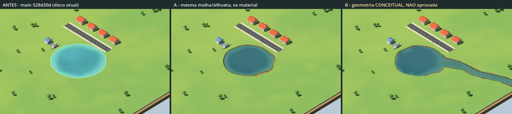

# IndexCities — estudo de água e margens (WaterStudy)

> **Revisão humana: PENDENTE.** Estudo visual da frente de assets (IA), pedido pelo coordenador em 2026-10-14 depois do retorno humano de que o rio/lago atual parece “ridículo e totalmente irreal” e de que um material novo não resolveu. Cores, medidas, perfis, intensidades e recomendações são **propostas para avaliar**. Este README documenta a entrega; não é fonte de verdade. Comportamento do jogo: [`docs/SPEC.md`](../../../../docs/SPEC.md). **Nada aqui foi integrado** ao `CityWorld`, ao `Main`, à simulação, aos saves ou à documentação oficial.
>
> **A amostra B é GEOMETRIA CONCEITUAL, NÃO APROVADA PARA GAMEPLAY.** A bacia rebaixada, a margem em relevo e o trecho de rio existem **só na prévia isolada** desta pasta. Não mudam o mapa, a seed, a regra de água (`InWater`), a validade de prédios e ruas, a captação, a poluição, os saves nem nada da simulação.
>
> **Só aparência, nas duas amostras.** Faixa de margem, linha d'água irregular, raso, “profundidade”, reflexo, ondulação, riscos de correnteza, juncos e pedras **não representam** nível, profundidade, vazão, correnteza, poluição, captação, recurso, área navegável, recuo de obra nem vegetação da regra de qualidade ambiental. Nenhuma malha nova tem colisão, picking ou conector.



*Esquerda: estado atual da `main` 528d30d. Centro: amostra A (mesma malha). Direita: amostra B (conceitual). Câmera ortogonal do jogo, zoom 110, yaw 45, sol das 10:00.*

## 1. Resposta curta

- **Diagnóstico visual proposto.** O jogo desenha um cilindro perfeito, 9,5 cm **acima** da grama, com um talude externo que acende como um disco convexo. A grama encosta direto na água, sem margem. A faixa clara acompanha o círculo e pode reforçar a leitura de piscina. O albedo da água recebe a iluminação difusa do material, com turquesa próximo da luminosidade da grama. A aparência continua insatisfatória segundo o responsável; a relação entre forma, margem e material é a hipótese visual avaliada aqui.
- **Amostra A** (mesma malha, mesmo raio, mesma altura e mesma silhueta; só material e adereços dentro do círculo). A borda real do disco e o talude ficam com a cor e a normal exatas da grama, e o “prato” some: a diferença medida na borda caiu de **65,1 para 8,9**. Entre a borda e a água entra uma margem natural irregular, com **linha d'água 0,9–5,4 m para dentro do círculo**, relevo falso de bacia pela luz do jogo, raso, profundo escuro e reflexo estilizado. Custo de GPU **+0,01 a +0,08 ms**. **Limite:** a forma continua presa ao círculo, não há rebaixo nem paralaxe de verdade, e a água visível fica menor que a área de jogo.
- **Amostra B** (conceitual). O chão é rebaixado 0,8 m, a margem tem relevo real e sombreamento real, e a linha d'água é **a mesma que A pinta** (desvio máximo de 0,005 m em 295 raios). Toda a margem do lago fica dentro do círculo de jogo, e um rio curto (~85 m fora do círculo) chega da borda leste do mapa. Custo **+0,23 a +0,32 ms**. Exige **decisões de geometria** (§8) antes de qualquer uso.
- **Recomendação** (§10). Para “água natural” de verdade, a correção é de **geometria do terreno**, não de material. A é um paliativo barato e reversível, se aceitarem a margem dentro da área de jogo. B mostra o alvo e o menor passo que mantém a regra atual do círculo.

## 2. Diagnóstico do visual atual (medido na `main` 528d30d)

| Aspecto | Como está no jogo | Efeito na leitura |
| --- | --- | --- |
| **Silhueta** | `CylinderMesh` de 64 segmentos, raio R exato. Na seed 42, R = 28,577 m e centro (152,609; 85,983), recalculados com o xorshift64\* da simulação. A regra de jogo usa o mesmo círculo (`InWater`: distância < R). | Neste cenário, o círculo sem margem pode lembrar um objeto ou piscina. A irregularidade do material atual é de cor interna e não toca o contorno. |
| **Disco elevado** | Tampa em y = +0,035 e chão em −0,06: a água fica **9,5 cm acima da grama**. O talude R → R + 1 aparece até R + 0,63, com a normal inclinada 8,5° para fora. | A luz do jogo trata o lago como convexo: o lado do sol acende e o oposto escurece, ao contrário de uma depressão. Diferença média de cor dentro/fora da borda (zoom 45): **65,1** (soma RGB 0–765). |
| **Transição da margem** | Grama uniforme até a água; sem terra, areia, lama molhada nem declive. Árvores excluídas até R + 9 m. | Corte seco e anel de “gramado aparado” em volta. Não há onde a água “encontre” o terreno. |
| **Raso** | Faixa clara de largura constante (3,2 m), com uma linha mais clara de 0,6 m que segue o círculo. | Lê como borda/rejunte de piscina e reforça o círculo. |
| **Reflexo e luz** | Opaco, com albedo iluminado pelo modelo difuso do material e Fresnel de ~11% na câmera de 38°. Turquesa `#6bb3bd`, com valor parecido ao da grama. À noite continua turquesa. | Pode lembrar uma superfície pintada. A pouca separação de luminosidade entre água e margem dificulta a leitura de profundidade. |
| **Escala e paisagem** | Lago de 57–80 m de diâmetro (R 28–40), ruas de 10,5 m, casas de ~8,8 m, mapa de 512 m. Não há rio, embora a SPEC fale em “rio/lago”. | Uma lagoa redonda isolada num gramado vazio não forma paisagem. *(Tamanho e quantidade são parâmetros de jogo, fora deste estudo.)* |

**Causa raiz:** a água é uma primitiva sobre o chão. Material só recolore. Além disso, o círculo também é a regra de jogo, então mudar o contorno visível exige decidir a relação entre água visível e área de jogo.

## 3. Amostra A — mesma malha, só material (+ adereços dentro do círculo)

**Igual ao jogo, conferido pelo validador:**

- mesmo `CylinderMesh` (R, R + 1, 0,15, 64 segmentos, 4 anéis);
- mesma posição (centro, y = −0,04), rotação, escala e sombra;
- mesmo chão (`BoxMesh` 512 × 1 × 512 com `env_grass_soft`).

Muda o `material_override` do lago (`Materials/ws_water_a.tres`). Opcionalmente entram duas `MultiMeshInstance3D` decorativas (14 moitas de junco e 20 pedras), todas **dentro do círculo** (no máximo a R − 0,4 m).

**Como o shader `ws_water_a` funciona** (tudo no fragmento, sem deslocar vértice):

1. **Borda invisível:** a borda real do disco e o talude lateral recebem a cor do chão, por um espelho exato de `env_grass_soft`, com normal para cima e a mesma rugosidade e especular. No chão longe do lago, A e antes dão diferença média **0,0**.
2. **Linha d'água irregular dentro do círculo:** a largura da margem vem de ruído no espaço do mundo (baías de 38 m, lobos de 14 m, recorte de 4,6 m) e varia de **0,9 a 5,4 m**. A água visível nunca passa da borda de jogo.
3. **Margem natural:** a grama desce em línguas, mais escura e úmida perto da água; depois vêm terra, areia em trechos, pedrisco fino e uma faixa de lama molhada na linha d'água.
4. **Relevo falso de bacia:** a normal da margem inclina para dentro, então o sol do jogo ilumina a margem como depressão. O declive começa numa linha irregular, e não no círculo, para a faixa iluminada não redesenhar o contorno.
5. **Água:**
   - fundo visível no raso, escurecendo para um profundo azul-esverdeado;
   - reflexo estilizado do céu do jogo (Fresnel) e faixa escura com o reflexo da margem do lado oposto à câmera (acompanha a rotação Q/E);
   - linha de contato clara e fina, só de perto;
   - ondulação e rajadas lentas só na normal;
   - brilho especular do sol e dos postes à noite.
6. **Tempo:** usa o mesmo parâmetro `host_time_s` que o `CityWorld` já alimenta, com frequências que fecham em 3600 s. A ondulação continua decorativa, com cadência uniforme e parada na pausa, como na IA-020.

**O que A não resolve:**

- o contorno total continua um círculo deformado por dentro;
- não há rebaixo, oclusão nem paralaxe: de perto, a “bacia” é pintada;
- o disco segue 9,5 cm acima do chão (invisível, mas presente);
- a água visível é menor que a área de jogo (§9).


## 4. Amostra B — geometria conceitual, NÃO APROVADA PARA GAMEPLAY

Só na cena `Preview/ws_sample_b.tscn`. O gerador é `Source/ws_shore_geometry.gd`, determinístico.

**Chão.** Só na prévia, um terreno gerado substitui o `BoxMesh`:

- retalho fino de 1 m (x 120–256, z 24–120) costurado a uma grade de 8 m no resto do mapa;
- as 46 células da costura viram leques, sem junção em T e sem fatias finas;
- faces laterais iguais às do chão do jogo.

No chão plano, o shader `ws_terrain_b` produz exatamente a grama do jogo: longe da bacia, B e antes dão diferença média **0,0**.

**Lago.**

- Nível d'água 0,8 m abaixo do chão. A margem desce do **próprio círculo de jogo** (inclinação zero no topo, sem vinco) até a linha d'água e cruza o nível com ângulo, sem faixa plana rente à superfície.
- Barrancos curtos em alguns trechos do contorno. O fundo desce até 2,2 m (só para a cor do raso).
- A linha d'água é a mesma de A. **Toda a margem e toda a água do lago ficam dentro do círculo de jogo.**

**Rio (fora da simulação atual).** Trecho de ~85 m entre o círculo do lago e o limite leste do mapa:

- cerca de 8–16 m de largura, mais largo na foz, com margens de 3,2–4,8 m;
- termina num corte vertical de água na borda do mapa, no estilo maquete do próprio chão;
- água mais turva e riscos discretos de correnteza (fase dupla, período de 12 s; decorativo).

**Água.** Malha plana no nível d'água, que entra sob a margem; a linha d'água nasce da interseção com o relevo. O gerador grava por vértice a profundidade do fundo, a distância até a margem, a direção da margem e a correnteza, então não há textura de profundidade nem passe transparente.

**Adereços.** 35 moitas de junco e 23 pedras (as mesmas do lago de A, mais as do rio). A sombra real da margem aparece pouco: com a câmera a ~538 m e sombras de até 650 m, a resolução do mapa de sombras não registra degraus de 0,8 m (§9).

## 5. Capturas (mesma câmera, luz e cena; antes | A | B)

Godot 4.7.2 mono, **GL Compatibility** (`opengl3`; OpenGL 3.3.0 NVIDIA 546.18), RTX 3050 Laptop. Viewport de 1280 × 800 (a janela padrão do jogo), MSAA 4x. Câmera do `Main.UpdateCamera` (ortogonal, `size` = zoom, foco + (300, 330, 300) girado pelo yaw). Sol do `Main._Process` (cor `fff0d0`, sombra até 650 m) e ambiente do `Main` (`b9c9d5` / `afc5ce` × 0,32). À noite, postes acesos como no `CityWorld` (Omni de 17 m, energia 1,3). Água com tempo decorativo fixo de 12 s.

| Tomada | Zoom | Foco (x, z) | Yaw | Hora (energia; inclinação do sol) |
| --- | ---: | --- | ---: | --- |
| `z45_day` / `z45_night` | 45 | (163, 66), margem nordeste e foz | 45 | 10:00 (0,882; −54,0°) / 21:00 (0,12; −15°) |
| `z110_day` / `z110_night` / `z110_dusk` | 110 | (158, 82) | 45 | 10:00 / 21:00 / 17:00 (0,348; −26,6°) |
| `z250_day` / `z250_night` | 250 | (152,61; 85,98), centro do lago | 45 | 10:00 / 21:00 |
| `z110_yaw225_day` | 110 | (158, 82) | 225 | 10:00 (câmera do outro lado) |
| `z45_shore_day` | 45 | (125, 90), captação e margem oeste | 45 | 10:00 |

Nesta pasta, em JPEG leve:


**Conjunto completo** em PNG (local e ignorado pelo Git), em `artifacts/verification/water-study/final/`:

- `shots/`: 29 quadros de 1280 × 800;
- `sheets/`: 9 folhas antes | A | B, 3 escadas de zoom (dia e noite) por variante e 2 pares de A só material × com adereços;
- `render_report.json` e `perf_report.json`.

As rodadas de calibragem (`round1`–`round3`) também ficaram lá, como histórico.

**Medidas do relatório:**

- **Movimento em 0,6 s** (soma RGB média no quadro, zoom 45): antes 1,76, A 1,18, B 1,55. Ondulação perceptível só de perto, sem cintilar.
- **Contorno do disco:** antes 65,1, A 8,9. Em B, 17,3: a borda já é terreno real e a diferença vem do início do declive iluminado.

## 6. Malhas, passadas de material e custo

Contagem real lida das cenas salvas (`validate_report.json`). A parte comparada é o chão + água + adereços. O contexto (rua, postes, casas, captação, 133 árvores, saia e bordas) é **idêntico** nas três cenas: 153 malhas, 136 311 vértices, 47 222 triângulos e 471 itens de desenho.

| Parte comparada | Antes | A | B (conceitual) |
| --- | --- | --- | --- |
| Malhas / itens de desenho | 2 / 2 | 4 / 4 | 5 / 5 |
| Vértices | 546 | 2 978 | 25 912 |
| Triângulos | 780 | 2 104 | 44 152 |
| Materiais × passadas | 2 × 1 (opacos) | 4 × 1 (opacos) | 5 × 1 (opacos) |
| Lago | cilindro 522 v / 768 t | **o mesmo** cilindro, 522 v / 768 t | água 3 444 v / 6 464 t + corte do rio 40 v / 20 t |
| Chão | caixa 24 v / 12 t | caixa 24 v / 12 t | 17 968 v / 34 898 t (retalho 1 m: 13 289 v / 26 112 t; resto em 8 m) |
| Adereços (MultiMesh) | — | 14 juncos (88 v / 66 t cada) + 20 pedras (60 v / 20 t) | 35 juncos + 23 pedras |

**Custo de GPU** do quadro inteiro (ms). 1280 × 800, MSAA 4x, RTX 3050 Laptop. Aquecimento de 300 quadros, 3 rodadas com a ordem das variantes girando, 150 quadros por medida. Média, com o intervalo entre rodadas entre parênteses:

| Vista | Antes | A | B |
| --- | ---: | ---: | ---: |
| Zoom 110 (jogo) | 0,721 (0,699–0,742) | 0,727 (0,722–0,730) | 1,038 (1,009–1,071) |
| Zoom 45 no lago | 0,795 (0,790–0,802) | 0,869 (0,854–0,886) | 1,058 (1,051–1,069) |
| Zoom 35, água na tela toda | 0,913 (0,905–0,919) | 0,997 (0,965–1,052) | 1,140 (1,124–1,162) |

- A CPU de renderização ficou entre +0,03 e +0,04 ms em A e entre +0,04 e +0,08 ms em B.
- Os shaders têm ramos para não pagar o que não aparece: água aberta não calcula grama, e chão plano em B só calcula a grama. As imagens antes e depois da otimização são idênticas (diferença máxima de 1 em 765).
- Em B, boa parte do extra vem dos triângulos pequenos do retalho de 1 m. Numa integração, a malha pode ser mais econômica (§9).
- É uma comparação local de custo de renderização nesta GPU; não mede FPS nem desempenho da cidade integrada.

## 7. Restrições respeitadas e verificações executadas

- **Unidades e eixos:** Y para cima, metros, padrões no XZ do mundo.
- **Sem herança:** nenhum código, textura, modelo ou arquivo de projeto antigo ou externo. Sem textura nenhuma: o ruído é calculado.
- **Sem gameplay:** sem colisão, física, script, conector ou marcador próprio nas cenas, e sem luzes além do sol e de 2 postes.
- **GL Compatibility, uma passada opaca:**
  - não usa textura de tela ou profundidade, `ALPHA`, `EMISSION`, `discard`, `light()`, uniform global ou de instância;
  - não usa `render_mode`, exceto `cull_disabled` nos juncos;
  - nenhum `vertex()` altera `VERTEX` ou `NORMAL`.
- **Derivadas:** `fwidth` só é chamado em fluxo uniforme. Detalhes menores que ~3 px somem, sem cintilar.
- **Tempo:** compatível com o `host_time_s` do `CityWorld`, com fechamento em 3600 s.
- **Validador headless** (`Source/validate_water_study.gd`): **1 593 verificações, 0 falhas.** Ele confere:
  - análise dos shaders pela Godot, com os uniforms esperados;
  - malha de A idêntica à do `CityWorld` e, no texto do `CityWorld.cs` atual, o cilindro R/R+1/0,15/64 em y −0,04, o chão em caixa e os dois materiais integrados;
  - B marcada como conceitual;
  - adereços de A dentro do círculo;
  - B determinística (duas gerações idênticas);
  - linha d'água de B igual à de A;
  - margem entre 0,9 e 5,4 m;
  - hash com média 0,50, desvio 0,288 e correlação vizinha ≤ 0,016 em 6 sais;
  - materiais `.tres` que só apontam o shader;
  - pasta sem imagens importáveis fora de `Preview/Captures`;
  - este README.
- **Importação** headless no projeto de verificação: exit 0, sem erros nem avisos. Captura renderizada: exit 0, sem `SHADER ERROR`.
- **Isolamento:**
  - nenhum arquivo fora desta pasta foi alterado (`git status` limpo fora de `Assets/WaterStudy/`);
  - o projeto real não foi aberto nem importado, e os `.import` de `Assets/V1` seguem intactos;
  - não foi usado save pessoal.
- **Janela:** as capturas rodaram sem roubar foco, numa janela de 1 × 1 px sem borda e com `no_focus`, renderizando num `SubViewport` de 1280 × 800.

## 8. O que depende de uma decisão de geometria aprovada

Nada abaixo foi decidido. Esta é a lista do que precisa de decisão de geometria (humana ou do coordenador, conforme a SPEC/AGENTS) **antes** de B — ou parte de A além do material — ir para o jogo:

1. **Água visível × área de jogo.** Em A e em B (lago), a água visível fica 0,9–5,4 m para dentro do círculo `InWater`, e a faixa de margem continua não construível. Decidir se isso é aceitável e se a mensagem “O edifício invade a água” deve falar em margem/lago. *(Decisão de UX; vale até para A, que vai além do escopo da IA-020: “faixa rasa e ondulação”.)*
2. **Chão rebaixado.** Substituir o `BoxMesh` do chão por terreno gerado com a bacia (ou um buraco com retalho) no `CityWorld.Reset`, mais o novo lago. Profundidade do rebaixo (0,8 m), largura e perfil da margem.
3. **Contorno de jogo.** Manter o círculo como regra, como B foi construído (só muda a renderização), ou adotar o contorno irregular. A segunda opção exige mudar:
   - `InWater` (obras e ruas);
   - a validade das posições;
   - a distância da captação (|d − R| ≤ 22 m);
   - o ponto de amostra da poluição;
   - a exclusão de árvores (R + 9);
   - a geração por seed.
4. **Rio.** Existir ou não na V1, de onde vem e onde termina. Um rio que atravessa o mapa **corta ruas sem pontes, adiadas na V1**. Também afeta a captação ao longo do rio, a poluição, a geração e a reprodutibilidade por seed (versão do gerador nos saves).
5. **Borda do mapa.** Como o rio sai do mapa (corte de maquete, como na prévia) e a linha de limite passando sobre a água.
6. **Forma determinística.** A margem depende só da posição no mundo e dos parâmetros. Mudar constantes muda o visual de todas as cidades existentes (não muda o jogo se o círculo continuar sendo a regra).
7. **Adereços decorativos.** Se juncos e pedras podem existir, e se juncos contam ou não como vegetação na regra de qualidade ambiental (5C). Hoje são só aparência.
8. **Escala do lago.** Raio de 28–40 m e quantidade de corpos d'água são parâmetros de jogo, fora deste estudo; listados porque a escala também pesa no “irreal”.

## 9. Limitações explícitas

- **Avaliação:**
  - uma GPU (RTX 3050 Laptop) e um driver;
  - sem Forward+/Mobile, sem build exportada, sem hardware fraco;
  - sem teste no jogo integrado (HUD, prévias, dia e noite contínuos);
  - sem avaliação humana, inclusive de quem ainda não lê.
- **Escopo da prévia:** uma seed (42) e uma cena de vitrine; não é partida.
- **A:**
  - a forma é limitada pelo círculo, então o lago continua “arredondado”;
  - a bacia é pintada (sem oclusão nem paralaxe);
  - um prédio encostado no limite legal do círculo fica 0,9–5,4 m longe da água visível; a captação desta cena, 4 m fora do círculo, fica a ~5–9 m (ver `z45_shore_day`);
  - o disco segue 9,5 cm acima do chão, invisível na prática; a sombra do cilindro não aparece nas tomadas.
- **B:**
  - geometria de prévia, não otimizada para integração: retalho de 1 m em todo o retângulo da bacia e do rio;
  - o rio tem caminho fixo e só desenha uma direção;
  - a sombra de margens de 0,8 m se perde na resolução das sombras do jogo;
  - a água só fica plana porque nível e rio estão na mesma cota.
- **Noite:** só os 2 postes da cena.
- **Medidas:** custo e movimento são medições locais indicativas.
- **Referências do coordenador avaliadas e não usadas:**
  - `ReflectionProbe` (até 2 por malha no Compatibility): na câmera de 38°, o reflexo real de margens baixas é estreito, e a faixa de reflexo estilizada entrega a pista principal sem sonda nem atualização.
  - Textura de tela ou profundidade: exigiria o passe transparente e a reconstrução de profundidade do OpenGL. A já conhece o círculo, e B grava a profundidade por vértice.
- **Correção de dados:** o estudo anterior (RecoveryEnvironment) registrou o lago da seed 42 como (152,61; 86,04) com R = 28,38. Recalculando com o código C# da simulação, o valor é (152,609; 85,983) com R = 28,577. Este estudo usa o valor recalculado.

## 10. Recomendação curta

O visual atual falha porque a água é um **disco opaco colocado acima do chão**: contorno de raio constante, degrau e talude que acendem como convexo, nenhuma margem, faixa clara de piscina e iluminação de tinta. Material novo só recolore esse disco. Isso não é falta de acabamento do shader; é falta de **terreno**.

- Se for preciso melhorar já, sem decisão de geometria, **A** é o paliativo mais barato: troca de material, +0,01 a +0,08 ms, borda do disco de 65 → 9. Exige aceitar que a margem fica dentro da área de jogo (§8.1) e não remove o contorno arredondado.
- Para água que pareça natural, o caminho é o de **B**: rebaixar o terreno e modelar a margem.
  - O menor passo mantém o círculo como regra de jogo (B foi feito assim) e muda só a renderização do chão e do lago.
  - Contorno irregular de jogo e rio são decisões separadas e maiores (§8.3–8.5).
  - Juncos e pedras ajudam pouco perto do que a forma e o encontro com o terreno fazem.

## 11. Como regenerar, validar e capturar

O projeto de verificação fica fora do Git (`artifacts/verification/water-study/project/`). Ele tem um `project.godot` próprio (GL Compatibility, janela de 1 × 1 px sem foco) e *junctions* para `Assets/WaterStudy`, `Assets/V1/{Scenes,Meshes,Materials}` e `Assets/RecoveryEnvironment/{Materials,Shaders}`. Assim, `res://` resolve igual ao jogo, e o projeto real não é importado nem alterado.

As *junctions* não ficam criadas entre usos: `harness.ps1 setup` cria e `harness.ps1 teardown` remove só os links. **Não apague essa pasta com `Remove-Item -Recurse` enquanto houver junctions:** no Windows PowerShell 5.1 isso pode apagar o conteúdo das pastas reais.

```sh
# a partir de artifacts/verification/water-study (Git Bash):
powershell -NoProfile -ExecutionPolicy Bypass -File harness.ps1 setup
./run_all.sh "$PWD/final" --readme-captures     # build + validate (headless) + capturas
godot --path project --rendering-driver opengl3 --script res://Assets/WaterStudy/Source/render_water_study.gd -- --out="$PWD/final" --perf-only
# isolados:
godot --headless --path project --script res://Assets/WaterStudy/Source/build_water_study.gd -- --report=<json>
godot --headless --path project --script res://Assets/WaterStudy/Source/validate_water_study.gd -- --report=<json> --cityworld=<repo>/src/IndexCities.Godot/CityWorld.cs
powershell -NoProfile -ExecutionPolicy Bypass -File harness.ps1 teardown
```

- **Derivados:** `Materials/`, `Meshes/` e `Preview/*.tscn` vêm do gerador. Para mudar algo, edite `Shaders/` ou `Source/` e rode o build de novo.
- **Sincronia:** os parâmetros da linha d'água são **iguais** nos shaders e em `ws_shore_geometry.gd` (`BANK`, `GRASS_REACH`).
- **Logs:** `artifacts/verification/water-study/logs/` (importação, build, validação, captura e desempenho de cada rodada).
- **Exportação:** sugere-se excluir `Assets/WaterStudy/` inteira do preset. É estudo.

## 12. Arquivos

| Caminho | O que é | Tamanho |
| --- | --- | ---: |
| `Shaders/ws_common.gdshaderinc` | Hash e ruído próprios, espelho da grama, largura da margem, ondulação, rajadas, céu | 8,0 KB |
| `Shaders/ws_water_a.gdshader` | Amostra A: água + margem pintadas na malha atual | 12,0 KB |
| `Shaders/ws_terrain_b.gdshader` / `ws_water_b.gdshader` | Amostra B: chão com bacia / água da bacia e do rio | 5,0 / 6,7 KB |
| `Shaders/ws_reeds.gdshader` | Juncos (duas faces com a mesma normal) | 0,9 KB |
| `Materials/*.tres` | 4 `ShaderMaterial` que só apontam o shader; pedra e corte do rio em `StandardMaterial3D` | < 1 KB cada |
| `Meshes/ws_b_*.res`, `ws_reed_clump.res`, `ws_rock.res` | Malhas geradas (compactadas) | 213 + 83 + 4 KB |
| `Preview/ws_before.tscn`, `ws_sample_a.tscn`, `ws_sample_b.tscn` | Cenas de vitrine (antes / A / B), sem script | 36–46 KB |
| `Preview/Captures/*.jpg` | 5 folhas para este README (`.gdignore`) | 450 KB |
| `Source/ws_shore_geometry.gd` | Gerador de B, espelho do ruído, adereços | 27 KB |
| `Source/build_water_study.gd` / `validate_water_study.gd` / `render_water_study.gd` | Gerador de recursos e cenas / validador / capturas e custo | 16 / 16 / 16 KB |

## 13. Origem, autoria e execução

- **Autoria:** shaders, gerador, validador e capturas são originais, escritos para este pedido em 2026-10-14.
- **Técnicas genéricas implementadas do zero:**
  - ruído de valor com hash inteiro de constantes próprias;
  - soma de ondas senoidais com frentes deformadas;
  - Fresnel estilizado;
  - fluxo em duas fases cruzadas;
  - perfis de Hermite e grade costurada por leques.
- **Espelho da grama:** a função de `RecoveryEnvironment/Shaders/env_grass_soft.gdshader`, integrada neste projeto, foi reproduzida para a borda ficar invisível. Nenhum arquivo daquela pasta foi alterado; ela só é lida e instanciada no “antes”.
- **Contexto da cena:** peças de `Assets/V1` instanciadas como contexto, sem cópia nem alteração.
- **Nada externo:** nenhum código, textura, modelo ou arquivo de projeto anterior ou da internet foi consultado ou copiado.
- **Modelo efetivo:** Claude Opus 5.5 (`claude-opus-5-5`) no Claude Code, com esforço de raciocínio **max** configurado na sessão. “Ultracode” não é uma opção selecionável neste runtime e não foi usado como recurso. Sem subagentes e sem workflows.
- **Coordenação:** papel de especialista de assets. A integração, a revisão e as escolhas de produto ficam com o coordenador (Codex).
